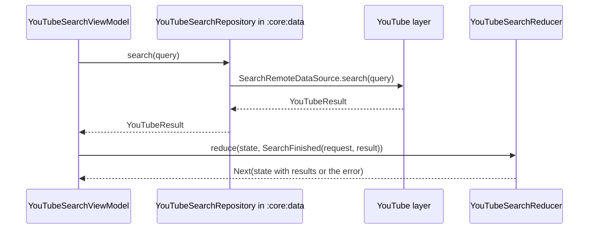
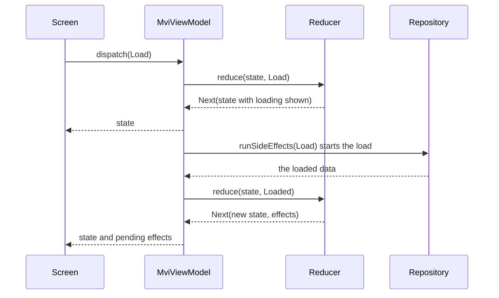
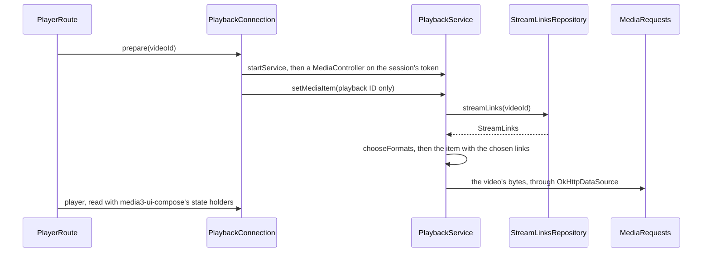
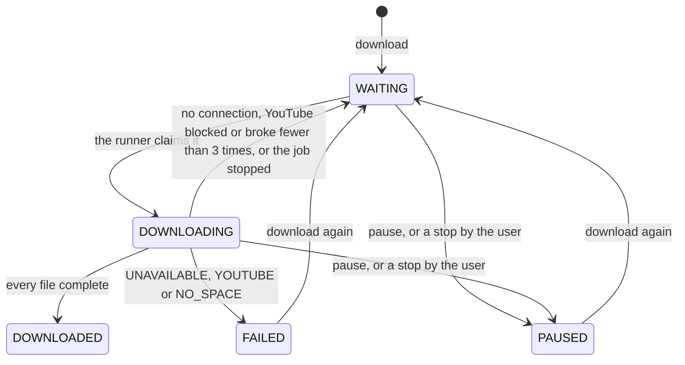
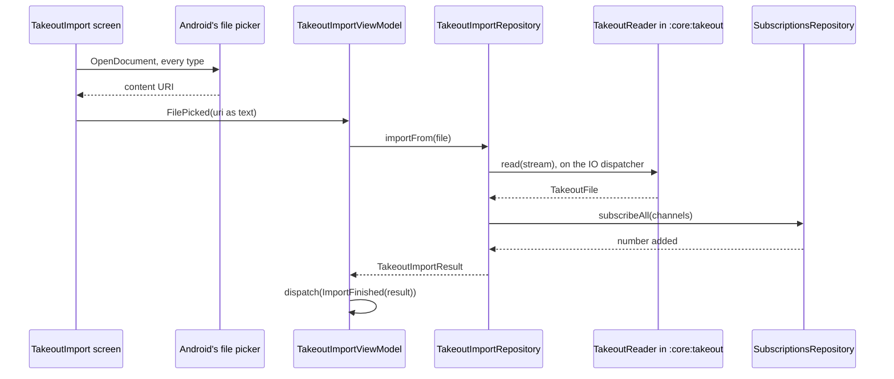

# Architecture

This is the design document for Dewfall. It explains how the app is built: its modules, how data moves through them, and how the main features work underneath. The reasons behind each decision are in the ADRs in [adr/](adr/). Update this file in the same pull request as any change to the structure of the app.

## Modules

Dewfall is one Gradle build with an app module, core modules, and feature modules as features arrive. Today the feature modules hold the inbox, the app's first screen, Search YouTube, which opens from it, the video screen, with the mini player and the fullscreen player, the channel page, and the YouTube layer's debug screen, which only debug builds contain. Some modules are plain Kotlin/JVM and the rest are Android modules. [ADR 0006](adr/0006-platform-and-android-versions.md) explains why.

- A plain Kotlin/JVM module can't see Android classes, so the build itself keeps Android code out of it. Its tests run on the computer's JVM with nothing from Android to fake. It can't hold user-facing text, because string resources are part of Android, so it returns types that the screens turn into text.
- An Android module is the app or an Android library. It holds everything that needs Android, such as the database, screens, ViewModels, resources and background jobs.

### The module graph

Solid arrows are dependencies in the build today. An arrow labeled api is an api dependency, so a module that depends on the module where the arrow starts sees the module where it ends too. For example, `:core:data` sees `:core:logging` through `:core:youtube`. The arrow labeled debug only is a debugImplementation dependency, so release builds leave out the debug screen's modules. See [The YouTube layer's debug screen](#the-youtube-layers-debug-screen). The inbox shares `:core:ui`'s video row with search and the channel page, and the Channels screen shares its group shape.

```mermaid
graph TD
    app[":app<br/>Android app"]
    data[":core:data<br/>Android library"]
    database[":core:database<br/>Android library"]
    designsystem[":core:designsystem<br/>Android library"]
    youtube[":core:youtube<br/>Kotlin/JVM"]
    logging[":core:logging<br/>Kotlin/JVM"]
    model[":core:model<br/>Kotlin/JVM"]
    mvi[":core:mvi<br/>Kotlin/JVM"]
    playback[":core:playback<br/>Android library"]
    download[":core:download<br/>Android library"]
    searchUi[":feature:youtube-search-ui<br/>Android library"]
    searchLogic[":feature:youtube-search-logic<br/>Kotlin/JVM"]
    playerUi[":feature:player-ui<br/>Android library"]
    playerLogic[":feature:player-logic<br/>Kotlin/JVM"]
    channelUi[":feature:channel-page-ui<br/>Android library"]
    channelLogic[":feature:channel-page-logic<br/>Kotlin/JVM"]
    debugUi[":feature:youtube-debug-ui<br/>Android library, debug builds only"]
    debugLogic[":feature:youtube-debug-logic<br/>Kotlin/JVM, debug builds only"]
    coreUi[":core:ui<br/>Android library"]
    takeout[":core:takeout<br/>Kotlin/JVM"]
    takeoutUi[":feature:takeout-import-ui<br/>Android library"]
    takeoutLogic[":feature:takeout-import-logic<br/>Kotlin/JVM"]
    inboxUi[":feature:inbox-ui<br/>Android library"]
    inboxLogic[":feature:inbox-logic<br/>Kotlin/JVM"]
    channelsUi[":feature:channels-ui<br/>Android library"]
    channelsLogic[":feature:channels-logic<br/>Kotlin/JVM"]
    downloadsUi[":feature:downloads-ui<br/>Android library"]
    downloadsLogic[":feature:downloads-logic<br/>Kotlin/JVM"]

    app --> data
    app --> designsystem
    app --> logging
    app --> playback
    data --> database
    data --> youtube
    data --> takeout
    data --> logging
    takeout -->|api| model
    data -->|api| model
    database --> model
    youtube -->|api| model
    youtube -->|api| logging
    playback --> data
    playback -->|api| model
    playback --> logging
    app --> download
    download --> data
    download --> playback
    download --> logging
    download --> model
    app --> searchUi
    searchUi --> searchLogic
    searchUi --> data
    searchUi --> designsystem
    searchUi --> model
    searchUi --> coreUi
    searchUi --> mvi
    searchLogic -->|api| mvi
    searchLogic -->|api| model
    app --> playerUi
    playerUi --> playerLogic
    playerUi --> data
    playerUi --> designsystem
    playerUi --> model
    playerUi --> mvi
    playerUi --> playback
    playerUi --> coreUi
    playerLogic -->|api| mvi
    playerLogic -->|api| model
    app --> channelUi
    channelUi --> channelLogic
    channelUi --> data
    channelUi --> designsystem
    channelUi --> model
    channelUi --> mvi
    channelUi --> coreUi
    channelLogic -->|api| mvi
    channelLogic -->|api| model
    app --> takeoutUi
    takeoutUi --> takeoutLogic
    takeoutUi --> data
    takeoutUi --> designsystem
    takeoutUi --> model
    takeoutUi --> mvi
    takeoutUi --> coreUi
    takeoutLogic -->|api| mvi
    takeoutLogic -->|api| model
    app -->|debug only| debugUi
    debugUi --> debugLogic
    debugUi --> designsystem
    debugUi --> youtube
    debugUi --> model
    debugUi --> mvi
    debugLogic -->|api| mvi
    debugLogic -->|api| model

    app --> inboxUi
    inboxUi --> inboxLogic
    inboxUi --> data
    inboxUi --> designsystem
    inboxUi --> mvi
    inboxUi --> model
    inboxUi --> coreUi
    inboxLogic -->|api| mvi
    inboxLogic -->|api| model

    app --> channelsUi
    channelsUi --> channelsLogic
    channelsUi --> data
    channelsUi --> designsystem
    channelsUi --> mvi
    channelsUi --> model
    channelsUi --> coreUi
    channelsLogic -->|api| mvi
    channelsLogic -->|api| model

    app --> downloadsUi
    downloadsUi --> downloadsLogic
    downloadsUi --> data
    downloadsUi --> designsystem
    downloadsUi --> mvi
    downloadsUi --> model
    downloadsUi --> coreUi
    downloadsLogic -->|api| mvi
    downloadsLogic -->|api| model
    coreUi --> designsystem
    coreUi -->|api| model
```



### Core modules

Android modules set a namespace. Plain Kotlin/JVM modules have no namespace, so for them the table gives the package their code uses.

| Module | Folder | Type | Namespace or package | What it holds | Depends on |
|---|---|---|---|---|---|
| `:app` | app/ | Android app | io.github.dewfallapp | The entry point, which ties the other modules together. It holds the Hilt Application class, the app's only activity, and the navigation between screens: the navigation bar with its three destinations, Inbox, Channels and Downloads, each with its own back stack, which opens on the inbox and leads to Search YouTube, the video screen, the channel page and the Takeout import, from an inbox card, a row of the Channels or Downloads screen, a video, a channel in Search YouTube's results or the import button of an empty inbox or Channels screen. See [Navigation](#navigation). It also holds the logcat writer and the Hilt module that provides the logger. See [Logging](#logging). It holds the image loader, with ImageLoaderInitializer, ImageLinkRule and the image client. See [Network access](#network-access). Its activity tells the player whether the app can be seen, and its PlaybackModule gives the media notification the PendingIntent that opens the app. See [The player](#the-player). DewfallApplication gives WorkManager its configuration and starts the check after a stop by the user, and MainActivity starts the download queue each time the app shows. See [Downloads and cleanup](#downloads-and-cleanup). | `:core:data`, `:core:designsystem`, `:core:download`, `:core:logging`, `:core:playback`, WorkManager, for its Configuration, and each feature's `-ui` module, today `:feature:inbox-ui`, `:feature:channels-ui`, `:feature:downloads-ui`, `:feature:youtube-search-ui`, `:feature:player-ui`, `:feature:channel-page-ui` and `:feature:takeout-import-ui`. In debug builds only, `:feature:youtube-debug-ui`. Navigation 3 and kotlinx-serialization-core, for the back stack. Coil, coil-network-okhttp and OkHttp, for the image loader. In androidTest only, `:core:youtube`, for the emulator tests' fakes, and `:core:database`, for their in-memory database. The emulator tests run in DewfallTestApplication, a Hilt test Application that gives WorkManager the same configuration. |
| `:core:model` | core/model/ | Kotlin/JVM | io.github.dewfallapp.core.model | Domain models, such as videos, channels and subtitle lines. Today it holds the YouTube layer's models, its IDs, YouTubeResult and YouTubeError, TimeAgo, which counts how long ago a PublishedTime was, the way YouTube writes it, for screens to turn into text, LengthLabel, which says what a video row's thumbnail box shows about its length, `initialOf`, a channel name's first character for its emblem, `forWidth`, which picks the size of an image for a space, `isYouTubeImageLink` and the list of YouTube's image hosts, and the player's FormatChoice, PlaybackFailure and MediaRequestRefused, and TakeoutImportResult, what an import of a Takeout file did, and the downloads' DownloadStatus, DownloadProgress and DownloadFailure, with `chooseDownloadFormats` and DOWNLOAD_LIMIT. It also holds one rule for screens, YouTubeError's `offersTryAgain`, because it is the one plain Kotlin/JVM module that every screen's reducer sees. See [The YouTube layer](#the-youtube-layer) and [The player](#the-player). | Nothing |
| `:core:takeout` | core/takeout/ | Kotlin/JVM | io.github.dewfallapp.core.takeout | TakeoutReader, which reads the subscriptions from a Google Takeout .zip or .csv file, with its own small CSV parser, and its tests with made-up files. See [The Takeout import](#the-takeout-import). | `:core:model`, as an api dependency, because the reader gives ChannelIds |
| `:core:logging` | core/logging/ | Kotlin/JVM | io.github.dewfallapp.core.logging | The Logger that every module logs through, its levels and fields, and the error summary that leaves out messages. See [Logging](#logging). | Nothing |
| `:core:mvi` | core/mvi/ | Kotlin/JVM | io.github.dewfallapp.core.mvi | The MVI base: MviState, MviIntent, MviEffect, the Reducer, and MviViewModel, the base class of every screen's ViewModel, with the count of its state's collectors for a ViewModel that reads only while its screen shows. See [The MVI contract](#the-mvi-contract). | Nothing. It uses Lifecycle's ViewModel and kotlinx.coroutines. |
| `:core:youtube` | core/youtube/ | Kotlin/JVM | io.github.dewfallapp.core.youtube | The YouTube layer: Dewfall's interfaces for search, video details, a channel's latest uploads, stream links and subtitles, and their NewPipeExtractor implementation. NewPipeYouTube, one of its two public classes, implements all five. The other, MediaRequests, makes the player's OkHttp clients for googlevideo.com. It also holds the HTTP code that NewPipeExtractor sends its requests through, and the code that runs each call. It is the only module that may use NewPipeExtractor. See [ADR 0001](adr/0001-newpipeextractor-behind-youtube-layer.md) and [The YouTube layer](#the-youtube-layer). | `:core:model`, `:core:logging`, kotlinx.coroutines and OkHttp, all four as api dependencies, because the interfaces return the models, NewPipeYouTube's constructor takes a Logger and a CoroutineDispatcher, and MediaRequests returns OkHttp's Call.Factory |
| `:core:database` | core/database/ | Android library | io.github.dewfallapp.core.database | The Room database: DewfallDatabase with its four tables, their entities and DAOs, the column type converters, the merge rule for saved videos, and the exported schemas. Its DAO tests run on an emulator. See [Database tables](#database-tables). | `:core:model` and Room's runtime as api dependencies, because the entities use the models' types and DewfallDatabase extends Room's RoomDatabase, and kotlinx-serialization-json |
| `:core:data` | core/data/ | Android library | io.github.dewfallapp.core.data | Repositories that combine the database and the YouTube layer. Today it holds YouTubeSearchRepository, which the Search YouTube screen uses, VideoDetailsRepository, which the video screen uses, ChannelUploadsRepository, which the channel page uses, StreamLinksRepository, which the player uses, the database's three repositories, SubscriptionsRepository, StoredVideosRepository and WatchStateRepository, UploadsChecker, the check for new videos, with DatabaseModule, the Hilt module that provides the database, and YouTubeModule, the Hilt module that provides the YouTube layer, and the player's two OkHttp Call.Factory providers, marked `@ProgressiveMediaCalls` and `@LiveMediaCalls`. It also holds the downloads' DownloadsRepository, which the screens use, DownloadQueue, the download job's view of the `downloads` table, DownloadScheduler, which `:core:download` binds, and DownloadFiles, which knows where the files live. See [Downloads and cleanup](#downloads-and-cleanup). It also holds TakeoutImportRepository, with DocumentOpener, which opens a picked file through ContentResolver, and TakeoutModule, which binds them and provides the dispatcher the reads run on, marked `@TakeoutReadDispatcher`. See [How Hilt provides the layer](#how-hilt-provides-the-layer), [Reading from YouTube](#reading-from-youtube), [The database repositories](#the-database-repositories) and [The check for new videos](#the-check-for-new-videos). | `:core:model`, `:core:database`, `:core:logging`, `:core:takeout`, `:core:youtube`, and core-ktx, for `String.toUri` |
| `:core:playback` | core/playback/ | Android library | io.github.dewfallapp.core.playback | The player: PlaybackService, the media session service with one ExoPlayer, and PlaybackConnection, which hands screens and the mini player its MediaController, with the format choice's Android parts, the media sources and the error mapping. Its Decoders is public, so downloads keep only formats the player can decode. See [The player](#the-player). | `:core:model` as an api dependency, `:core:data`, `:core:logging`, Media3 with media3-session as an api dependency, because the connection exposes Media3's Player, and OkHttp |
| `:core:download` | core/download/ | Android library | io.github.dewfallapp.core.download | The download engine: DownloadRunner, which runs the queue, FormatWriter, which writes a format's bytes in ranges, DownloadJobService, the user-initiated data transfer job on Android 14 and later, DownloadWorker with its hand-written DownloadWorkerFactory on Android 10 to 13, QueueScheduler, the DownloadScheduler they start from, DownloadsAfterStop, DownloadNotifications, BootReceiver, which starts the queue after a boot on Android 10 to 13, and their tests. See [Downloads and cleanup](#downloads-and-cleanup) and [ADR 0010](adr/0010-download-engine.md). | `:core:data`, `:core:model`, `:core:logging`, `:core:playback`, for Decoders and the PendingIntent that opens the app, WorkManager, OkHttp and kotlinx.coroutines |
| `:core:designsystem` | core/designsystem/ | Android library | io.github.dewfallapp.core.designsystem | The Compose theme built from the design tokens, with the Manrope font. See [The theme](#the-theme). It also holds the shared icons, today the search, close, error, keyboard_arrow_down, play_arrow, filled pause, fullscreen, fullscreen_exit, arrow_back, check, add, chevron_right, done_all, subscriptions, sync, wifi_off, download, schedule and outlined pause glyphs from Material Symbols Rounded, under the Apache License 2.0, ReadableWidth, the widest a screen's column gets, DewfallOpacity, with the opacities that the components use, and the shared components that take plain values: Banner, and ChannelEmblem, a channel's round emblem with its initial. | Nothing. It exposes Material 3 as an api dependency. |
| `:core:ui` | core/ui/ | Android library | io.github.dewfallapp.core.ui | Shared UI that needs the domain models or string resources: VideoRowItem, the video row that Search YouTube, the channel page and the inbox show, `rowGroupShape`, the rounded shape of a group of rows, the text of a video's length and of how long ago it was published, with their strings, DownloadStatusWords and DownloadStatusControl, a row's download status, and the download words that the video screen's chip shares, UnsubscribeDialog, the dialog that the channel page and Search YouTube's channel rows show before unsubscribing, ChannelAvatar, a channel's picture over the design system's ChannelEmblem, the image in VideoRowItem's box, and PreviewImages, which gives previews a plain fill for every image. See [Network access](#network-access). | `:core:model` as an api dependency, because VideoRowItem takes its types, `:core:designsystem`, and Coil's coil-compose, for AsyncImage. It has no network fetcher, so it can't reach the network on its own |

`:core:mvi` holds the MVI base, `:core:designsystem` holds the theme, and `:core:logging` holds the logger. `:core:youtube` holds the YouTube layer's interfaces and the code that runs NewPipeExtractor, and `:core:model` the models they return. `:core:database` holds the database, and `:core:data` holds the search, video details and stream links repositories, the database's repositories, and the Hilt modules that provide the YouTube layer and the database. `:core:takeout` reads Google Takeout files, and `:core:data`'s TakeoutImportRepository uses it to import subscriptions. `:core:playback` holds the player, `:core:download` the download engine, which no screen owns, and `:core:ui` the video row and its text, which several features share. A module that logs depends on `:core:logging`. Today `:app`, `:core:data`, `:core:download`, `:core:youtube` and `:core:playback` do, and each other module adds the dependency when it first logs. `-logic` modules never do, because reducers don't log. NewPipeYouTube implements all five of the YouTube layer's interfaces. Compose is set up in `:app`, `:core:designsystem`, `:core:ui` and every feature's `-ui` module. Hilt is set up in `:app`, `:core:data`, `:core:download`, `:core:playback` and every feature's `-ui` module.

`:lint-rules` is a build tool, not part of the app. It holds Dewfall's own lint checks, which lint runs on every module of the app. No module's code depends on it, and nothing from it ships. See [Dewfall's lint checks](#dewfalls-lint-checks).

`:core:designsystem` holds the theme and the components that know nothing about Dewfall's data. Its components take plain values, such as text, images and click handlers. Shared UI that needs the domain models or string resources, such as a video row that several features use, or the text of a duration, goes in a `:core:ui` Android library instead. Counting that needs no text, such as TimeAgo, stays in `:core:model`, a plain Kotlin/JVM module, as ADR 0006 asks. `:core:ui` was created when search and the channel page (#47) first needed the same video row. It may depend on `:core:designsystem` and `:core:model`, and feature `-ui` modules may depend on it.

### Feature modules

Each feature has two modules, because its reducer has to be plain Kotlin/JVM and its screens need Android. The inbox, the app's first screen, has this pair:

| Module | Folder | Type | Namespace or package | What it holds | Depends on |
|---|---|---|---|---|---|
| `:feature:inbox-logic` | feature/inbox-logic/ | Kotlin/JVM | io.github.dewfallapp.feature.inbox.logic | InboxState, with what the top bar and the banner show for the check for new videos and each row's download status, InboxIntent, InboxGroup, the reducer, which groups the videos by channel, and its tests | `:core:mvi`, `:core:model`, both as api dependencies |
| `:feature:inbox-ui` | feature/inbox-ui/ | Android library | io.github.dewfallapp.feature.inbox.ui | Inbox, the Compose screen with its cards and its empty and failed states, their previews, the previews' screenshot tests in src/screenshotTest with their reference images, InboxViewModel and its tests, and string resources | `:feature:inbox-logic`, `:core:data`, `:core:designsystem`, `:core:model`, `:core:mvi`, `:core:ui` |

InboxViewModel combines the number of subscribed channels with StoredVideosRepository's `inboxVideos()`, and reads them only while the inbox collects its state, with `SharingStarted.WhileSubscribed(5_000)` on MviViewModel's `stateSubscriptionCount`, as the UI layer's [state production](https://developer.android.com/topic/architecture/ui-layer/state-production) guide does. Navigation 3 composes only the top entry, so the query doesn't run again while another screen covers the inbox. A read that throws shows "Your inbox can't be shown" instead of crashing the app. While it says so, the inbox reads again each time it shows again. That includes a return within the 5 seconds, when WhileSubscribed alone wouldn't start a new read (#247). Opening the inbox fetches nothing from YouTube: the channel page saves the uploads of a subscribed channel, and the top bar's "Check for new videos" button starts the check, which fetches the rest. InboxViewModel reads the check's state with the other reads, and dispatches CheckForNewVideos, whose side effect calls `UploadsChecker.start()`. The screen reads the system's animation scale once per check, and the check button's glyph turns only when it isn't 0. See [The check for new videos](#the-check-for-new-videos).

The Channels screen, the navigation bar's second destination, has this pair:

| Module | Folder | Type | Namespace or package | What it holds | Depends on |
|---|---|---|---|---|---|
| `:feature:channels-logic` | feature/channels-logic/ | Kotlin/JVM | io.github.dewfallapp.feature.channels.logic | ChannelsState, ChannelsList, ChannelsIntent, the reducer and its tests | `:core:mvi`, `:core:model`, both as api dependencies |
| `:feature:channels-ui` | feature/channels-ui/ | Android library | io.github.dewfallapp.feature.channels.ui | Channels, the Compose screen with its count, its card of channels with their last upload, and its empty and failed states, their previews, the previews' screenshot tests in src/screenshotTest with their reference images, ChannelsViewModel and its tests, and string resources | `:feature:channels-logic`, `:core:data`, `:core:designsystem`, `:core:model`, `:core:mvi`, `:core:ui` |

ChannelsViewModel reads SubscriptionsRepository's `channelOverviews()` the same way, only while the screen collects its state, and a read that throws shows "Your channels can't be shown". The screen fetches nothing from YouTube: the last upload line comes from the videos Dewfall saved.

The Downloads screen, the navigation bar's third destination, has this pair:

| Module | Folder | Type | Namespace or package | What it holds | Depends on |
|---|---|---|---|---|---|
| `:feature:downloads-logic` | feature/downloads-logic/ | Kotlin/JVM | io.github.dewfallapp.feature.downloads.logic | DownloadsState, DownloadsList, DownloadsIntent, DownloadsEffect, the reducer, which splits the downloads into "Downloading" and "On this phone", and its tests | `:core:mvi`, `:core:model`, both as api dependencies |
| `:feature:downloads-ui` | feature/downloads-ui/ | Android library | io.github.dewfallapp.feature.downloads.ui | Downloads, the Compose screen with its two sections, each row's progress and buttons, and its empty and failed states, their previews, the previews' screenshot tests in src/screenshotTest with their reference images, DownloadsViewModel and its tests, HandleEffects, and string resources | `:feature:downloads-logic`, `:core:data`, `:core:designsystem`, `:core:model`, `:core:mvi`, `:core:ui` |

DownloadsViewModel reads DownloadsRepository's `downloads()` the same way, only while the screen collects its state, and a read that throws shows "Your downloads can't be shown". Its taps go through the repository: Pause through `pause`, Resume and Try again through `download`, which queues a paused or failed download again, and Cancel and Remove download through `remove`. A write that throws leaves the row as it was. "Download removed" is the app's first MVI effect: the ViewModel dispatches Removed once a finished download's `remove` returned, the reducer turns it into ShowRemoved, and the screen shows it in a snackbar through HandleEffects, as [Effects](#effects) describes. The screen fetches nothing from YouTube but the thumbnails. See openspec/specs/downloads/spec.md.

- Feature modules depend on core modules, never on another feature's modules. A feature's `-ui` module also depends on its own `-logic` module.
- The ViewModel goes in the `-ui` module and extends MviViewModel from `:core:mvi`. It runs side effects through `:core:data` and uses Hilt, and both are Android. A plain Kotlin/JVM module can't depend on an Android module.
- `:app` depends on every feature's `-ui` module and handles navigation between features. A feature whose screen sits on `:app`'s back stack exposes one public composable from its `-ui` module, which takes plain values and actions, such as `onOpenVideo`, and never sees Navigation 3. The one exception is `:feature:player-ui`, which also exposes the mini player, a bar that `:app` places under the back stack, with the same kind of actions. The maintainer approved it on November 21, 2026, as ADR 0002's note records. See [Navigation](#navigation). The YouTube layer's debug screen has its own activity instead.

Search YouTube, which opens from the inbox's search button, has this pair:

| Module | Folder | Type | Namespace or package | What it holds | Depends on |
|---|---|---|---|---|---|
| `:feature:youtube-search-logic` | feature/youtube-search-logic/ | Kotlin/JVM | io.github.dewfallapp.feature.youtubesearch.logic | YouTubeSearchState, YouTubeSearchIntent, the channel and video rows, the reducer, the line-break functions, and their tests | `:core:mvi`, `:core:model`, both as api dependencies |
| `:feature:youtube-search-ui` | feature/youtube-search-ui/ | Android library | io.github.dewfallapp.feature.youtubesearch.ui | The Compose screen and its previews, the previews' screenshot tests in src/screenshotTest with their reference images, YouTubeSearchViewModel and its tests, and string resources | `:feature:youtube-search-logic`, `:core:data`, `:core:designsystem`, `:core:model`, `:core:mvi`, `:core:ui` |

The screen searches through YouTubeSearchRepository, and reads and changes subscriptions through SubscriptionsRepository, so each channel row's Subscribe button follows the database. See openspec/specs/youtube-search/spec.md.

The video screen, which opens from the inbox, a search result or a channel page, has this pair:

| Module | Folder | Type | Namespace or package | What it holds | Depends on |
|---|---|---|---|---|---|
| `:feature:player-logic` | feature/player-logic/ | Kotlin/JVM | io.github.dewfallapp.feature.player.logic | PlayerState, PlayerIntent, the reducer, DownloadChip, the start decision, the shared failure rule, the playback times' text, what the mini player shows, when the fullscreen controls show, and their tests | `:core:mvi`, `:core:model`, both as api dependencies |
| `:feature:player-ui` | feature/player-ui/ | Android library | io.github.dewfallapp.feature.player.ui | PlayerRoute, the Compose screen and its previews, the previews' screenshot tests in src/screenshotTest with their reference images, the video area and its playback status, the fullscreen player, MiniPlayer and their previews, PlayerViewModel and its tests, and string resources | `:feature:player-logic`, `:core:data`, `:core:designsystem`, `:core:model`, `:core:mvi`, `:core:playback`, `:core:ui`, for the channel's picture, media3-ui-compose, media3-common-ktx and activity-compose, for fullscreen's window and back gesture |

The modules are named player, because #42 to #44 add playback to the same screen, and #44 adds the mini and fullscreen players. The service that plays media doesn't depend on any screen, so it lives in a core module of its own, `:core:playback`. See [The player](#the-player).

The channel page, which opens from the video screen's channel or an inbox card, has this pair:

| Module | Folder | Type | Namespace or package | What it holds | Depends on |
|---|---|---|---|---|---|
| `:feature:channel-page-logic` | feature/channel-page-logic/ | Kotlin/JVM | io.github.dewfallapp.feature.channelpage.logic | ChannelState, ChannelIntent, the reducer, and its tests | `:core:mvi`, `:core:model`, both as api dependencies |
| `:feature:channel-page-ui` | feature/channel-page-ui/ | Android library | io.github.dewfallapp.feature.channelpage.ui | ChannelPage, the Compose screen and the subscription card with their previews, the previews' screenshot tests in src/screenshotTest with their reference images, ChannelViewModel and its tests, and string resources | `:feature:channel-page-logic`, `:core:data`, `:core:designsystem`, `:core:model`, `:core:mvi`, `:core:ui` |

The page reads a channel's latest uploads through ChannelUploadsRepository and keeps subscriptions through SubscriptionsRepository. While the channel is subscribed, or when the user taps Subscribe, it saves the uploads it shows: on Subscribe through SubscribeWithUploads, which keeps the subscription and then saves them, and through StoredVideosRepository once for each load that finishes while subscribed, so they reach the inbox with no request of their own. It saves them under the ID YouTube answered for. Its state keeps only rows, so ChannelViewModel keeps the shown uploads in a private field for the save. The modules are named channel-page, because #115's Channels screen, the list of subscribed channels, is a feature of its own. See openspec/specs/subscriptions/spec.md.

The Takeout import screen, which imports subscriptions from a Google Takeout file, has its pair too:

| Module | Folder | Type | Namespace or package | What it holds | Depends on |
|---|---|---|---|---|---|
| `:feature:takeout-import-logic` | feature/takeout-import-logic/ | Kotlin/JVM | io.github.dewfallapp.feature.takeoutimport.logic | TakeoutImportState, TakeoutImportIntent, the reducer, and its tests | `:core:mvi`, `:core:model`, both as api dependencies |
| `:feature:takeout-import-ui` | feature/takeout-import-ui/ | Android library | io.github.dewfallapp.feature.takeoutimport.ui | The Compose screen, the file picker and the previews, the previews' screenshot tests in src/screenshotTest with their reference images, TakeoutImportViewModel and its tests, and string resources | `:feature:takeout-import-logic`, `:core:data`, `:core:designsystem`, `:core:model`, `:core:mvi`, `:core:ui`, for the shape of a group of rows, and activity-compose, for the file picker |

The YouTube layer's debug screen has a pair of its own, which `:app` adds to debug builds only. [The YouTube layer's debug screen](#the-youtube-layers-debug-screen) explains it.

| Module | Folder | Type | Namespace or package | What it holds | Depends on |
|---|---|---|---|---|---|
| `:feature:youtube-debug-logic` | feature/youtube-debug-logic/ | Kotlin/JVM | io.github.dewfallapp.feature.youtubedebug.logic | YouTubeDebugState, YouTubeDebugIntent, the reducer, the summaries of each answer, and their tests | `:core:mvi`, `:core:model`, both as api dependencies |
| `:feature:youtube-debug-ui` | feature/youtube-debug-ui/ | Android library | io.github.dewfallapp.feature.youtubedebug.ui | YouTubeDebugActivity, the Compose screen and its previews, the previews' screenshot tests in src/screenshotTest with their reference images, YouTubeDebugViewModel and its tests, and string resources | `:feature:youtube-debug-logic`, `:core:designsystem`, `:core:model`, `:core:mvi`, `:core:youtube` |

`:feature:youtube-debug-ui` is the only feature module that depends on `:core:youtube`, because its job is to call the layer's functions themselves. Every real feature reaches YouTube only through repositories in `:core:data`.

### Module names

Every module's last name segment must be unique in the build. Gradle can mix up two projects that have both the same group and the same name, such as `:inbox:logic` and `:search:logic` when both are in group dewfall ([gradle/gradle#847](https://github.com/gradle/gradle/issues/847)). By default, Gradle bases each project's group on its parent's path, so `:core:data` is in group dewfall.core and the clash can't happen yet. It happens as soon as a build setting gives every project the same group. Unique names prevent it, whatever the groups are. So feature modules are named `:feature:inbox-logic` and `:feature:inbox-ui`, not `:feature:inbox:logic` and `:feature:inbox:ui`.

### Build settings

Every module of the app applies one of three convention plugins from build-logic/. They hold the settings that every module of that type shares, and each one adds Dewfall's lint checks to the module's lint. `:lint-rules` applies a fourth, dewfall.lint.rules.

| Plugin | For | What it sets |
|---|---|---|
| dewfall.android.application | `:app` | compileSdk 37, minSdk 29 and targetSdk 37, as ADR 0006 decides, the JDK 17 toolchain, the shared Kotlin compiler, lint and detekt settings, JUnit 4 unit tests, and a manifest merge kept out of the build cache |
| dewfall.android.library | Android libraries | compileSdk 37 and minSdk 29, targetSdk 37 for lint and tests, the JDK 17 toolchain, the shared Kotlin compiler, lint and detekt settings, JUnit 4 unit tests, and a manifest merge kept out of the build cache |
| dewfall.jvm.library | Plain Kotlin/JVM modules | The Kotlin JVM plugin, the JDK 17 toolchain, the shared Kotlin compiler, lint and detekt settings, the Android API check, and JUnit 6 unit tests |
| dewfall.lint.rules | `:lint-rules` | The Kotlin JVM and lint plugins, the JDK 17 toolchain, the shared Kotlin compiler with Kotlin API version 2.2, lint and detekt settings with lint's checks for lint code turned on, JUnit 6 unit tests, and lint-api and lint-tests at AGP's version plus 23. See [Dewfall's lint checks](#dewfalls-lint-checks). |

Another plugin, dewfall.detekt, holds the detekt settings and adds the compose-rules plugin to detekt. The four plugins above apply it, and so does the root project, to check the code in build-logic.

Android modules that use Compose, Hilt or Room also apply the matching plugins below, after dewfall.android.application or dewfall.android.library. Today `:app`, `:core:designsystem` and every feature's `-ui` module apply dewfall.android.compose, `:app`, `:core:data` and every feature's `-ui` module apply dewfall.android.hilt, only `:core:database` applies dewfall.android.room, and every feature's `-ui` module applies dewfall.android.screenshots. `:app` also applies Kotlin's serialization plugin, for its navigation keys, and so does `:core:database`, for the thumbnail lists it stores as JSON. See [Navigation](#navigation) and [Database tables](#database-tables).

`:app` also turns on BuildConfig, which AGP 8.0 and later generate only for modules that ask ([AGP 8.0.0](https://developer.android.com/build/releases/agp-8-0-0-release-notes)). The Hilt module that provides the logger reads BuildConfig.DEBUG to pick the lowest log level. See [Logging](#logging).

| Plugin | What it sets |
|---|---|
| dewfall.android.compose | The Compose compiler plugin, Compose turned on in the Android build, the Compose BOM, and the preview annotations, with the preview tooling in debug builds only. The module adds the Compose libraries it uses, such as Material 3. |
| dewfall.android.hilt | KSP, the Hilt Gradle plugin, Hilt and Hilt's compiler, with KSP warnings failing the build |
| dewfall.android.room | KSP, the Room Gradle plugin, Room and Room's compiler, with KSP warnings failing the build, and the module's schemas/ folder as the place where Room writes the database schemas |
| dewfall.android.screenshots | A screenshot test suite named screenshotTest for the debug variant, with the engine version from the catalog, the Compose BOM, ui-tooling and screenshot-validation-api. It pins the suite's JVM to the locale en-GB and the time zone UTC, and adds src/screenshotTest/kotlin to detekt's sources. Apply it after dewfall.android.compose. gradle.properties turns on the two experimental flags that the suites need. See [testing.md](testing.md#screenshot-tests). |

The Compose compiler is part of Kotlin, so its plugin always has the Kotlin version, and it runs inside the Kotlin compiler that AGP's built-in Kotlin provides ([Compose compiler](https://developer.android.com/develop/ui/compose/compiler)). Compose 1.12 needs compileSdk 37 and AGP 9 ([compatibility](https://developer.android.com/develop/ui/compose/compiler#agp-compatibility)).

Hilt's compiler runs through KSP. The kotlin-kapt plugin doesn't work with built-in Kotlin. Google recommends KSP instead, and offers the com.android.legacy-kapt plugin only as a fallback for projects that can't move to KSP yet ([Migrate to built-in Kotlin](https://developer.android.com/build/migrate-to-built-in-kotlin#migration-steps-migrate-kotlin-kapt-plugin)). Hilt supports KSP, so the build uses neither. The Hilt Gradle plugin then builds the app's Hilt components in a javac task of its own, such as hiltJavaCompileDebug. In an Android module, the `ksp` configuration covers the main source set only. Tests that use Hilt add its compiler to `kspTest` or `kspAndroidTest` ([KSP configurations](https://github.com/google/ksp/blob/2.3.12/README.md#single-platform-jvm--android)). The Hilt Gradle plugin needs Hilt 2.59 or later on AGP 9 ([Dagger 2.59](https://github.com/google/dagger/releases/tag/dagger-2.59)), and Hilt reads the classes that Kotlin 2.4 compiles from 2.60 on ([google/dagger#5180](https://github.com/google/dagger/issues/5180)). So a new Kotlin minor version may need a Hilt update too.

Room's compiler runs through KSP too. The build uses Room 3, whose classes are in the androidx.room3 package. Google marks Room 2 as deprecated ([Room 2.x guide](https://developer.android.com/training/data-storage/room/v2)), and its Room guide uses Room 3 ([Room](https://developer.android.com/training/data-storage/room)). Room 3 generates only Kotlin, runs only through KSP, and is built around coroutines ([Room 3.0.0](https://developer.android.com/jetpack/androidx/releases/room3#3.0.0)). WorkManager 2.12.0 uses Room 2 for its own database, so the app ships both since #54 added WorkManager, as [ADR 0010](adr/0010-download-engine.md) says. The two don't clash, because Room 3 has a package of its own for exactly this case ([Migrate from Room 2.x to Room 3.0](https://developer.android.com/training/data-storage/room/migration-2-to-3)).

The Room Gradle plugin tells Room's compiler where the schemas go. Room writes the schema of each database version to core/database/schemas/, as `<database class>/<version>.json`, and the files are committed. Debug and release builds share the folder, and the plugin checks that both write the same schema. The plugin also adds the folder to the androidTest assets, where migration tests read it ([Room Gradle plugin](https://developer.android.com/training/data-storage/room/migrating-db-versions#export-schemas)). Room writes a file only when the schema changed. If the schema changes but the version number stays the same, Room rewrites that version's file and the build still passes. The pull request workflow catches this, as [testing.md](testing.md#database-migration-tests) describes.

Room 3 adds a service, MultiInstanceInvalidationService, to the app's manifest. It isn't exported, and it runs only for a database built with enableMultiInstanceInvalidation(), which keeps database instances in several processes in sync. The app runs in a single process, so it doesn't need that.

**The same versions in debug and release.** Checks on an emulator run a debug build, so debug and release builds must resolve the same version of every library they share. A debugImplementation dependency can break that, because Gradle resolves each build type's dependencies on its own. Until #40, only the debug screen brought `:core:mvi`, whose Lifecycle 2.11.0 is newer than 2.9.4, the highest version that the app's other AndroidX libraries ask for. Without a constraint, debug builds would have run Lifecycle 2.11.0 and SavedState 1.4.0 while release builds kept 2.9.4 and 1.3.2. A constraint in `:app` on lifecycle-viewmodel gave release the same versions, because Lifecycle publishes rules that keep all its artifacts on one version, and Lifecycle 2.11.0 needs SavedState 1.4.0 ([dependency constraints](https://docs.gradle.org/9.8.1/userguide/dependency_constraints.html)). Now the Search YouTube screen brings `:core:mvi` and Lifecycle 2.11.0 into release builds too, so both builds resolve the same versions with no constraint, and #40 removed it. A new debugImplementation dependency needs the same check. To compare the two builds, run `./gradlew -q :app:dependencies --configuration debugRuntimeClasspath` and the same for releaseRuntimeClasspath. Today the debug build has only these extra parts: Compose's preview tooling and the debug screen's two modules. #41 checked it again for Navigation 3: both builds resolve the same versions, and the only versions that changed are navigationevent and navigationevent-compose, from 1.0.0 to 1.1.1, and kotlinx-serialization-core and its BOM, kotlinx-serialization-bom, from 1.7.3 to 1.11.0. The merged release manifest didn't change.

**The manifest merge stays out of the build cache.** ManifestMerge.kt in build-logic turns off Gradle's build cache for AGP's manifest merge tasks: ProcessApplicationManifest in `:app` and ProcessLibraryManifest in Android libraries. AGP caches both ([ProcessApplicationManifest.kt](https://android.googlesource.com/platform/tools/base/+/c4deb059dbc637de3244db818e4f3388a2ea0e63/build-system/gradle-core/src/main/java/com/android/build/gradle/tasks/ProcessApplicationManifest.kt#80), [ProcessLibraryManifest.kt](https://android.googlesource.com/platform/tools/base/+/c4deb059dbc637de3244db818e4f3388a2ea0e63/build-system/gradle-core/src/main/java/com/android/build/gradle/tasks/ProcessLibraryManifest.kt#60)), with the manifests' paths relative to the project in the cache key. But the merge report that they write, build/outputs/logs/manifest-merger-<variant>-report.txt, holds the absolute paths of the checkout that ran the task ([ManifestProcessorTask.kt](https://android.googlesource.com/platform/tools/base/+/c4deb059dbc637de3244db818e4f3388a2ea0e63/build-system/gradle-core/src/main/java/com/android/build/gradle/tasks/ManifestProcessorTask.kt#35)). Lint's report task reads that report, and AGP's own comment says it holds absolute paths ([AndroidLintInputs.kt](https://android.googlesource.com/platform/tools/base/+/c4deb059dbc637de3244db818e4f3388a2ea0e63/build-system/gradle-core/src/main/java/com/android/build/gradle/internal/lint/AndroidLintInputs.kt#1041)). Lint then checks `tools:ignore` in the files that the report names. Checkouts on one machine share the build cache in ~/.gradle, so a checkout that restored the task from it got lint results from another checkout's manifest, and could fail, or pass, on that branch's suppressions (#230). CI restores the build cache too, through setup-gradle's basic caching ([setup-gradle](https://github.com/gradle/actions/blob/v6.4.1/docs/setup-gradle.md)), but every run checks out to the same absolute path, so a restored report named the run's own files. The setting also adds an input to the tasks, so a checkout that holds a restored report merges again on its next build. The links point to AGP's main branch on 2026-11-22. The same lines are in AGP 9.5.1's sources ([gradle-9.5.1-sources.jar](https://dl.google.com/android/maven2/com/android/tools/build/gradle/9.5.1/gradle-9.5.1-sources.jar)), checked on that date. The task classes are internal to AGP, which its [roadmap](https://developer.android.com/build/releases/gradle-plugin-roadmap) advises against and tentatively hides in AGP 10. ManifestMerge.kt says what to do then. After its build, the pre-push gate fails when a merge report names a path outside the checkout and outside Gradle's user home, as [Manifest merge reports](testing.md#manifest-merge-reports) in docs/testing.md describes (#232).

Every module compiles with JDK 17, and the Java and Kotlin bytecode targets follow the toolchain. So every module produces Java 17 bytecode, and the version is written in one place. Android modules get Kotlin from AGP's built-in Kotlin support.

Kotlin compiler warnings fail the build in every module, so a call to a deprecated API stops the build. KotlinCompiler.kt in build-logic turns on the compiler's [allWarningsAsErrors](https://kotlinlang.org/docs/gradle-compiler-options.html#attributes-common-to-jvm-and-javascript) option in the module's `kotlin.compilerOptions` block, which reaches every Kotlin compilation in the module, tests included ([Target the JVM](https://kotlinlang.org/docs/gradle-compiler-options.html#target-the-jvm)). In Android modules, AGP's built-in Kotlin provides that block ([Migrate to built-in Kotlin](https://developer.android.com/build/migrate-to-built-in-kotlin#migration-steps-migrate-kotlin-options)). In plain Kotlin/JVM modules, the Kotlin JVM plugin does. The code in build-logic is a separate build, so the setting doesn't cover it. KSP has a setting of its own, which dewfall.android.hilt and dewfall.android.room turn on through KotlinSymbolProcessing.kt, so warnings that Hilt or Room report while KSP runs fail the build too. javac compiles the Java code that Hilt generates, and builds the Hilt components in the Hilt Gradle plugin's own task. Its warnings, such as Dagger's warnings about the dependency graph, don't fail the build. If a warning can't be fixed, suppress it with @Suppress on the single statement or declaration, never a whole file, with a comment that says why and names the issue that will remove it, if there is one.

**Unit tests.** Testing.kt in build-logic sets up every module's unit tests, so a new module gets them by applying its plugin. Tests use [kotlin.test](https://kotlinlang.org/api/core/kotlin-test/)'s annotations and assertions everywhere, so they read the same in every module. Underneath, two versions of JUnit run them:

- Plain Kotlin/JVM modules run JUnit 6 through the JUnit Platform. Kotlin's docs use JUnit 6 with kotlin.test ([Test code using JUnit](https://kotlinlang.org/docs/jvm-test-using-junit.html)). Gradle 9 no longer puts the JUnit Platform launcher on the test classpath by itself, so Testing.kt adds it ([Gradle upgrade guide](https://docs.gradle.org/9.8.1/userguide/upgrading_version_8.html)).
- Android modules run JUnit 4, AGP's default and the framework in Android's [local test guide](https://developer.android.com/training/testing/local-tests). Robolectric supports only JUnit 4 ([robolectric#3477](https://github.com/robolectric/robolectric/issues/3477)), Compose's test rules are JUnit 4 rules, and JUnit 6 deprecates the engine that would run JUnit 4 tests on it ([JUnit 6.0.0](https://docs.junit.org/6.0.0/release-notes/)).

Both get kotlinx-coroutines-test. [testing.md](testing.md#running-tests-locally) explains how to write and run the tests.

**Repositories.** Libraries come from Google's Maven repository and Maven Central, and plugins from those two and the Gradle Plugin Portal. NewPipeExtractor is the exception: it publishes its releases only on JitPack, which builds each version from TeamNewPipe's Git tag ([ADR 0009](adr/0009-how-the-youtube-layer-reaches-youtube.md)). settings.gradle.kts adds JitPack through Gradle's `exclusiveContent`, with a filter for the group com.github.TeamNewPipe alone. Gradle then looks for that group only on JitPack, and for nothing else there ([repository content filtering](https://docs.gradle.org/9.8.1/userguide/filtering_repository_content.html)). The filter compares the group's name exactly, and NewPipeExtractor's POM names its nanojson dependency as com.github.TeamNewPipe, so the build spells the group that way everywhere. JitPack answers to any case, and NewPipeExtractor's README spells it com.github.teamnewpipe. On a disk that ignores case, as macOS's does by default, Gradle's cache keeps both spellings in one folder, so a build that once resolved the other spelling can show it in the dependency tree. `./gradlew --refresh-dependencies` fixes that.

The versions of every plugin and library are in gradle/libs.versions.toml. To add a module, include it in settings.gradle.kts, apply one of the three plugins in its build.gradle.kts, add dewfall.android.compose, dewfall.android.hilt or dewfall.android.room if it uses them, and set a namespace if it is an Android module.

### Formatting and lint

Four tools check the code. AGENTS.md lists the commands that run them.

**Formatting.** Spotless runs ktfmt in kotlinlang style, with 4-space indents and lines of up to 100 characters. It covers every Kotlin file and Kotlin build script in the repository. Its settings are in the root build.gradle.kts, because build-logic and the root build scripts belong to no module. Kotlin files use LF line endings, set in .gitattributes and in the Spotless settings. ktfmt doesn't read .editorconfig. The Kotlin section there comes from ktfmt and helps the IDE's own formatter come close to it. The roadmap first named ktlint. Its last stable release, 1.8.0 from November 2025, parses Kotlin 2.2. The ktlint organization took the project over from Pinterest and supports newer Kotlin only in 2.0 alphas, which moved to new Maven coordinates ([ktlint changelog](https://github.com/ktlint/ktlint/blob/master/CHANGELOG.md)). As of Spotless 8.11.0, Spotless can't load them, because it only knows the old coordinates ([KtLintStep.java](https://github.com/diffplug/spotless/blob/gradle/8.11.0/lib/src/main/java/com/diffplug/spotless/kotlin/KtLintStep.java)).

**detekt.** detekt runs its default rules, with the changes in config/detekt/detekt.yml, on every module and on build-logic. Any finding fails the build. Each module runs the plain `detekt` task, which doesn't need compiled code. So the rules that need type resolution don't run, such as InjectDispatcher, which would back the "inject dispatchers" rule in AGENTS.md. ForbiddenImport runs without it, and rejects imports of GlobalScope. It sees only imports, so the logging rules of [ADR 0007](adr/0007-how-the-app-logs.md) are left to [Dewfall's lint checks](#dewfalls-lint-checks), which resolve each call. Suppressing a detekt finding follows the rule for compiler warnings in [Build settings](#build-settings). An import finding can only be suppressed for a whole file, because an import can't carry an annotation, and no file does that. Two brace rules back the Kotlin style rule in AGENTS.md, and neither needs type resolution. BracesOnIfStatements flags an if or if/else that spans lines without braces. It keeps its default policies, singleLine 'never' and multiLine 'always'. The 'never' policy flags braces on a one-line if, which never happens here, because ktfmt puts every braced branch on lines of its own. MandatoryBracesLoops flags a for, while or do loop without braces whose body starts on a new line. BracesOnWhenStatements stays off. Once one branch of a when spans lines, none of its policies allows braces only on the branches that span lines. Android's Kotlin style guide allows a when to mix one-line branches without braces and longer branches with them ([braces](https://developer.android.com/kotlin/style-guide#braces)). So the build doesn't catch a one-line loop without braces, a one-line if with more than one else, a when branch that needs braces, or a forEach that should be a for loop. AGENTS.md's rule and the reviewer subagent in .claude/agents/ cover those. detekt's defaults read only src/main and src/test, and the convention plugin adds src/androidTest, for the emulator tests. Variant folders, such as src/debug, aren't checked. dewfall.android.screenshots adds src/screenshotTest/kotlin, where the screenshot tests' wrappers are. Composable functions are named in PascalCase, as the Compose API guidelines say, so FunctionNaming ignores functions annotated with @Composable ([detekt and Compose](https://github.com/detekt/detekt/blob/v2.0.0-alpha.6/website/docs/introduction/compose.mdx)). UnusedPrivateFunction and LongParameterList need type resolution, so they don't run yet. When type resolution is turned on, they need the same page's settings for private previews and for composables with many parameters. The build uses detekt 2.0.0-alpha.6, which is an alpha. The newest stable release, 1.23.8 from February 2025, was built for Kotlin 2.0.21, Gradle 8.12.1 and AGP 8.8.1 ([compatibility table](https://detekt.dev/docs/introduction/compatibility/)). It uses a Gradle method that Gradle 10 removes, and its maintainers plan no more 1.23 releases ([detekt#8452](https://github.com/detekt/detekt/issues/8452)). Support for AGP 9's built-in Kotlin came only in the 2.0 alphas ([detekt#8320](https://github.com/detekt/detekt/issues/8320)). 2.0.0-alpha.6 is built against Kotlin 2.4.10, Gradle 9.6.1 and AGP 9.3.1, close to this build's versions ([release notes](https://github.com/detekt/detekt/releases/tag/v2.0.0-alpha.6)). Rule names and settings may still change before 2.0.0, so read the release notes before each detekt update.

**detekt's Compose rules.** detekt also runs [compose-rules](https://github.com/mrmans0n/compose-rules) 0.6.7, a detekt plugin with rules for Compose code, such as "a public composable that emits UI takes a modifier parameter". dewfall.detekt adds it, so it checks every module and build-logic. The Compose section of config/detekt/detekt.yml lists every rule, as compose-rules' docs recommend ([detekt setup](https://github.com/mrmans0n/compose-rules/blob/v0.6.7/docs/detekt.md#enabling-rules)). The docs leave the four opt-in rules off. Three of them stay off: ComposableNestingDepth, PreviewNaming and UnstableCollections. Material2 is on, because it enforces the Material 3 rule in AGENTS.md. It flags any use of Material 2, the androidx.compose.material package, but not the icons in androidx.compose.material.icons, which the rule always allows. Every other rule is on. [rules.md](https://github.com/mrmans0n/compose-rules/blob/v0.6.7/docs/rules.md) explains each rule. Eight rules need type resolution, so they don't run yet: ConditionHoist, InvalidReadOnlyComposable, MissingNonRestartableComposable, MissingReadOnlyComposable, StaleRememberUpdatedStateInRemember, UnnecessaryComposable, UnnecessaryLaunchedEffect and VarsWithoutStateBacking. compose-rules' ComposableNaming checks the names of composable functions, which detekt's FunctionNaming skips. Each compose-rules release is built for one detekt version, and 0.6.7 is built for detekt 2.0.0-alpha.6 ([supported versions](https://github.com/mrmans0n/compose-rules/blob/v0.6.7/docs/detekt.md#supported-versions-matrix)). So each detekt update has to wait for a compose-rules release built for the new detekt version, and both versions change in the same pull request. Renovate puts both in one pull request, which waits for the approval of an agent or the maintainer ([testing.md](testing.md#dependency-updates)).

**Android Lint.** Lint checks every module, the plain Kotlin/JVM ones through the com.android.lint plugin. It also runs [Dewfall's lint checks](#dewfalls-lint-checks) on main and test sources. Lint can't read the screenshot test folders, src/screenshotTest, which hold only one-call wrappers that scripts/scan_screenshot_tests.py checks instead, as [ADR 0007](adr/0007-how-the-app-logs.md#the-lint-checks)'s note of November 21, 2026 says. Any warning fails the build. Each module checks only its own code. The checks that look up versions or library data on the network are off, so lint gives the same result on every run. AndroidLint.kt in build-logic lists them. Renovate's pull requests bring new versions instead ([testing.md](testing.md#dependency-updates)). The app's manifest suppresses one check until the task that fixes it is done: MissingApplicationIcon (#120). Lint also runs the checks that libraries ship in their AARs. Compose BOM 2026.09.00 brings Lifecycle 2.9.4 into `:core:designsystem`. The checks in lifecycle-runtime 2.9.4's lint.jar call `KtLightModifierList.getKotlinOrigin()`, which the Kotlin compiler in AGP 9.5's lint no longer has. Lint then skips UnsafeLifecycleWhenUsage and RepeatOnLifecycleWrongUsage and reports ObsoleteLintCustomCheck, which fails the build, as it did on November 20, 2026. So a constraint in that module raises Lifecycle to the catalog's version, whose checks load, and which the app ships anyway. Lifecycle's lint checks stopped making that call in May 2025 ([androidx 5a836f5](https://github.com/androidx/androidx/commit/5a836f50695c2e8ad93c363ceb42e97ca29f03f8)), and the first release line with the change is 2.10.0, from its first alpha in July 2025 to its stable release in November 2025. The 2.9 line kept the old call, up to 2.9.4 in September 2025 ([Lifecycle releases](https://developer.android.com/jetpack/androidx/releases/lifecycle)). So the constraint can go once Compose brings 2.10.0 or later on its own. `./gradlew -q :core:designsystem:dependencies --configuration debugRuntimeClasspath` shows the version it brings.

**The Android API check.** The plain Kotlin/JVM modules compile and run their tests against the full JDK, so a call to a Java API that Android 10 lacks passes there and fails on a phone ([ADR 0006](adr/0006-platform-and-android-versions.md)). Lint can't catch this in these modules. AGP runs lint one module at a time, and lint's API check skips any module that isn't Android ([ApiDetector](https://android.googlesource.com/platform/tools/base/+/refs/heads/mirror-goog-studio-main/lint/libs/lint-checks/src/main/java/com/android/tools/lint/checks/ApiDetector.kt)). So [Animal Sniffer](https://github.com/xvik/gradle-animalsniffer-plugin) checks each of these modules' compiled classes against a [Gummy Bears](https://github.com/open-toast/gummy-bears) signature of the Android API. The signature's API level comes from the minSdk in build-logic, so the check follows it. `./gradlew lint` runs it too.

The signature includes the methods that D8 backports, but not the APIs that core library desugaring adds, because Gummy Bears publishes no such signature for API 29. So the check also flags an API that only desugaring provides. If code needs such an API, check that Android's [desugaring table](https://developer.android.com/studio/write/java11-nio-support-table) lists it, then allow it in configureAndroidApiCheck with Animal Sniffer's ignore or annotation setting, and say why in a comment.

What it checks:

- The module's own classes in src/main. Test code never ships, so it isn't checked, and a module with no classes has nothing to check.
- Calls to the JDK. It doesn't check the module's dependencies, such as NewPipeExtractor, or calls into them, because Animal Sniffer allows every package it finds on the compile classpath, such as kotlinx.coroutines or androidx.lifecycle.
- For an invokedynamic call, only a lambda's target method and interface ([SignatureChecker, Animal Sniffer 1.24](https://github.com/mojohaus/animal-sniffer/blob/animal-sniffer-1.24/animal-sniffer/src/main/java/org/codehaus/mojo/animal_sniffer/SignatureChecker.java#L358-L371)). It never checks the JDK class that sets the call up.

That last point matters for Kotlin's string templates, such as the toString of a data class. Kotlin compiles them to invokedynamic calls through StringConcatFactory, which Android 10 lacks, and Animal Sniffer passes them. That is right, because D8 rewrites these calls into StringBuilder calls ([StringConcatInstructionDesugaring](https://r8.googlesource.com/r8/+/refs/heads/main/src/main/java/com/android/tools/r8/ir/desugar/stringconcat/StringConcatInstructionDesugaring.java)). Lambdas work on any API level too ([Java 8+ language features](https://developer.android.com/studio/write/java8-support)).

### Dewfall's lint checks

`:lint-rules` holds Dewfall's own lint checks, which enforce the logging rules of [ADR 0007](adr/0007-how-the-app-logs.md). The ADR lists the five issues and the two exceptions. Lint runs them on every module of the app, because the three module plugins add `:lint-rules` to each module's `lintChecks` configuration ([Add build dependencies](https://developer.android.com/build/dependencies)). That configuration only feeds lint, so nothing from `:lint-rules` reaches the app. `./gradlew :app:dependencies --configuration releaseRuntimeClasspath` doesn't list it, and neither does the debug classpath.

- **Why lint and not detekt.** This build runs detekt without type resolution, so detekt sees only names and imports. Lint resolves each call, so it catches a fully qualified call, an import alias and a callable reference such as `Log::println`.
- **Test sources.** Lint skips test sources by default, except for issues that ask for them ([Lint](https://developer.android.com/reference/tools/gradle-api/9.5/com/android/build/api/dsl/Lint)). Each Dewfall issue asks for them, so it runs on src/test, where the recorder of saved YouTube responses and the live YouTube check live. AGP's lint has no setting for screenshot test sources, so no Dewfall issue runs on src/screenshotTest. A `println` planted there passed `./gradlew lint` with AGP 9.5.1 on November 21, 2026. That folder holds only one-call wrappers, which scripts/scan_screenshot_tests.py checks, as [testing.md](testing.md#screenshot-tests) explains. The build leaves `checkTestSources` off, so lint's own checks still skip tests. AGP already analyzes each module's tests in a task of its own, such as lintAnalyzeJvmTest, so no task is added.
- **Nothing can suppress them.** Each issue has an empty list of suppress names, as "Can I make my lint check not suppressible?" in lint's [FAQ](https://github.com/googlesamples/android-custom-lint-rules/blob/5751b4f0b7d6c5af67b990e7e06571179baa1e07/docs/api-guide/faq.md.html) describes. Lint then reports @Suppress, @SuppressLint, `//noinspection` and a `disable` setting for the issue as errors of their own, and ignores the issue in lint.xml, in a severity setting and in `checkOnly`. The two exceptions live in LogWriterClass.kt, and each allows only what its writer needs: Log.println in LogcatWriter, and standard output in ConsoleLogWriter. Changing them updates ADR 0007 in the same pull request.
- **@ConstantText.** `:core:logging` marks Logger's messages, withTag's area and every LogField name with @ConstantText. DewfallLogTextNotConstant finds the arguments through lint's annotation handling, which maps named arguments and reads the annotation from compiled classes, as `:core:youtube` sees `:core:logging`. A function that passes its own String parameter on as log text marks it too, such as ResultField in the live YouTube check, and its callers are checked instead.
- **Versions.** Lint's libraries add 23 to AGP's major version, so AGP 9.5.1 comes with lint 32.5.1 ([custom lint rules](https://github.com/googlesamples/android-custom-lint-rules/blob/5751b4f0b7d6c5af67b990e7e06571179baa1e07/README.md#lint-version)). dewfall.lint.rules derives lint-api's and lint-tests' version from the catalog's AGP version, so they have no catalog entry, and Renovate's AGP update moves them too. The issue registry reports lint's current API level, so lint never calls the checks out of date.
- **Kotlin.** Lint runs the checks on its own Kotlin standard library, 2.2.10 for lint 32.5.1, as lint-api's POM names. The `lintChecks` configuration also brings kotlin-stdlib 2.4.20 from `:lint-rules`, but lint loads its own classes first. So dewfall.lint.rules compiles the checks with Kotlin API version 2.2, which keeps them to the 2.2 standard library. Lint 32.5.1 analyzes code with Kotlin compiler 2.4, as the META-INF/compiler.version file in its kotlin-compiler 32.5.1 jar says (2.4.20-dev-6724-for-lint), and AGP 9.3 and later always run lint's K2 mode.
- **Lint's checks for lint code.** lint-checks has checks for code that implements lint checks, such as LintImplTextFormat, which are off by default. dewfall.lint.rules turns on the twelve that lint-checks registers. MissingVendor isn't one of them, so DewfallIssueRegistryTest checks the vendor.

docs/testing.md describes the checks' tests, and how to check a rule in the real build.

## Network access

AGENTS.md says the app's network calls go only to YouTube, through the YouTube layer, and to services the user turns on, with one exception: images load straight from YouTube's image hosts, from links that the layer gave ([ADR 0011](adr/0011-images-load-from-youtubes-image-hosts.md)). PRIVACY.md tells users that the app connects to YouTube and its image hosts. Some libraries make requests of their own, so the app turns those off.

**YouTube.** NewPipeExtractor sends every request through NewPipeDownloader in `:core:youtube`, which sends it with OkHttp ([ADR 0009](adr/0009-how-the-youtube-layer-reaches-youtube.md)). It sends only HTTPS requests to youtube.com, its subdomains and youtubei.googleapis.com, the host of YouTube's API for its mobile clients. It refuses any other link without sending it, and the layer reports that as BROKEN. Its client follows no redirects, so no request reaches a host that it didn't check, and it stores no cookies. HTTP 429, a redirect to Google's captcha page, and HTTP 403 with an HTML body, which is Google's block page for networks that it suspects of automated requests, become ReCaptchaException, so the layer reports them as BLOCKED. For the block page it reads only the status and the content type, never the page's text. The only cookie in the requests is a fixed one that NewPipeExtractor adds to the web client's requests, `SOCS=CAE=`, which tells YouTube that the user rejected all non-essential cookies, so YouTube doesn't answer with its consent page ([generateConsentCookie](https://github.com/TeamNewPipe/NewPipeExtractor/blob/v0.27.1/extractor/src/main/java/org/schabi/newpipe/extractor/services/youtube/YoutubeParsingHelper.java#L1165-L1175)). In a check of the layer with NewPipeExtractor v0.27.1 against YouTube on November 18, 2026, and in the saved responses recorded that day, the functions that NewPipeYouTube implements sent these requests. [What each function sends](#what-each-function-sends) gives the cases that the checks didn't reach. The layer's tests replay the saved responses and check these counts, as [testing.md](testing.md#saved-youtube-responses) describes.

| Function | Hosts | Requests |
|---|---|---|
| Search | www.youtube.com | One |
| Video details, and stream links | youtubei.googleapis.com, for the player request of YouTube's visionOS client, and www.youtube.com, for both clients' visitor IDs, the web client's player request and the video page's other data | Five each: a visitor ID and a player request for each of the visionOS and web clients, and the page's other data. Two for a video that YouTube says can't be played, such as a private one, or that never existed: NewPipeExtractor stops at the visionOS client's answer. |
| A channel's latest uploads | www.youtube.com | Two for most channels: the channel's page, which holds its Videos tab, then its Live tab. One for a channel with no Live tab. |
| Subtitle tracks | The same as video details | Five, as for video details, because NewPipeExtractor reads the tracks from the same page. Two for a video that YouTube says can't be played. |
| Subtitle lines | www.youtube.com, at /api/timedtext | One: the track's link |

NewPipeExtractor asks for a new visitor ID for each player request and keeps none. The first call in each process also fetches www.youtube.com/sw.js_data, to read the version of YouTube's web client, or YouTube's search page if that fails ([getClientVersion](https://github.com/TeamNewPipe/NewPipeExtractor/blob/v0.27.1/extractor/src/main/java/org/schabi/newpipe/extractor/services/youtube/YoutubeParsingHelper.java#L566-L591)). A stream link that needs decoding makes NewPipeExtractor fetch YouTube's player code from www.youtube.com, once per process. No link of the visionOS client needed it in the check, because none had the `n` parameter or a cipher. The stream links and HLS manifests that the layer returns point to googlevideo.com, which the player and downloads contact. The player's requests, downloads and images are below. The YouTube layer's debug screen, in debug builds only, calls the same functions, so it sends the same requests and nothing else.

**The daily check.** The live check of the YouTube layer runs in the daily workflow and by hand, never in the app ([testing.md](testing.md#the-daily-youtube-check)). It sends the layer's requests through NewPipeDownloader, so the allow list above applies to them. It also asks two of Big Buck Bunny's stream links, an audio-only and a video-only one, for their first KiB, with GET requests and a Range header. So it is the only code today that fetches bytes from googlevideo.com: two small requests a run, plus any retry or redirect, and never from a phone. They go through an OkHttp client of the check's own, which sends only HTTPS requests to googlevideo.com and its subdomains. The client follows no redirects itself. The check follows at most three, and checks each one's host before it sends anything. The layer's allow list doesn't change.

Each request sends the User-Agent that NewPipe v0.29.3's player, which uses NewPipeExtractor v0.27.1, sends for the client that made the link, which the link's `c` parameter names ([YoutubeHttpDataSource](https://github.com/TeamNewPipe/NewPipe/blob/v0.29.3/app/src/main/java/org/schabi/newpipe/player/datasource/YoutubeHttpDataSource.java#L669-L675)). It comes from NewPipeExtractor's YoutubeParsingHelper, with its default localization, en-GB, so the country in it is GB. NewPipeExtractor v0.27.1 makes every link with its visionOS client.

| Client in the link | User-Agent that the check sends |
|---|---|
| VISIONOS | getVisionOsUserAgent, the one that the visionOS client's player request sends |
| Any other | None. The check fails with LINK_NOT_PLAYABLE without sending anything. |

StreamLinks carries no headers, so this table binds only the check. The player's requests follow the rules below. In a run by hand on November 18, 2026, with NewPipeExtractor v0.27.1, both links were made for the visionOS client, and both answered 206 with the format's length.

From GitHub's runners, YouTube blocks the player requests of video details and stream links. On November 18, 2026, with NewPipeExtractor v0.27.1, it answered the visionOS client's player request on some runners with its "confirm you're not a bot" status, which NewPipeExtractor throws as SignInConfirmNotBotException, and on others with HTTP 403 and Google's block page, an HTML page, which NewPipeDownloader throws as ReCaptchaException. The layer returns BLOCKED for both. Search and channel pages worked. Phones on home or mobile networks don't use data-center addresses, so the block affects CI only. The daily workflow skips blocked calls, and a run by hand, which skips nothing, checks them ([testing.md](testing.md#youtube-blocks-the-runners-video-calls)).

**The player.** While a video plays, the app fetches its bytes from googlevideo.com. Every such request goes through MediaRequests, the YouTube layer's second client, which `:core:data` hands the player as OkHttp's Call.Factory. Its rules follow NewPipe v0.29.3's player, which uses NewPipeExtractor v0.27.1, checked on November 19 and 20, 2026:

- **Hosts.** Only HTTPS requests to googlevideo.com and its subdomains. Its OkHttpClient follows no redirects. MediaRequests follows at most 20, the same as NewPipe's, checks each Location's host before it sends anything, and closes each redirect's response. A 307 or 308 keeps the method and the body, and 300 to 303 become a GET with no body, as OkHttp's own rule does ([RetryAndFollowUpInterceptor at parent-5.5.0](https://github.com/square/okhttp/blob/parent-5.5.0/okhttp/src/commonJvmAndroid/kotlin/okhttp3/internal/http/RetryAndFollowUpInterceptor.kt)). Anything else fails with MediaRequestRefused, an IOException with constant text, before it is sent. The client keeps no cookies and no cache.
- **Progressive formats.** NewPipe's main path plays each format through a DASH manifest that NewPipeExtractor builds. Only when it can't build one does it fall back to a progressive source through [YoutubeHttpDataSource](https://github.com/TeamNewPipe/NewPipe/blob/v0.29.3/app/src/main/java/org/schabi/newpipe/player/datasource/YoutubeHttpDataSource.java). Dewfall follows that fallback, which needs no DASH library: each request is a POST with the body `x\0` and `TE: trailers`, keeps Media3's Range header, gets an `rn` parameter that numbers each source's requests from 0, and sends the visionOS client's User-Agent. Only a link whose `c` parameter is `VISIONOS` gets it, and it stays across redirects. Any other link fails without a request.
- **The User-Agent.** The stream links call, which holds the layer's Mutex, reads it from NewPipeExtractor's `getVisionOsUserAgent` with the layer's Localization, en-GB, and keeps it for MediaRequests, so no NewPipeExtractor code runs on Media3's loader threads. NewPipe passes no Localization, which falls back to the same en-GB, so the string is the same.
- **Live streams.** HLS requests stay plain GET requests with NewPipeDownloader's own User-Agent, as NewPipe sends them for live streams.
- **Language.** Every request sends `Accept-Language: en-GB` and no country, as ADR 0009's note of November 20, 2026 says. The bytes hold no text, and the links already carry the country of the call that made them.

A 1080p run of a 2 h 31 min video on November 20, 2026, with a seek near its end, played through these rules. Opening a video now sends the video details call and the stream links call, five requests each, one after the other behind the layer's Mutex, so the picture starts after both. #181 tracks sharing one call between them.

**Downloads.** A download sends the stream links call, through the YouTube layer as above, and then requests for its files' bytes, which go through MediaRequests' progressive client, a new one for each format, so they keep every rule of the player's progressive requests: HTTPS to googlevideo.com and its subdomains only, every redirect's host checked, POST with `x\0`, `rn` from 0, the visionOS client's User-Agent and `Accept-Language: en-GB`. Each asks for one range of at most 10 MiB with a Range header. They contact no other host. See [Downloads and cleanup](#downloads-and-cleanup).

**Images.** Thumbnails and channel pictures load through `:app`'s image loader, Coil 3, which ImageLoaderInitializer sets when the app starts ([ADR 0011](adr/0011-images-load-from-youtubes-image-hosts.md)):

- **Hosts.** Only HTTPS links with no user info and the default port to exactly i.ytimg.com, yt3.ggpht.com and yt3.googleusercontent.com, as `isYouTubeImageLink` in `:core:model` decides. ImageLinkRule, a Coil interceptor, runs first for every request and refuses any other link, a `file:`, `content:`, `data:` or `android.resource:` one included, before Coil's own fetchers see it. The image client's ImageHostRule checks each request's URL again, before DNS or a connection. Both refuse with constant text.
- **The client.** An OkHttpClient apart from the layer's, which follows no redirects, keeps no cookies and no cache of its own, and sends OkHttp's own User-Agent.
- **Language.** Every request sends `Accept-Language: en-GB` and no country: an image's bytes hold no text, and the image links need no country.
- **What Coil does on its own.** Nothing: Coil sends no analytics or reports, and reaches the network only through a network fetcher. The loader turns off Coil's discovery of fetchers (`serviceLoaderEnabled(false)`, [imageLoaders.kt at 3.6.3](https://github.com/coil-kt/coil/blob/3.6.3/coil-core/src/commonMain/kotlin/coil3/imageLoaders.kt), checked on November 26, 2026), and adds only the network fetcher with the image client. It sets no logger.
- **The cache.** Up to 64 MiB of images in the app's cache folder, cacheDir/images, which Android may clear and backups leave out, and Coil's default memory cache. Coil 3 ignores the hosts' Cache-Control headers by default ([Network images](https://coil-kt.github.io/coil/network/), checked on November 26, 2026), so an image stays until the cache drops it.

Each image asks for the size its space needs, so a row's thumbnail is one small image. Only `:app` has a network fetcher: `:core:ui` and the feature modules have none on their classpath, so previews and screenshot tests can't reach the network.

**Media3's platform diagnostics.** ExoPlayer would send each video's length, codecs, sizes, bitrates and errors to Android's media metrics, which Google may collect. The player turns that off, as [The player](#the-player) says.

**The INTERNET permission and OkHttp's initializer.** `:app`'s manifest declares the INTERNET permission. The Android build of OkHttp merges the same permission into the app's manifest, and adds [PlatformInitializer](https://github.com/square/okhttp/blob/parent-5.5.0/okhttp/src/androidMain/kotlin/okhttp3/internal/platform/PlatformInitializer.kt) to App Startup's InitializationProvider. It runs at startup, makes no network call, and only stores the app's Context, from which OkHttp reads its public suffix list in the APK's assets ([AssetPublicSuffixList](https://github.com/square/okhttp/blob/parent-5.5.0/okhttp/src/androidMain/kotlin/okhttp3/internal/publicsuffix/AssetPublicSuffixList.kt)). So the app keeps it.

**Emoji fonts.** Compose brings in androidx.emoji2. Its EmojiCompatInitializer runs at startup and asks the system's downloadable font provider for a newer emoji font. On most phones that provider is Google Play services, which may download the font from Google. `:app`'s manifest removes the initializer with `tools:node="remove"`, as the [emoji2](https://developer.android.com/develop/ui/views/text-and-emoji/emoji2#use-different-font-provider) and [App Startup](https://developer.android.com/topic/libraries/app-startup#disable-individual) docs describe. The cost is on older phones. Android 11 and lower can't update their emoji font ([Display emoji](https://developer.android.com/develop/ui/compose/text/emoji)), so very new emoji, such as those in video titles, may show as empty boxes on Android 10 and 11.

**Fonts.** The theme bundles its font, Manrope, in the APK. Compose's downloadable fonts, from androidx.compose.ui:ui-text-google-fonts, would ask Google Play services' font provider for it instead, and that provider may download the font from Google. So the app doesn't use downloadable fonts. See [The theme](#the-theme).

## Logging

Every module logs through the Logger in `:core:logging`. [ADR 0007](adr/0007-how-the-app-logs.md) explains why the app has its own logger, and defines the user data that no log line may contain. The logger makes no network calls and has no startup initializer. Its lines go to logcat on the phone and nowhere else.

### The parts

| Type | Module | What it does |
|---|---|---|
| Logger | `:core:logging` | The class that code calls: `debug`, `info`, `warn` and `error`. It drops lines below its minimum level before it builds any text, and writes an error as its summary. It is final, so every line goes through the same formatting. |
| LogLevel | `:core:logging` | DEBUG, INFO, WARN and ERROR. |
| LogField | `:core:logging` | A value logged after the message as `name=value`: a count, a flag, a duration or an enum's name. It has no version that takes a String. |
| ConstantText | `:core:logging` | The annotation that marks Logger's messages, withTag's area and every LogField name as constant text. A lint check flags any argument for them that isn't. See [Dewfall's lint checks](#dewfalls-lint-checks). |
| LogWriter | `:core:logging` | Where finished lines go. It has one function, so a test can pass a lambda. |
| LogcatWriter | `:app` | The LogWriter that writes to logcat. It is the only code that calls android.util.Log. |
| ConsoleLogWriter | `:core:youtube`'s tests | The LogWriter of the recorder of saved YouTube responses and of the live check, which writes to standard output, where Gradle shows it. It is the only code in src/test that writes to standard output. See [testing.md](testing.md#recording-the-sets) and [The daily YouTube check](testing.md#the-daily-youtube-check). |
| LoggingModule | `:app` | The Hilt module that provides one Logger for the whole app, with LogcatWriter and the build's lowest level. |

### Using the logger

A class receives a Logger in its constructor and keeps it with an area tag. Messages, areas and field names are constant text. Values go in fields, and an error goes in the `error` parameter. For example:

```kotlin
class UploadsRefresher(logger: Logger) {
    private val log = logger.withTag("YouTube")

    fun onRefreshed(videoCount: Int) {
        log.info("Refreshed uploads", LogField.count("videos", videoCount))
    }

    fun onRefreshFailed(attempt: Int, error: Exception) {
        log.warn("Refresh failed", LogField.count("attempt", attempt), error = error)
    }
}
```

The warning above is written with the tag Dewfall.YouTube, as text like this:

```
Refresh failed attempt=2
java.io.IOException
  at io.github.dewfallapp.core.youtube.UploadsRefresher.refresh(UploadsRefresher.kt:41)
Caused by: java.net.SocketTimeoutException
  at ...
```

- Messages, areas and field names are a string literal, a `const val`, or `+` of those, never a string template, even of constants. A function that passes its own String parameter on as one of them marks it @ConstantText, so its callers are checked instead. Lint flags anything else, in tests too.
- Every tag is Dewfall, or Dewfall followed by a dot and an area, such as Dewfall.YouTube, so one prefix finds every line the app writes. Android limits tag length only up to Android 7 ([isLoggable](https://developer.android.com/reference/android/util/Log#isLoggable(java.lang.String,%20int))), but tags stay short anyway, because LogcatWriter leaves only 68 bytes of each entry for everything except the text. See [Long text](#long-text).
- The error summary writes the class name of the error and of each cause, each with up to 30 stack frames, and at most 10 causes. It never writes a message or toString(). It stops at a cause it already wrote, so a chain that loops ends.
- There is no global logger. Hilt provides the Logger, and code that Hilt doesn't build gets it from whoever builds that code.
- Reducers never log, because logging is a side effect. ViewModels may.
- Tests pass `Logger.Silent`, or a Logger with a writer that records lines. [testing.md](testing.md#logging) shows how.

### Levels in each build

Debug builds keep every level. Release builds keep WARN and ERROR. LoggingModule picks the level from BuildConfig.DEBUG, which `:app` turns on, as [Build settings](#build-settings) describes.

Google's [Log Info Disclosure](https://developer.android.com/privacy-and-security/risks/log-info-disclosure) page recommends a logcat backend in developer builds only. For apps that can't avoid logs in production, it falls back to keeping only warnings and errors, with R8 removing the other levels, with no values that aren't constant in the log statements, and with flags that can shut logging down during an incident. Dewfall keeps one part of the fallback, warnings and errors in release builds, because it has no crash reporting: the WARN and ERROR lines in logcat are what a user can read with adb and share when reporting a problem. It departs from the fallback in three ways, as [ADR 0007](adr/0007-how-the-app-logs.md#why-release-builds-keep-warnings-and-errors) explains. Its lines keep LogField values and error class names and frames, which aren't constant, but whose types keep user data out. Until Phase 9 turns on R8, a level check drops the other levels, not R8. And it has no flag to shut logging down, because it has no server or remote settings, so only a new release can change logging.

Nothing shrinks the code yet, so release builds still contain the debug and info calls and their constant text. Those calls return after one level check, before building any text. When Phase 9 turns on R8 (#146):

- A `-assumenosideeffects` rule on Logger.debug and Logger.info removes those calls ([rule types](https://developer.android.com/topic/performance/app-optimization/additional-rule-types)). Phase 9 checks R8's output for what stays, such as the code that builds the LogField arguments.
- The same page describes `-maximumremovedandroidloglevel` as removing Android logging calls, such as Log.w and Log.isLoggable, at or below a level. LogcatWriter passes the priority as a variable, so that rule can't remove its calls by level. The `-assumenosideeffects` rule above does that job instead.

### Long text

liblog cuts any log entry whose payload, the priority, the tag and the text, is over LOGGER_ENTRY_MAX_PAYLOAD, 4068 bytes ([log.h](https://android.googlesource.com/platform/system/logging/+/bcac7c30d88a3773a7c0bc9f5617a23a886331fd/liblog/include/log/log.h#71)). An error summary at its limits goes far past that. So LogcatWriter splits text longer than 4000 bytes into several entries, with the same priority and tag:

- It splits at line breaks, so each entry holds whole lines where it can.
- It splits a single line longer than 4000 bytes between characters, never inside one.
- It counts a character outside the Basic Multilingual Plane, such as most emoji, as 6 bytes. Log.println hands the text to liblog through JNI's GetStringUTFChars ([android_util_Log.cpp](https://android.googlesource.com/platform/frameworks/base/+/1cdfff555f4a21f71ccc978290e2e212e2f8b168/core/jni/android_util_Log.cpp#92)). The [JNI spec](https://docs.oracle.com/en/java/javase/17/docs/specs/jni/functions.html#getstringutfchars) says that returns modified UTF-8, which writes such a character as 6 bytes. ART writes it as UTF-8's 4 bytes instead, against the spec ([jni_internal.cc](https://android.googlesource.com/platform/art/+/6484611fd45e69db9f33f98bfd6864014b030ecf/runtime/jni/jni_internal.cc#222)). Counting 6 keeps each entry within 4000 bytes either way.

The splitting is a function that unit tests call directly, because android.util.Log has no working code in local unit tests.

### What the logger can't cover

- **NewPipeExtractor's logger.** NewPipeExtractor has its own hook, ExtractorLogger, which stays silent until an app sets a logger. Dewfall never sets it, because half of its calls log user data, such as URLs and titles. A lint check flags any use of ExtractorLogger and any class that implements NewPipeExtractor's Logger.
- **Uncaught exceptions.** Android's RuntimeInit installs a pre-handler in every app process that writes an uncaught exception's full stack trace, messages included, to logcat's crash buffer. Apps can replace the default handler, but not the pre-handler ([RuntimeInit.java](https://android.googlesource.com/platform/frameworks/base/+/1cdfff555f4a21f71ccc978290e2e212e2f8b168/core/java/com/android/internal/os/RuntimeInit.java#240)). This gap is permanent. Catching exceptions at module edges narrows it. See [Error handling](#error-handling).
- **Other libraries' own logs.** Media3 logs errors by default ([Debug logging](https://developer.android.com/media/media3/exoplayer/debug-logging)), and its lines append each throwable's message, which can name a host or carry a link. So the player turns Media3's logging off before its first Media3 call, as [The player](#the-player) says, and ADR 0007's note records. WorkManager has its own minimum logging level ([custom configuration](https://developer.android.com/develop/background-work/background-tasks/persistent/configuration/custom-configuration)), but in 2.12.0 its logger is picked before the configuration applies, so the app sets no level, and the work it gives WorkManager carries no user data, as ADR 0007's note of November 26, 2026 and [ADR 0010](adr/0010-download-engine.md) say.
- **OkHttp's logs.** On Android, OkHttp writes its own lines to logcat, under the tag OkHttp. One of them warns that a response body was never closed, and names the host ([RealConnectionPool](https://github.com/square/okhttp/blob/parent-5.5.0/okhttp/src/commonJvmAndroid/kotlin/okhttp3/internal/connection/RealConnectionPool.kt#L310)). Another reports an IOException that leaves a response callback, with the request's host ([RealCall](https://github.com/square/okhttp/blob/parent-5.5.0/okhttp/src/commonJvmAndroid/kotlin/okhttp3/internal/connection/RealCall.kt#L588)). NewPipeDownloader closes every answer and catches every exception in its callback, so it causes neither.
- **Calls that skip the logger.** Lint flags them: android.util.Log outside LogcatWriter, console output outside ConsoleLogWriter, and other logging APIs, such as java.util.logging. The two writers are where lines leave the logger. See [Dewfall's lint checks](#dewfalls-lint-checks).

## The YouTube layer

`:core:youtube` is the only module that reaches YouTube, and the only one that may use NewPipeExtractor ([ADR 0001](adr/0001-newpipeextractor-behind-youtube-layer.md)). It returns Dewfall's own models from `:core:model`, so nothing outside it knows which library sits underneath. [ADR 0008](adr/0008-youtube-layer-contract.md) explains its results, errors, IDs and time types.

### The interfaces

There is one interface for each thing the app needs from YouTube, so each caller depends only on what it uses. Their names follow Google's convention for data sources, the type of data followed by RemoteDataSource ([data layer](https://developer.android.com/topic/architecture/data-layer)).

| Interface | Function | Returns | Implemented in |
|---|---|---|---|
| SearchRemoteDataSource | `search(query)` | The first page of channels and videos | #35 |
| VideoDetailsRemoteDataSource | `videoDetails(videoId)` | What the video screen shows | #35 |
| ChannelUploadsRemoteDataSource | `latestUploads(channelId)` | The channel, with its latest long-form videos and live streams | #35 |
| StreamLinksRemoteDataSource | `streamLinks(videoId)` | The links that play or download the video | #35 |
| SubtitlesRemoteDataSource | `subtitleTracks(videoId)`, then `subtitleLines(track)` | The video's subtitle tracks, then one track's lines | #148 |

The first four are `fun interface`s, so a test can pass a lambda instead of writing a fake. One class can implement several of them. NewPipeYouTube implements all five, and Hilt provides it, as [How Hilt provides the layer](#how-hilt-provides-the-layer) describes.

Every function keeps these rules. Each interface's KDoc repeats the first two.

- It is a suspend function, and main-safe: it can be called from any thread, including the main thread, and the implementation moves blocking work to a dispatcher it receives, so tests can replace it, as the [data layer guide](https://developer.android.com/topic/architecture/data-layer) asks.
- It returns `YouTubeResult`: `Success` with the value, or `Failure` with a `YouTubeError`. It reports every problem with YouTube or the network as a Failure. The only exception it throws is CancellationException, when the calling coroutine is cancelled.
- It catches every NewPipeExtractor exception at the module's edge, logs it with the Logger, and returns its category. No NewPipeExtractor exception leaves the module. See [Mapping NewPipeExtractor's exceptions](#mapping-newpipeextractors-exceptions).
- It never logs the search text, IDs, URLs or anything else that ADR 0007 calls user data.

### The models

| Model | What it holds |
|---|---|
| VideoId, ChannelId | A video's or a channel's ID. The constructor checks the format and throws IllegalArgumentException with a fixed message. `parseOrNull` returns null instead, for text from outside the app, such as the Takeout import. toString leaves out the ID. |
| VideoSummary | A video in a list: ID, title, channel ID and name, length, publish time, thumbnails and VideoKind |
| VideoKind | VIDEO, SHORT, LIVE or UPCOMING. VIDEO includes finished premieres and recordings of live streams. LIVE includes a premiere that is playing now. |
| Channel | ID, name, avatars and description |
| SearchResults | The first page of a search: channels and videos, in YouTube's order |
| ChannelUploads | A channel, and its latest long-form videos and live streams, never Shorts, in the order that [A channel's latest uploads](#a-channels-latest-uploads) describes. A premiere or live stream that hasn't started is UPCOMING. |
| VideoDetails | ID, title, channel ID, name and avatars, description as plain text, length, publish time, thumbnails, and whether it is live |
| StreamLinks | Audio formats, video formats, an HLS manifest, and when the links stop working |
| SubtitleTrack, SubtitleLine | A track's language as a BCP 47 tag, whether YouTube generated it, and its link. A line's start, end and plain text, with the times YouTube gives it. See [Subtitles](#subtitles). |
| Thumbnail | One size of an image, with its width and height when YouTube gives them |
| PublishedTime | When a video was published or is scheduled to start, and whether that time is only an estimate |
| YouTubeResult, YouTubeError | What a function returns, and why it failed. See [Error handling](#error-handling). |

The ID, title, channel ID and channel name of a video are required, and so are the ID and name of a channel. When the layer can't read one of them, it leaves the item out of a list, or fails a call about one video or channel with BROKEN. The other fields are optional, and the layer fills a missing one with null or an empty list or text. YouTube often leaves them out, such as a channel's description or a live stream's length, so a missing one logs nothing. The layer warns only about items it left out, and about parts that NewPipeExtractor reports it couldn't parse, in one line for each call, as [How a call runs](#how-a-call-runs) describes.

Times are kotlin.time's Instant, and lengths are its Duration. YouTube often gives only a date with no time, or a relative time in days or longer, such as "3 weeks ago". Then PublishedTime's `isApproximate` is true, and its Instant is an estimate: the time of day means nothing, and the date can be as far off as the unit YouTube gave. A relative time in hours, such as "7 hours ago", isn't marked approximate, but is only as exact as the hour.

A model's thumbnails hold every size YouTube offers. The screen picks the smallest one that is at least as wide as the space it fills in pixels, or the widest one if none is that wide, with `forWidth` in `:core:model`. Sizes whose width YouTube didn't give count only when no size has one. `:core:ui`'s rows compute the space's width from its width in dp, the font size and the screen's density, so the choice doesn't wait for layout. See [Network access](#network-access) for how images load.

### A channel's latest uploads

ChannelUploads holds a channel's long-form videos and live streams, and never its Shorts. Whether the inbox shows videos that haven't started is a Phase 5 decision.

On a channel's page, YouTube shows regular videos and premieres in the Videos tab, live streams in the Live tab, whether they are on air, upcoming or recorded, and Shorts in the Shorts tab. So the layer reads two tabs and merges them, which takes two requests for most channels:

- The Videos tab. NewPipeExtractor's channel request already holds it, with the channel's name, avatar and description.
- The Live tab. A channel with no live streams has no Live tab, and then the layer sends only the first request.

NewPipeExtractor can't read an age-restricted channel's tabs. It reads the channel's system playlists of videos and of live streams instead, with two requests each, or one when a playlist doesn't exist ([YoutubePlaylistExtractor](https://github.com/TeamNewPipe/NewPipeExtractor/blob/v0.27.1/extractor/src/main/java/org/schabi/newpipe/extractor/services/youtube/extractors/YoutubePlaylistExtractor.java#L83-L114)). So such a channel takes three to five requests. When YouTube sends a channel's ID on to another channel, each step adds a request. Every item takes the channel's ID and name from the channel's page, and an item that is in both tabs is kept once, in its first place.

Both tabs give the length of each video that can be watched from start to end. NewPipeExtractor's item code marks a stream that is on air by its badge, and a premiere or stream that hasn't started by its scheduled start. The other publish times are relative, such as "Streamed 2 years ago", so most of them are approximate.

The merged list follows this order, which the KDoc of ChannelUploads and ChannelUploadsRemoteDataSource states too:

- The videos are sorted by their publish time, newest first. Exact and approximate times are compared as they are.
- An upcoming video's time is its scheduled start, which is in the future, so upcoming videos with a scheduled start come first.
- Videos with no publish time come last.
- Videos with the same time, and videos with no time, keep the order YouTube gave, with the Videos tab's videos before the Live tab's.

UploadOrder.kt implements this order, and its tests cover each rule. If the inbox wants a different order later, Phase 5 sorts its own rows.

The channel's RSS feed was rejected. It lists Shorts without marking them, so leaving them out would depend on an undocumented link pattern, and it gives no lengths.

### Stream links

YouTube serves most of a video's sound and picture as separate formats. Each format in StreamLinks is a single file that HTTP GET requests with byte ranges can read. The layer keeps the formats that NewPipeExtractor marks as PROGRESSIVE_HTTP with a direct link, and leaves out the formats that need a manifest to play. So a player usually plays one audio format and one video format together, such as with Media3's MergingMediaSource ([media sources](https://developer.android.com/media/media3/exoplayer/media-sources)). A video format whose `includesAudio` is true has the sound too, so it plays on its own. NewPipeExtractor v0.27.1 reads formats only from YouTube's visionOS client, which in the check gave no such format, so a player plays an audio and a video format together, or the HLS manifest. A live stream has only the HLS manifest.

A format's codec, length in bytes, bitrate, width, height or frame rate is null when NewPipeExtractor doesn't know it.

The links stop working after some time. NewPipeExtractor doesn't say when, so the layer reads it from the links themselves: the `expire` query parameter of each format's link, and the `/expire/` path segment of the HLS manifest's link. `expiresAt` is the earliest of them, or null when no link has one. Callers fetch new links just before playing or downloading, and again when a link stops working. The player fetches the bytes through MediaRequests, as [Network access](#network-access) describes. StreamLinks has no DASH manifest, because NewPipeExtractor v0.27.0 stopped giving one.

A video with no format that plays as a single file and no HLS manifest fails with BROKEN. NewPipeExtractor leaves out a format whose link it can't decode, without an error, so an empty answer is the only sign that it couldn't read the links.

### Descriptions

NewPipeExtractor gives a video's description as HTML, with `<br>` for line breaks and `<a>` for links. VideoDetails holds it as plain text, so the layer turns it into text with jsoup's [wholeText](https://jsoup.org/apidocs/org/jsoup/nodes/Element.html#wholeText()). Each `<br>` becomes a newline, and a link keeps the text it shows, unless YouTube shortened it. NewPipeExtractor writes a run of spaces as a space followed by no-break spaces, and the layer turns those back into spaces.

YouTube shortens the text of a long link to the start of its address followed by "...". The saved set VIDEO_BIG_BUCK_BUNNY, recorded on November 18, 2026 with NewPipeExtractor v0.27.1, shows `https://studio.blender.org/projects/b...`, and NASA's "We Are NASA" showed `https://images.nasa.gov/details/NHQ_2...` in #41's check of the video screen on November 19, 2026. In v0.27.1, NewPipeExtractor puts the whole address in the link's `href` ([addAllCommandRuns](https://github.com/TeamNewPipe/NewPipeExtractor/blob/v0.27.1/extractor/src/main/java/org/schabi/newpipe/extractor/services/youtube/YoutubeDescriptionHelper.java#L225-L263)). For a link through YouTube's redirect, that is the redirect's `q` parameter, decoded ([getUrlFromNavigationEndpoint](https://github.com/TeamNewPipe/NewPipeExtractor/blob/v0.27.1/extractor/src/main/java/org/schabi/newpipe/extractor/services/youtube/YoutubeParsingHelper.java#L692-L717)). Both were checked on November 21, 2026. The layer shows the whole address in place of the text when the text starts with `http://` or `https://` and ends with `...` or `…`, and the address is longer and starts with the text before them. An address with a space, a line break, or a control or format character keeps the shortened text, because it wouldn't open a page, or could read differently on screen from the address that the user copies. In v0.27.1, when bold, italic or struck-through text starts before a link and ends inside it, NewPipeExtractor splits the link in two ([runsToHtml](https://github.com/TeamNewPipe/NewPipeExtractor/blob/v0.27.1/extractor/src/main/java/org/schabi/newpipe/extractor/services/youtube/YoutubeDescriptionHelper.java#L145-L223), checked on November 21, 2026), and both pieces keep their text.

For some of YouTube's answers, NewPipeExtractor puts the description's text into the HTML without escaping it, so a `<` in the text would read as the start of a tag. Before jsoup reads the HTML, the layer escapes each `<` that doesn't start one of the tags that NewPipeExtractor writes: links, `<b>`, `<i>`, `<s>`, their closing tags, and `<br>`. Text that looks exactly like one of those tags, such as `<b>`, still reads as a tag, and an entity such as `&amp;` that wasn't escaped is decoded. A channel's description already comes as plain text.

### Subtitles

SubtitlesRemoteDataSource lists a video's tracks first, then reads the lines of the track the caller picks. A track carries its link, so reading its lines is one request. The facts below come from a check against YouTube on November 18, 2026, with NewPipeExtractor v0.27.1, and from the saved sets SUBTITLES_ME_AT_THE_ZOO, SUBTITLES_TEARS_OF_STEEL and SUBTITLES_AUTO_DUBBED, recorded the same day ([testing.md](testing.md#the-saved-sets)).

**Tracks.** NewPipeExtractor lists the tracks that the visionOS client's player answer names ([getSubtitles](https://github.com/TeamNewPipe/NewPipeExtractor/blob/v0.27.1/extractor/src/main/java/org/schabi/newpipe/extractor/services/youtube/extractors/YoutubeStreamExtractor.java#L683-L723)), from the same page as video details, so listing them sends the same five requests. It lists only the tracks that YouTube has, those that a person wrote and those that YouTube generated from speech, and never YouTube's machine translations into other languages: it removes the `tlang` parameter from each link. A video with no tracks, such as Big Buck Bunny, which has no speech, has an empty list.

The layer leaves out one more kind of machine translation. For a video with AI-dubbed audio tracks, YouTube also lists an auto-generated track in each dubbed language, made from the dubbed audio, whose text is a translation. Each of three NASA videos had 20 of them, one for each dubbed audio track, next to a written English track and an auto-generated English one from the original speech. The link of each of the 20 had `variant=timing-optimized`, while the original track's had `variant=gemini` or `variant=unified`, and Tears of Steel's auto-generated track, from a video without dubbing, had none. YouTube doesn't document the parameter, so the saved set SUBTITLES_AUTO_DUBBED and the daily check's kind of the same name watch it: if YouTube renames it, the dubbed tracks come back, and the check fails. The layer drops an auto-generated track whose link has that variant. A written track is never dropped. The other variants vary from one fetch to the next: in one of 15 fetches of the same NASA video on November 19, 2026, YouTube listed its auto-generated English track twice, as en with no variant and as en-US with `variant=unified`, and the layer kept both.

Each track's link goes to www.youtube.com/api/timedtext, which the layer's allow list accepts, and needs no PoToken. It carries a signature and an expiry, which was about 7 hours after the tracks were listed. So callers list the tracks just before reading their lines, as they fetch stream links just before playing. NewPipeExtractor v0.27.0 added a name to each track, YouTube's label, such as "English (auto-generated)". SubtitleTrack has no field for it, so two tracks in the same language and of the same kind look the same, and later phases take the first, in YouTube's order.

**Language tags.** NewPipeExtractor passes YouTube's language code on unchanged. Almost all of YouTube's codes are BCP 47 tags already, such as en, pt-BR, es-ES or zh-Hant, but YouTube writes Hebrew as iw, an old ISO 639 code that BCP 47 replaced with he. The layer writes each code with Locale's BCP 47 functions, `Locale.forLanguageTag(code).toLanguageTag()`, which write iw as he, and in and ji as id and yi, as the documentation of [Locale](https://developer.android.com/reference/java/util/Locale) says under legacy language codes. Of the 159 codes in YouTube's answers, the 156 of its list of translation languages and the other codes of the tracks in the saved sets, only iw changed. A code that isn't a tag at all becomes und, BCP 47's tag for an unknown language, and counts as a part that the layer couldn't read.

**The format.** The layer asks for TTML, the W3C's Timed Text Markup Language, which NewPipeExtractor also uses by default ([getSubtitlesDefault](https://github.com/TeamNewPipe/NewPipeExtractor/blob/v0.27.1/extractor/src/main/java/org/schabi/newpipe/extractor/services/youtube/extractors/YoutubeStreamExtractor.java#L677-L679)), so NewPipe's own users read the same links. The track's link asks for it with `fmt=ttml`, which NewPipeExtractor adds when it lists the tracks, so SubtitleTrack's link is the one that the layer reads, unchanged. YouTube also sends WebVTT, and its own formats srv1, srv3 and json3. In the check, every track came back with its text in each of them, and these were the differences:

| Format | A written track | An auto-generated track | Why it lost |
|---|---|---|---|
| TTML | One `p` per line, with `begin` and `end` times, and `<br />` for a line break | The same, one phrase per `p`, with no repeated text | Chosen |
| WebVTT | One cue per line | Each cue repeats the row before it, with a tag before each word, such as `<00:00:05.000><c> have</c>`, and a cue of 10 milliseconds between them | Clean phrases would need guesses that real repeated speech can fool |
| srv3 | One `p` per line, with times in milliseconds | Each word in its own `s` element, an empty `p` between lines, and elements for windows and pens | It is YouTube's own format, with no documentation, and it would need more rules of YouTube's own. The word times aren't in the model. |
| srv1 | One element per line | The same | It escapes character references twice, such as `&amp;#39;` for an apostrophe |
| json3 | One event per line | Each word in its own segment, and an event with only a line break between lines, as in srv3 | It would need rules of YouTube's own too, and a JSON parser, which `:core:youtube` doesn't depend on itself |

TTML was also the smallest for the auto-generated track of Tears of Steel: 8.3 KB, against 16.1 KB for srv3 and 21 KB for WebVTT.

**Reading the file.** TtmlLines.kt reads the file with jsoup's XML parser, which `:core:youtube` already uses for descriptions, so the same code runs on the computer and on a phone. jsoup never reads a document type declaration or an external entity, and never expands an entity that one declares: `&secret;` stays as that text. YouTube's TTML has no declaration, so the layer also refuses any file that has one. The root element must be `tt` in TTML's namespace, and each `p` in the body is one line:

- Its times are `begin` and `end`, as clock times such as 00:01:02.345, kept as YouTube gives them. A line whose times are missing or can't be read, or that ends at or before its start, is left out and counted, so the call logs "YouTube answer read in part".
- Its text is plain. jsoup decodes character references, such as `&#39;`. Styling, such as a `span`, is left out and its text kept. Each run of white space, line breaks and no-break spaces in the file included, becomes one space, and each `br` becomes a line break. Each row is trimmed, and empty rows are left out. A line with no text is left out without a warning.
- The lines are sorted by their start. Lines that start together keep the file's order.

Lines can overlap. In an auto-generated track they overlap by design: YouTube shows two lines at once, so each line ends when the line after the next one starts. 47 of the 97 lines of Tears of Steel's auto-generated track overlapped the next. In a written track an overlap means two lines on screen at once, such as a short line inside a longer one in Tears of Steel's Hebrew track. The layer keeps YouTube's times either way, because a caller that wants lines one after another can end each line when the next one starts, while times that the layer changed couldn't be got back. How lines show on screen is the player's decision, in Phase 4.

Sound labels, such as [Music] and [Applause], stay, as YouTube shows them. Phase 8 decides what its search index keeps.

**Failures.** Listing the tracks fails as video details do, because it reads the same page: PRIVATE for a private video, and UNAVAILABLE for an age-restricted video and for one that never existed. Reading the lines maps YouTube's answer to the track's link:

| Answer | Category |
|---|---|
| 200 with a TTML file | The lines. A file with no lines gives an empty list. |
| 403 without an HTML body, 404 or 410. An expired link, a link whose signature doesn't match and a link for another video each got 404 with Google's HTML error page. | UNAVAILABLE. Here it means that the link no longer works, so the caller lists the tracks again, which also shows whether the video is still there. SubtitlesRemoteDataSource's KDoc says so. |
| 403 with an HTML body, 429, or a redirect to Google's captcha page | BLOCKED, as for every request, see [Network access](#network-access) |
| 500 to 599 | NETWORK, so a job tries again later. BROKEN would say that only an update helps. |
| Any other status, or 200 with something that isn't a TTML file: an empty body, an HTML page, another format, or a file with a document type declaration | BROKEN. A link without its signature, and one for a language that the video has no track in, each got 200 with an empty body. |

### How a call runs

Every call into NewPipeExtractor goes through NewPipeCalls in `:core:youtube`, which keeps the rules above for each one. [ADR 0009](adr/0009-how-the-youtube-layer-reaches-youtube.md) explains the choices.

- **Setup.** NewPipeExtractor's setup, NewPipe.init, is global. It writes static fields that every request reads, and they aren't volatile. NewPipeCalls runs it once, on the first call, inside a lazy. Every call reads the lazy on the thread that then calls NewPipeExtractor, so that thread sees the setup. Nothing runs at app startup.
- **Language and country.** Every request asks for British English, because NewPipeExtractor reads some of YouTube's answers by their English text. Its country is the device's region, read at each call, or GB when YouTube's country list doesn't have the region. Each extractor that the layer builds gets both from RequestSettings. NewPipeExtractor builds some extractors itself, inside another one, such as the system playlists that an age-restricted channel's tabs read. Those ask for NewPipe's preferred country, so NewPipeCalls sets it to the call's country before each call.
- **Threads and cancellation.** A call runs its blocking work with runInterruptible, on the dispatcher that NewPipeCalls receives. Cancelling the caller interrupts that thread. NewPipeDownloader then cancels the request in progress and throws InterruptedIOException, and the thread stays interrupted, so NewPipeExtractor's next request stops too. NewPipeExtractor passes that exception on, and it would read as NETWORK, so NewPipeCalls checks for cancellation first and throws CancellationException.
- **One call at a time.** NewPipeExtractor keeps caches in static fields that it reads and writes without locks. Every call into NewPipeExtractor touches at least one of them, so each holds one Mutex while NewPipeExtractor runs, and they wait for each other. The fields belong to the process, so the Mutex does too, and every NewPipeCalls shares it. The table below lists the static state of v0.27.1 that the layer's calls reach, apart from ExtractorLogger's logger, which is volatile and which Dewfall never sets ([Logging](#what-the-logger-cant-cover)). It leaves out youtubeMusicClientVersion, which only YouTube Music requests read and write. v0.27.0 removed the static PoToken provider and iOS client flag, and setPoTokenProvider now does nothing.
- **Downloads.** Reading a subtitle track's lines calls no NewPipeExtractor code that reads or writes its static state: it sends one request through NewPipeDownloader, which keeps no state of its own, and parses the answer with jsoup. So NewPipeCalls runs it with `runDownload`, which keeps every rule above except the lock and the setup: a download doesn't wait for a call that holds the lock, such as a search behind an overnight job's slow video page, and a slow download doesn't hold up other calls. The request still goes through the downloader and its host checks, and asks for British English. It names no country, like NewPipeExtractor's request for sw.js_data, because the link comes from the call that listed the tracks, which named the call's country. See [ADR 0009](adr/0009-how-the-youtube-layer-reaches-youtube.md).
- **Logging.** A failure is logged once, with the message "YouTube call failed" and two fields: the call, such as SEARCH, and the category. BROKEN is logged at ERROR, because only an update fixes it, and the other categories at WARN. The error is written as class names and stack frames, as [Logging](#logging) describes. A call that succeeds after leaving out items that lack a required field, or after NewPipeExtractor reported parts it couldn't parse, logs one WARN line, "YouTube answer read in part", with three fields: the call, `dropped`, the number of items left out, and `parseErrors`, the number of parse errors.

| Static state in NewPipeExtractor v0.27.1 | Written by | Read or written by | How the layer keeps it safe |
|---|---|---|---|
| The downloader, localization and country ([NewPipe](https://github.com/TeamNewPipe/NewPipeExtractor/blob/v0.27.1/extractor/src/main/java/org/schabi/newpipe/extractor/NewPipe.java#L39-L41)) | NewPipe.init, and NewPipeCalls, which sets the country at the start of each call | Every request. The country counts only for an extractor that NewPipeExtractor builds inside another one, because the others get theirs from RequestSettings. | The lazy setup for the downloader and localization. The country is set on the thread that runs the call, inside the Mutex. |
| The version of YouTube's web client: clientVersion, clientVersionExtracted and hardcodedClientVersionValid ([YoutubeParsingHelper](https://github.com/TeamNewPipe/NewPipeExtractor/blob/v0.27.1/extractor/src/main/java/org/schabi/newpipe/extractor/services/youtube/YoutubeParsingHelper.java#L162-L168)) | [getClientVersion](https://github.com/TeamNewPipe/NewPipeExtractor/blob/v0.27.1/extractor/src/main/java/org/schabi/newpipe/extractor/services/youtube/YoutubeParsingHelper.java#L566-L591), the first time it runs, from sw.js_data. A thread can see clientVersionExtracted set while clientVersion is still null, and then send no version. | Every request of the web client, whose body [prepareDesktopJsonBuilder](https://github.com/TeamNewPipe/NewPipeExtractor/blob/v0.27.1/extractor/src/main/java/org/schabi/newpipe/extractor/services/youtube/YoutubeParsingHelper.java#L1049-L1076) builds and whose headers [getClientInfoHeaders](https://github.com/TeamNewPipe/NewPipeExtractor/blob/v0.27.1/extractor/src/main/java/org/schabi/newpipe/extractor/services/youtube/YoutubeParsingHelper.java#L1125-L1130) builds: search, a channel's page and tabs, the video page's other data, and the [web player request](https://github.com/TeamNewPipe/NewPipeExtractor/blob/v0.27.1/extractor/src/main/java/org/schabi/newpipe/extractor/services/youtube/YoutubeStreamHelper.java#L41-L71). So every function but reading a subtitle track's lines, which calls no NewPipeExtractor code that touches this state. | The Mutex |
| YouTube's player code and what it decodes: the player code, the signature timestamp, the decoding functions, a HashMap of decoded parameters, and the errors it keeps ([YoutubeJavaScriptPlayerManager](https://github.com/TeamNewPipe/NewPipeExtractor/blob/v0.27.1/extractor/src/main/java/org/schabi/newpipe/extractor/services/youtube/YoutubeJavaScriptPlayerManager.java#L33-L49)) | getSignatureTimestamp, deobfuscateSignature and getUrlWithThrottlingParameterDeobfuscated | Stream links only. [buildAndAddItagInfoToList](https://github.com/TeamNewPipe/NewPipeExtractor/blob/v0.27.1/extractor/src/main/java/org/schabi/newpipe/extractor/services/youtube/extractors/YoutubeStreamExtractor.java#L1240-L1272) calls the last two for each format, from getAudioStreams, getVideoStreams and getVideoOnlyStreams. getSignatureTimestamp has no caller in v0.27.1. The player code is fetched only for a link with a cipher or the `n` parameter, and no link of the visionOS client had either in the check. | The Mutex |
| The cookie consent flag and the random generator for playback nonces ([YoutubeParsingHelper](https://github.com/TeamNewPipe/NewPipeExtractor/blob/v0.27.1/extractor/src/main/java/org/schabi/newpipe/extractor/services/youtube/YoutubeParsingHelper.java#L181-L200)), and the interpreter that runs the player code instead of Rhino when an app sets one ([JavaScript](https://github.com/TeamNewPipe/NewPipeExtractor/blob/v0.27.1/extractor/src/main/java/org/schabi/newpipe/extractor/utils/JavaScript.java#L11)) | Setters that Dewfall never calls | Every video fetch reads the generator, every web request reads the consent flag, and every run of the player code reads the interpreter | Nothing to do: Dewfall never writes them, and the generator is a java.util.Random, which is thread-safe |

The table leaves out static fields that NewPipeExtractor fills when a class loads and only reads afterwards, such as the patterns that read relative times like "3 weeks ago" ([PatternMap](https://github.com/TeamNewPipe/NewPipeExtractor/blob/v0.27.1/timeago-parser/src/main/java/org/schabi/newpipe/extractor/timeago/PatternMap.java#L12-L95)). They need nothing, because the JVM makes what a class's initializer wrote visible to every thread that uses the class ([JLS 12.4.2](https://docs.oracle.com/javase/specs/jls/se17/html/jls-12.html#jls-12.4.2)).

### What each function sends

Each function calls NewPipeExtractor's extractors directly, never StreamInfo.getInfo or the other Info.getInfo helpers. Those read every part of the answer, and StreamInfo.getInfo fails a video whose formats it can't read, even when only its details are needed.

| Function | What it calls in NewPipeExtractor | Requests |
|---|---|---|
| Search | A blank query returns empty lists and sends nothing. Otherwise the search extractor for the query, with no filter, then its first page. Playlists in the results are left out. SearchExtractor.NothingFoundException means a Success with empty lists. | One |
| Video details | The stream extractor for the video, then only its details: the title, the channel's link, name and avatars, the description, the length, the publish time, the thumbnails and the stream type | Five, or two for a video that YouTube says can't be played or that never existed |
| A channel's latest uploads | The channel extractor for the channel's ID, then the tab extractors of its Videos and Live tabs | Two for most channels, one for a channel with no Live tab, three to five for an age-restricted channel, and one more for each step when YouTube sends the channel on to another. See [A channel's latest uploads](#a-channels-latest-uploads). |
| Stream links | The same stream extractor as video details, then only its audio formats, video formats, video-only formats and HLS manifest | Five, as for video details. If a link needs decoding, NewPipeExtractor also fetches YouTube's player code, once per process. |
| Subtitle tracks | The same stream extractor as video details, then only its subtitle tracks in TTML | Five, as for video details, or two for a video that can't be played |
| Subtitle lines | No extractor. NewPipeDownloader sends a GET for the track's link. | One |

Video details, stream links and subtitle tracks each fetch the video's page, about 0.5 to 0.7 MB, and the layer keeps no cache. An overnight job that needs a video's stream links and its subtitles sends eleven requests, five for each page and one for the lines, and sixteen with the video's details too. That is fine on Wi-Fi while charging, for the few videos of a night. Phase 7's plan for downloads decides whether the layer should offer one call that returns what a job needs from a single fetch of the page.

The first call in each process also fetches www.youtube.com/sw.js_data, as [Network access](#network-access) describes.

### How Hilt provides the layer

NewPipeYouTube in `:core:youtube` is one of the layer's two public classes. It builds the HTTP client, NewPipeDownloader and NewPipeCalls, and implements the five interfaces by delegating to one internal class for each. It also builds the other public class, MediaRequests, the player's client for googlevideo.com. YouTubeModule in `:core:data` is the Hilt module that provides them:

- One NewPipeYouTube for the whole app, in SingletonComponent with @Singleton, built with the app's Logger and Dispatchers.IO. Hilt's bindings are unscoped unless they name a scope ([Component scopes](https://developer.android.com/training/dependency-injection/hilt-android#component-scopes)). NewPipeExtractor's setup is global, so one instance keeps one downloader and one HTTP client for the whole app.
- Each of the five interfaces, bound to that instance with @Binds ([Inject interface instances with @Binds](https://developer.android.com/training/dependency-injection/hilt-android#inject-interfaces)).
- The player's two OkHttp Call.Factory providers, from that instance's MediaRequests. `@ProgressiveMediaCalls` isn't scoped, so each `Provider.get()` makes a new factory, whose requests number from 0. `@LiveMediaCalls` is a singleton. They expose only OkHttp's type, so `:core:playback` never sees `:core:youtube`.

Hilt builds NewPipeYouTube the first time something asks for one of the interfaces, not when the app starts. Repositories in `:core:data` take the interfaces they need in their constructors. Feature modules don't depend on `:core:youtube`, so they reach YouTube only through those repositories. The one exception is the debug screen, which calls the layer's functions themselves. See [The YouTube layer's debug screen](#the-youtube-layers-debug-screen).

YouTubeModule is public, so that the emulator tests in `:app` can replace it with fakes through Hilt's `@TestInstallIn`, which names the module it replaces ([Hilt testing guide](https://developer.android.com/training/dependency-injection/hilt-testing)). Kotlin's `internal` would hide it from `:app`'s tests. Nothing else names it. See [Emulator tests](testing.md#emulator-tests).

### Mapping NewPipeExtractor's exceptions

youTubeErrorOf in `:core:youtube` turns every exception into one of the categories in [Error handling](#error-handling), for #35's functions and for #148's. It checks a subclass before its parent. The table names the exceptions of NewPipeExtractor v0.27.1.

NewPipeExtractor wraps a failed request in ParsingException in some places, such as when it fetches YouTube's player code ([YoutubeJavaScriptExtractor](https://github.com/TeamNewPipe/NewPipeExtractor/blob/v0.27.1/extractor/src/main/java/org/schabi/newpipe/extractor/services/youtube/YoutubeJavaScriptExtractor.java#L160-L161)). So for an exception whose own type names no category, the causes count, up to 10 of them.

| Thrown | Category |
|---|---|
| CancellationException, and the InterruptedIOException that NewPipeExtractor passes on when the caller is cancelled | CancellationException, never mapped. NewPipeCalls checks for cancellation before it maps anything. |
| HostNotAllowedException, which the layer's HTTP code throws for a request that isn't HTTPS to one of YouTube's hosts | BROKEN, checked before IOException, which it extends. Only a NewPipeExtractor update can ask for another host, and that host has to be checked first. |
| Any other IOException, from the layer's own HTTP code | NETWORK |
| SignInConfirmNotBotException, and ReCaptchaException, which the layer's HTTP code throws for HTTP 429, a redirect to Google's captcha page, or HTTP 403 with an HTML body, which is Google's block page | BLOCKED |
| PrivateContentException | PRIVATE |
| AgeRestrictedContentException | AGE_RESTRICTED. NewPipeExtractor v0.27.1 throws it only for the Android client's wording. The visionOS client asks the viewer to sign in to confirm their age, which reaches the generic ContentNotAvailableException, so an age-restricted video is UNAVAILABLE for now. The layer doesn't read the wording itself. |
| GeographicRestrictionException, UnsupportedContentInCountryException | COUNTRY_BLOCKED |
| PaidContentException, YoutubeMusicPremiumContentException | MEMBERS_OR_PAID |
| AccountTerminatedException | CHANNEL_CLOSED |
| SubtitleLinkRefusedException, which the layer throws when YouTube answers a subtitle link with 403, 404 or 410 | UNAVAILABLE: the link no longer works, so the caller lists the tracks again |
| YouTubeServerErrorException, which the layer throws when YouTube answers a subtitle link with a server error | NETWORK, as an IOException |
| NotSubtitlesException, which the layer throws for a subtitle answer that isn't a TTML file or has another status | BROKEN |
| Any other ContentNotAvailableException, and ContentNotSupportedException | UNAVAILABLE |
| SearchExtractor.NothingFoundException | Not an error: search returns a Success with empty lists |
| ParsingException, ExtractionException and their other subclasses, such as HttpResponseException, which v0.27.0 added and only its SoundCloud code throws, and any other RuntimeException | The category of its first cause that is a HostNotAllowedException (BROKEN), a ReCaptchaException or SignInConfirmNotBotException (BLOCKED), or another IOException (NETWORK). BROKEN if no cause is. |

Errors, such as OutOfMemoryError, aren't caught.

### What NewPipeExtractor v0.27 changed

NewPipeExtractor [v0.27.0](https://github.com/TeamNewPipe/NewPipeExtractor/releases/tag/v0.27.0), released on November 7, 2026, and [v0.27.1](https://github.com/TeamNewPipe/NewPipeExtractor/releases/tag/v0.27.1), released on November 10, changed what the layer reads. The contract and the models stayed the same.

- Formats, the HLS manifest, subtitle tracks and the live flag come only from the visionOS client, because the Android and iOS clients are gone. In the check on November 18, 2026, the visionOS client gave a video's sound and picture only as separate formats, so StreamLinks had no format that includes audio. [Stream links](#stream-links) describes what a player does instead.
- The DASH manifest is gone, and setPoTokenProvider does nothing until NewPipeExtractor supports SABR, YouTube's newer way of streaming. SABR could replace single-file format links, which would change StreamLinks.
- Description is now a record with a Type enum. Subtitle tracks gain a name, and audio formats can be marked as dubbed automatically. Neither of those is in the models yet.
- NewPipeExtractor reads the web client's version from sw.js_data, a JSON answer, instead of sw.js. Its saved copies need a masking rule of their own, as [testing.md](testing.md#privacy) describes.
- An age-restricted video is UNAVAILABLE, as [Mapping NewPipeExtractor's exceptions](#mapping-newpipeextractors-exceptions) explains, and a video that never existed is UNAVAILABLE instead of BROKEN.

On November 18, 2026, NewPipeExtractor's dev branch was 27 commits past v0.27.1.

### The YouTube layer's debug screen

The debug screen calls each function of the YouTube layer on a phone and shows what came back. It is for checking the layer by hand: after a NewPipeExtractor update, when the daily check or a user reports a breakage, and on Android versions that tests on the computer don't cover. [testing.md](testing.md#checking-the-youtube-layer-on-a-phone) says how to use it. Only debug builds contain it.

**What it shows.** It has one section for each of the five interfaces, with an input field, a Run button that turns into Cancel while the call runs, and the call's outcome. The Subtitles section lists a video's tracks, and then reads the lines of the track that the user picks.

| Section | Input it starts with | What it shows when the call works |
|---|---|---|
| Search | nasa, the saved set SEARCH_NASA | How many channels and videos, how many videos of each kind, each channel's name and avatar count, and each video's title, channel, kind, length, publish time and thumbnail count |
| Video details | aqz-KE-bpKQ, Big Buck Bunny, the saved set VIDEO_BIG_BUCK_BUNNY | The title, the channel's name and ID, the length, the publish time, whether it is live, the description's length and line count, and how many thumbnails and channel avatars |
| Latest uploads | UCLA_DiR1FfKNvjuUpBHmylQ, NASA's channel, the saved set UPLOADS_NASA | The channel's name and ID, whether YouTube sent the channel on to another one, how many videos of each kind, and every video in the order the layer returned |
| Stream links | aqz-KE-bpKQ | How many audio and video formats, how many have sound, how many of each MIME type, whether there is an HLS manifest, when the links expire, and each format's itag, type, codec, size, frame rate, bitrate and length in bytes |
| Subtitles | R6MlUcmOul8, Tears of Steel, the saved set SUBTITLES_TEARS_OF_STEEL | How many tracks are written and how many auto-generated, and each track's number, language tag and kind, in YouTube's order, with a Read lines button. For the track read: how many lines, the first start, the latest end, how many lines have more than one row, how many overlap the next line, and the first 20 lines with their times and text |

- Publish times are ISO 8601 in UTC, marked when they are approximate. Lengths are Kotlin's Duration text, such as 10m 35s. A value that YouTube didn't give shows as unknown.
- A failed call shows its YouTubeError category, such as NETWORK. The layer throws only CancellationException, so there is no exception message to show.
- The screen shows text only, and no URL. The summaries that the reducer builds from each answer have no field for one. A subtitle track shows as its number in the listing, never as its link. Stream links carry the phone's IP address and other details of its network, as [testing.md](testing.md#privacy) lists, and ADR 0007 counts every URL as user data. For the same reason, the screen has no way to copy a link. Whether a link plays is the live check's job, and later the player's.
- A video or channel ID is trimmed, then has to parse as a VideoId or ChannelId. If it doesn't, the field says so and nothing is sent. Search text is sent as typed.

**How it opens.** YouTubeDebugActivity in `:feature:youtube-debug-ui` hosts the screen, so the app needs no navigation for it. The module's manifest gives the activity a launcher entry of its own, labeled "Dewfall debug". Library manifests are merged only into the builds that include the library ([Merge multiple manifest files](https://developer.android.com/build/manage-manifests#merge-manifests)), so only debug builds show the entry. The activity is exported, because the launcher and adb's shell can only start an exported activity, and it reads nothing from the intent that starts it. It has a task affinity of its own, so its entry never just brings the app's main task to the front. It takes its theme from the application, calls enableEdgeToEdge, and draws inside DewfallTheme. The screen's background fills the window behind the system bars, and its content scrolls inside the safe drawing area, so no text or control sits under the system bars, the display cutout or the keyboard.

```bash
adb shell am start -n io.github.dewfallapp/io.github.dewfallapp.feature.youtubedebug.ui.YouTubeDebugActivity
```

**How the calls run.** YouTubeDebugViewModel extends MviViewModel. Hilt builds it with the five interfaces of the layer, which YouTubeModule provides. The activity gets it through `by viewModels()`, which builds a @HiltViewModel in an @AndroidEntryPoint activity ([Hilt and Jetpack](https://developer.android.com/training/dependency-injection/hilt-jetpack#viewmodels)).

- Each section runs at most one call. Run stops the section's call, if one is running, then starts a new one with the input as it is now. Cancel stops it.
- An answer counts only while its section is running the same request. The reducer drops any other answer, such as one that arrives after a cancel.
- The Subtitles section reads one track's lines at a time, after its listing worked. Read lines stops the lines call that is running, if any, then starts one for the picked track. A new Run of the listing clears the lines and stops their call. The ViewModel keeps the listed tracks, links included, in memory only, never in the state, to pass the picked one to `subtitleLines`. It replaces them in the same step as it hands the listing to the reducer, so a number always picks the track on screen.
- Calls in different sections run at the same time, and the layer's Mutex makes them wait for each other ([How a call runs](#how-a-call-runs)). Reading a track's lines is the one call that doesn't wait, because it calls no NewPipeExtractor code that keeps state.
- Leaving the screen clears the ViewModel, which cancels every call. A rotation keeps the ViewModel, so calls keep running. After process death, each input field gets its text back, because it saves its own text, and every section goes back to idle.
- The screen has no effects, so its effect type is Nothing. Everything it shows has to survive a rotation, so it is all state.
- The input fields are state-based text fields. Each one holds its own text and reports every change as an intent, as Google's [migration guide](https://developer.android.com/develop/ui/compose/text/migrate-state-based#conforming-approach) describes.

**How release builds leave it out.** `:app` adds `:feature:youtube-debug-ui` with debugImplementation. So the release build has none of its classes, resources or manifest entries, and none of `:feature:youtube-debug-logic`. The screen lives in feature modules, not in `:app`'s src/debug folder, because detekt doesn't read src/debug, and because ADR 0006 puts reducers in plain Kotlin/JVM modules. [testing.md](testing.md#checking-that-release-builds-leave-it-out) has the commands that check the release APK. [Build settings](#build-settings) explains how both builds keep the shared libraries at the same versions.

**Why it sees the YouTube layer.** `:feature:youtube-debug-ui` depends on `:core:youtube` directly, to call the layer's own functions. It is the only feature module that may. Every real feature reaches YouTube through repositories in `:core:data`. NewPipeExtractor stays hidden from it too, because `:core:youtube` depends on NewPipeExtractor as an implementation dependency.

## Data flow

### Reading from YouTube

This is how a screen reads from YouTube, through a repository in `:core:data`. The Search YouTube screen with YouTubeSearchRepository, the video screen with VideoDetailsRepository, the channel page with ChannelUploadsRepository, and the player with StreamLinksRepository, do it. The player isn't a ViewModel, so step 1 runs in PlaybackService's scope instead, and step 3 turns the result into the item to play. Feature modules can't see `:core:youtube`, because `:core:data` depends on it as an implementation dependency. Feature modules see the models, `YouTubeResult` and `YouTubeError`, because those live in `:core:model`. The debug screen is the one feature module that sees `:core:youtube` too.



1. The ViewModel's runSideEffects calls the repository from viewModelScope. The call is main-safe, so the ViewModel doesn't switch threads.
2. The repository calls the YouTube layer, and returns its result, or a result of its own built from it. YouTubeSearchRepository, VideoDetailsRepository and StreamLinksRepository return the layer's result unchanged. Each is an interface, so a ViewModel's tests fake it without seeing `:core:youtube`.
3. The ViewModel dispatches the result as an intent, such as SearchFinished. The reducer turns a Success into content and a Failure into an error state.

### The database repositories

Features reach the database only through the repositories in `:core:data`, as they reach YouTube. Each is an interface with a Room implementation, bound in a Hilt module of its package, and returns Dewfall's own models, so no feature sees Room or the rows. The rows hold IDs as text, and the mapping in core/data/.../database/Mappings.kt turns them into ChannelId and VideoId. Only IDs that passed those types' checks are ever written.

| Repository | Functions | First used by |
|---|---|---|
| SubscriptionsRepository | `subscribedChannels()`, `channelOverviews()`, `subscribedChannel(channelId)` and `isSubscribed(channelId)` as Flows, `subscribe(channel)`, `subscribeAll(channels)`, `unsubscribe(channelId)`, `moveSubscription(from, to)`, which moves a subscription to the ID YouTube answered for, keeping the time of subscribing, in one ChannelDao transaction | #47, the channel page, #115, the Channels screen, which reads `channelOverviews()`, #222, Search YouTube's channel rows, #51, the Takeout import, for `subscribeAll`, and #52, the check for new videos, which moves subscriptions |
| StoredVideosRepository | `saveUploads(uploads)`, and `inboxVideos()` as a Flow of a list of VideoSummary | #49, the inbox, which reads `inboxVideos()`, and the channel page and #52, which save the uploads they fetch |
| SubscribeWithUploads | `subscribe(channel, uploads)`, which subscribes and then saves the uploads, if any, as one unit in the app-wide scope, so the save counts as the first since subscribing and finishes after the caller is cancelled | #49, the channel page's Subscribe |
| DownloadsRepository | `statuses()` and `status(videoId)` as Flows, `download(video)`, `pause(videoId)`, with DownloadQueue for the download job | #54, the video screen's and the inbox's download buttons, and the download job in `:core:download`. See [Downloads and cleanup](#downloads-and-cleanup). |
| WatchStateRepository | `watchState(videoId)` as a Flow, `savePosition(videoId, position)`, `markWatched(videoId)`, `markUnwatched(videoId)` | WatchProgress in `:core:playback`, which saves positions and marks videos watched near their end, and PlayerViewModel, which shows and changes the watched chip |

- **Main-safe.** Room runs every query on its own query context, so callers don't switch threads, and the repositories take no dispatcher.
- **Writes outlive their caller.** Every write runs in the app-wide scope that DatabaseModule provides, marked `@ApplicationScope`, as `externalScope.async { ... }.await()`. So a write that started finishes even when its caller's coroutine is cancelled, such as when the user leaves the channel page right after tapping Subscribe. Google's [coroutines best practices](https://developer.android.com/kotlin/coroutines/coroutines-best-practices#create-coroutines-data-layer) show the pattern with `launch` and `join`. `async` and `await` also hand a write's exception back to a caller that still waits. The scope has a SupervisorJob, so one failed write doesn't cancel the others. A write that fails after its caller was cancelled has nobody to rethrow to, and the error is lost. Each repository's tests check that a write held in a fake DAO finishes after its caller is cancelled.
- **Now** comes from a `kotlin.time.Clock` that DatabaseModule provides as `Clock.System`, so tests give a fixed one.
- **Flows** pass through `distinctUntilChanged`, because Room emits again after every change to a table the query reads.
- **DatabaseModule is public,** so that an emulator test can replace the real database with an in-memory one through Hilt's `@TestInstallIn`, as the tests do with YouTubeModule. `:app`'s emulator tests replace it with TestDatabaseModule, an in-memory database built the same way, so each test starts with an empty database, as [Emulator tests](testing.md#emulator-tests) describes. So ChannelSubscribeTest's unsubscribing before and after it runs no longer needs to clean anything, and is harmless.

How background jobs use the repositories comes with Phase 7.

### The check for new videos

UploadsChecker in `:core:data` asks YouTube for the latest uploads of every subscribed channel and saves them, so their new videos reach the inbox (#52). Its implementation, RepositoriesUploadsChecker, is a Hilt singleton that runs each check in the `@ApplicationScope` scope, not in a screen, so leaving the inbox doesn't stop it, and Phase 7's overnight job can run the same code, as AGENTS.md asks of sync logic. Its `state`, a StateFlow of UploadsCheck from `:core:model`, says whether a check runs and why the last one stopped early, if it did, and every screen reads the same one. It lives only as long as the process.

- **One at a time.** `start()` claims the check with `compareAndSet` on the state before it launches anything, so a second `start()` while one runs does nothing. The coroutine's completion handler frees it however the check ended.
- **One channel after another**, from one snapshot of `subscribedChannels()`, by name. The YouTube layer runs one NewPipeExtractor call at a time anyway, as [How a call runs](#how-a-call-runs) says, and kotlinx.coroutines' Mutex is fair, so a search during a check waits for at most one channel's read. A snapshot entry whose ID YouTube already answered for in this check is skipped.
- **Failures.** NETWORK stops the check at once and ends it with CANT_REACH_YOUTUBE. BLOCKED stops it with YOUTUBE_NOT_LOADING. BROKEN skips the channel, but 3 in a row stop the check with YOUTUBE_NOT_LOADING, because YouTube has then most likely changed its pages, and so does a check where no answer could be read and at least one couldn't. The errors about one channel skip it quietly. CheckTally holds this rule, and UploadsCheckerTest covers each case. The inbox shows a banner for the two failures, as the inbox spec says.
- **A moved channel.** When YouTube answers under another channel ID, the check calls `SubscriptionsRepository.moveSubscription(from, to)` before it saves the uploads. ChannelDao's `moveSubscription`, a `@Transaction` function with a body on the interface, which Room 3's compiler accepts, reads the old row, inserts it under the new ID with the new details and the old `subscribed_at`, ignoring a row already there, moves the videos saved under the old ID to the new one, and deletes the old row. The inbox then judges the moved videos with those already saved under the new ID, by the time of subscribing of the row that stays: the old row's time, or the new ID's own when it was already subscribed. So, for example, a video the user started since then stays, one that was in the inbox only as one of the channel's 2 latest can give way to newer videos saved under the new ID, and a moved video that wasn't in the inbox can join it. If the user unsubscribed during the check, there is no old row, and nothing is subscribed.
- **A failure on the phone**, such as a full disk, ends the check through its coroutine's CoroutineExceptionHandler, which logs it, so the app doesn't crash. Such a check ends with no failure, so no banner shows.
- **Logging.** One line when a check starts, with the count of channels, and one when it ends or stops, with the counts saved, moved and skipped and the failure's name. Never a channel or a video.

## The MVI contract

Every screen uses MVI, as [ADR 0002](adr/0002-mvi-with-playback-state-outside.md) decides. `:core:mvi` holds the base types that every screen builds on. A small example screen, a counter, lives in core/mvi/src/test/ and shows the whole pattern with its tests.

### The types

| Type | What it is |
|---|---|
| MviState | A screen's state. One immutable class per screen, usually a data class with val properties and read-only collections. After the initial state, only the screen's reducer makes new ones. |
| MviIntent | Something that happens to the screen: what the user does, or the result of work the ViewModel ran. A screen's intents form a sealed interface. Results are named in the past tense, such as Loaded. Player commands, such as play, pause and seek, aren't intents: they go straight to the player. See [The player](#the-player). |
| MviEffect | A one-time instruction to the UI that starts in the ViewModel, such as a message after a load, or a screen that opens only after work finishes. A screen's effects form a sealed interface. |
| Reducer | A pure function from the old state and an intent to a Next: the new state and any effects, in order. It runs no coroutines, I/O, clock, randomness or shared mutable state. |
| PendingEffect | An effect that the UI hasn't handled yet, with an id that is unique within its ViewModel. |
| MviViewModel | The base class of every screen's ViewModel. It holds the state and the pending effects, and runs every intent through the reducer. Its protected `stateSubscriptionCount` counts the state's collectors, so a ViewModel can read a stream only while its screen shows, as InboxViewModel does. |

A feature's State, Intent, Effect and reducer go in its `-logic` module. Its ViewModel extends MviViewModel and goes in its `-ui` module. The base type names start with Mvi, so they don't clash with Compose's State or Android's Intent.

An action that starts in the UI, changes no state and needs no business logic, such as opening or closing a screen, skips intents and effects. The UI calls the action its caller gave it, such as `onOpenVideo`, and `:app`'s navigation handles it, as Android's [UI events guidance](https://developer.android.com/topic/architecture/ui-layer/events) describes. [ADR 0002](adr/0002-mvi-with-playback-state-outside.md) records this.

### How an intent flows



1. The screen calls dispatch with an intent, such as Load.
2. dispatch runs the reducer. The new state replaces the old one in `state`, and the reducer's effects join the end of `pendingEffects`.
3. dispatch then calls the ViewModel's runSideEffects. It starts the work that the intent needs in viewModelScope, such as a load through `:core:data`. Intents that need no work do nothing there.
4. When the work finishes, the ViewModel calls dispatch again with the result, such as Loaded. The result goes through the reducer like any other intent.

So every change to the state comes from the reducer, and the reducer's unit tests cover most of the screen's logic. The ViewModel's tests cover which work starts for which intent. dispatch runs on the main thread: the UI calls it there, and viewModelScope runs on Dispatchers.Main.immediate.

### Effects

Android's [UI events guidance](https://developer.android.com/topic/architecture/ui-layer/events) says that events from a ViewModel should become UI state, because a channel or stream doesn't guarantee that the UI receives and handles each event when the ViewModel outlives the UI. So MviViewModel holds effects as state. Each effect waits in `pendingEffects`, a StateFlow next to `state`, until the UI says it handled it.

- The UI handles the first pending effect, then calls effectHandled with its id. That removes only that effect, and the next one becomes first, so effects are handled in order.
- An effect stays pending until then. If the UI stops before it handles the effect, or its handler is cancelled halfway, such as a message that was showing during a rotation, the UI gets the effect again.
- Pending effects survive configuration changes and the UI stopping, because they live in the ViewModel. They don't survive process death. Anything that must survive process death belongs in the screen's state, saved with [SavedStateHandle](https://developer.android.com/topic/libraries/architecture/viewmodel/viewmodel-savedstate).

The Downloads screen is the first screen with an effect, "Download removed", and HandleEffects in `:feature:downloads-ui` handles it. It moves to a shared module when a second screen has effects. It waits until the screen is started, handles the effect, then reports it. It is keyed by the effect's id, so a recomposition doesn't handle the same effect twice:

```kotlin
import androidx.compose.runtime.Composable
import androidx.compose.runtime.LaunchedEffect
import androidx.compose.runtime.getValue
import androidx.compose.runtime.rememberUpdatedState
import androidx.lifecycle.Lifecycle
// Not androidx.compose.ui.platform.LocalLifecycleOwner, which is deprecated.
import androidx.lifecycle.compose.LocalLifecycleOwner
import io.github.dewfallapp.core.mvi.MviEffect
import io.github.dewfallapp.core.mvi.PendingEffect
import kotlinx.coroutines.flow.first

@Composable
fun <E : MviEffect> HandleEffects(
    pendingEffects: List<PendingEffect<E>>,
    onEffectHandled: (id: Long) -> Unit,
    handle: suspend (E) -> Unit,
) {
    val first = pendingEffects.firstOrNull()
    val lifecycle = LocalLifecycleOwner.current.lifecycle
    val currentHandle by rememberUpdatedState(handle)
    val currentOnEffectHandled by rememberUpdatedState(onEffectHandled)
    if (first != null) {
        LaunchedEffect(first.id, lifecycle) {
            lifecycle.currentStateFlow.first { it.isAtLeast(Lifecycle.State.STARTED) }
            currentHandle(first.effect)
            currentOnEffectHandled(first.id)
        }
    }
}
```

A screen calls it with `viewModel.pendingEffects.collectAsStateWithLifecycle().value` and `viewModel::effectHandled`. The YouTube layer's debug screen has no effects, so it doesn't call it.

### Side effects and dispatchers

- MviViewModel takes no dispatcher. viewModelScope runs on Dispatchers.Main.immediate, and tests replace Main with Dispatchers.setMain, as Google's [coroutine testing guide](https://developer.android.com/kotlin/coroutines/test#setting-main-dispatcher) does.
- Code that moves work to another thread, such as a repository, receives a CoroutineDispatcher in its constructor, so a test can pass a TestDispatcher. Its suspend functions are safe to call from the main thread, so the ViewModel calls them from viewModelScope without switching threads ([coroutines best practices](https://developer.android.com/kotlin/coroutines/coroutines-best-practices)).
- The reducer never runs side effects. Only runSideEffects starts work.
- Playback state never goes into screen state. A screen that shows playback reads two sources: its own state, and the player, through its MediaController, with media3-ui-compose's state holders or as Flows, at the rate the visible UI needs. Player commands go straight to the player, not through intents. The mini player has no screen state, and reads only the player. See [ADR 0002](adr/0002-mvi-with-playback-state-outside.md) and its notes of November 20 and 21, 2026.

### Why the ViewModel base is in a plain Kotlin/JVM module

[ADR 0006](adr/0006-platform-and-android-versions.md) puts the MVI base types in a plain Kotlin/JVM module, and MviViewModel can live there too. Lifecycle publishes a JVM build of lifecycle-viewmodel, lifecycle-viewmodel-desktop, and `:core:mvi` compiles against it. Android modules get the Android build, lifecycle-viewmodel-android, instead. Both builds come from the same source files, and their ViewModel and viewModelScope APIs are the same, so classes compiled against one run with the other. The Android build only adds AndroidViewModel and helpers for Android's View tree, which `:core:mvi` doesn't use.

`:core:mvi` exposes Lifecycle and kotlinx.coroutines as api dependencies, because MviViewModel extends ViewModel and exposes StateFlows. So `-logic` modules can see ViewModel too. They don't use it, because ViewModels go in `-ui` modules.

On the computer's JVM there's no Main dispatcher, and viewModelScope then quietly falls back to EmptyCoroutineContext, so its coroutines run on Dispatchers.Default's threads ([Lifecycle 2.8.0](https://developer.android.com/jetpack/androidx/releases/lifecycle#2.8.0)). That's why every ViewModel test sets Main first, as [testing.md](testing.md#running-tests-locally) shows.

## Navigation

`:app` owns the back stacks and the screens on them, with [Navigation 3](https://developer.android.com/guide/navigation/navigation-3). Only `:app` sees it. Each feature whose screen sits on the back stack exposes one public composable from its `-ui` module, which takes plain values and actions: `Inbox(onOpenVideo, onOpenChannel, onOpenSearch, onImportFromTakeout)`, `Channels(onOpenChannel, onOpenSearch, onImportFromTakeout)`, `YouTubeSearch(onOpenVideo, onOpenChannel, onBack)`, `PlayerRoute(videoId, onMinimize, onOpenChannel)`, `ChannelPage(channelId, onOpenVideo, onBack)` and `TakeoutImport(onBack, onDone)`. `:feature:player-ui` also exposes `MiniPlayer(onOpenVideo)`, which `:app` places over the screens' bottom edge, above the navigation bar. So features never depend on each other or on the navigation library, and replacing it would change only `:app`.

- **The keys.** Each screen has a key: InboxKey and ChannelsKey, objects and always the first of their back stacks, SearchKey and TakeoutImportKey, which each hold an entry ID, PlayerKey, which holds the video's VideoId and an entry ID, and ChannelKey, which holds the ChannelId that the channel page was opened with and an entry ID. They are `@Serializable` NavKeys, so `rememberNavBackStack(InboxKey)` and `rememberNavBackStack(ChannelsKey)` save the back stacks across configuration changes and process death ([Save your back stack](https://developer.android.com/guide/navigation/navigation-3/save-state)). VideoId lives in `:core:model`, which has no serialization plugin, so `:app`'s VideoIdSerializer saves its text and restores it through VideoId's constructor, which checks it. ChannelIdSerializer does the same for a ChannelId.
- **The ID in saved state.** The back stacks are saved in the state Android keeps for a process it ends in the background, so the video ID of an open video screen and the channel IDs of open channel pages are in it, on the device only, as the search field's text is. Each destination keeps its own history, so it can hold one Search YouTube's text and channel pages for each destination. PlayerKey's and ChannelKey's toString hide the ID, as VideoId's and ChannelId's do ([ADR 0007](adr/0007-how-the-app-logs.md)).
- **The content key.** Navigation 3 tells entries apart by their content key, and NavEntry's toString prints it. Since Navigation 3 1.1.6, its default is made from the key's toString and its class ([release notes](https://developer.android.com/jetpack/androidx/releases/navigation3)), and in 1.2.1 it is the string `"$key:${key::class}"` ([NavEntry.kt at 1.2.1](https://android.googlesource.com/platform/frameworks/support/+/65822252146d26e872acf03dc11bda43f11efa3b/navigation3/navigation3-runtime/src/commonMain/kotlin/androidx/navigation3/runtime/NavEntry.kt)). PlayerKey's toString hides the ID, so that default would be the same for every video. So PlayerKey's entry ID, a random UUID's text made when the key is created, is its content key, and ChannelKey's, SearchKey's and TakeoutImportKey's the same. It keeps two entries apart, even two for the same video, and holds no ID. SearchKey's gives a Search YouTube opened again during its exit animation a new entry, with a new ViewModel and an empty field, and TakeoutImportKey's gives the import a new ViewModel that hasn't imported yet.
- **The decorators.** Each back stack gets its own `rememberSaveableStateHolderNavEntryDecorator()`, `rememberViewModelStoreNavEntryDecorator()` and room decorator (below), through `rememberDecoratedNavEntries`, because NavDisplay's `entries` overload takes no decorators. So each entry keeps its own saved state, such as the search field's text, and its own ViewModels, which are cleared when the entry leaves the back stack. From Lifecycle 2.11.0 the decorator passes the activity's default factory, which is Hilt's, on to each entry, so `viewModel()` works for a @HiltViewModel inside an entry ([Lifecycle 2.11.0](https://developer.android.com/jetpack/androidx/releases/lifecycle)).
- **A ViewModel per video or channel.** ChannelViewModel takes its channel with ChannelArgs, the same way. PlayerViewModel takes its video through Hilt's [assisted injection](https://dagger.dev/hilt/view-model.html): PlayerRoute adds a creation callback to the entry's default creation extras, which calls the ViewModel's assisted factory. The factory takes PlayerArgs, an ordinary class that holds the VideoId, because Kotlin renames any function that takes a value class ([inline classes](https://kotlinlang.org/docs/inline-classes.html)), and Dagger can't inject value classes ([google/dagger#2930](https://github.com/google/dagger/issues/2930)).
- **The three destinations.** The navigation bar has three destinations, Inbox, Channels and Downloads, as Navigation 3's [multiple back stacks recipe](https://developer.android.com/guide/navigation/navigation-3/recipes/multiple-backstacks) has them. AppNavigation holds the three back stacks and the selected destination, which DewfallNavigation keeps in `rememberSaveable`. NavDisplay gets the inbox's decorated entries, then the selected destination's entries when it isn't Inbox, so the inbox sits under the Channels and Downloads screens and the user always leaves the app through the inbox. A hidden destination keeps its entries, their saved state and their ViewModels. A tap on another destination shows it, a tap on the selected one closes the screens opened from it, and goBack, on the Channels or Downloads screen itself, selects Inbox. The bar shows while the inbox, the Channels screen, the Downloads screen or a channel page is on top of the selected stack, and not on Search YouTube, the Takeout import or the video screen. The Downloads glyph is `download_for_offline`, as the design system's NavigationBar names, because plain `download` has no filled form.
- **Opening and minimizing.** AppNavigation calls the small functions of one back stack in BackStack.kt on the selected destination's stack. openSearch and openTakeoutImport add a SearchKey or a TakeoutImportKey only while the screen it opens from, InboxKey, ChannelsKey or DownloadsKey, is on top, so a second tap while the screen opens adds nothing. openVideo adds a PlayerKey unless a PlayerKey is already on top, for the inbox, search results, a channel page's uploads, a row of the Downloads screen and the mini player, so a second tap while the video screen opens opens nothing. openChannel, for an inbox card, a row of the Channels screen, the video screen's channel and Search YouTube's channel rows, does nothing unless the calling screen's own key is on top, so a second tap opens nothing. From a video screen it removes that key, as minimize does, so the video goes on in the mini player. Then it adds a ChannelKey, unless the key now on top is a ChannelKey with the same ID, which then shows again. So a back stack holds at most one PlayerKey, always on top, and since the bar hides on the video screen, only the selected stack can hold one. close removes that entry's own key, if it is still there, for the video screen's minimize button, the back arrows of the channel page, Search YouTube and the Takeout import, and the import's Done button, and never removes InboxKey, ChannelsKey or DownloadsKey. goBack, which NavDisplay calls for the system's back gesture, removes the top key of the selected stack only while it has more than one. So a double tap on minimize can't empty a back stack, which would crash NavDisplay: it requires at least one entry, and throws "NavDisplay backstack cannot be empty" otherwise ([NavDisplay.kt at 1.2.1](https://android.googlesource.com/platform/frameworks/support/+/65822252146d26e872acf03dc11bda43f11efa3b/navigation3/navigation3-ui/src/commonMain/kotlin/androidx/navigation3/ui/NavDisplay.kt)).

- **The mini player and the bar.** DewfallNavigation puts NavDisplay in a Box at full size, and draws MiniPlayer and the navigation bar over NavDisplay's bottom edge, the mini player just above the bar, so they sit under the screens on the screen, and the screens end at their top. MiniPlayer shows while `showsMiniPlayer`, a function of the selected back stack, is true: while no PlayerKey is on top. The bar is Material 3's NavigationBar, with the design system's colors, the filled glyph for the selected destination and the outlined one for the other, and labels that always show; it grows with a large font rather than cut a label off. It pads itself with the system's navigation bar inset, and while it shows, the mini player's box takes that inset off, so the mini player doesn't pad for it twice. The mini player draws nothing while the player has no video, and its action is `openVideo`. It pads its content with the system bars and the display cutout, bottom and sides, but not the keyboard, so the keyboard covers it.
- **The room it keeps.** DewfallNavigation measures the mini player's height, in a box that reports 0 when the mini player draws nothing, and the bar's. An entry decorator ([NavEntryDecorator](https://developer.android.com/reference/kotlin/androidx/navigation3/runtime/NavEntryDecorator)), `keepRoomAtBottom`, keeps the mini player's height at the bottom of every entry but the video screen's, which its metadata marks as filling the window, and the bar's height too at the bottom of the entries whose metadata marks them as screens that show the bar, and gives it up from the window insets with `consumeWindowInsets(PaddingValues(bottom = height))`. So a screen ends at the mini player's top edge, and its own `safeDrawing` padding leaves out the navigation bar and keeps only the part of the keyboard that reaches above the mini player.
- **The video screen's transitions.** While the video screen is on top, neither the mini player nor the bar is drawn, but their last heights stay. A screen that leaves for the video screen keeps its size through the transition, so a list scrolled to its end keeps its place (#241). In a Column, NavDisplay grew when the mini player left, and the outgoing list clamped its scroll and saved that. The Box draws the theme's `surface` behind the screens, so the strip a screen keeps for the mini player during a transition, or behind a predictive back gesture, has the screens' own color.
- **Its limits.** The place is kept while the mini player shows a video. The height kept is 0 while it shows none, before the first video and after its close button, so a list scrolled to its end then ends beneath the mini player when it next appears, until the user scrolls. If the next video's title wraps to a different number of lines, the bar's height changes, and the screens take the new height a frame later. Above the bar the mini player's box leaves out the system's navigation bar inset, and on Search YouTube it includes it, so its measured height changes by that inset between the two, which only the screen that shows uses.
- **Its first frame.** When the mini player comes back, it has its height in its first frame: media3-ui-compose's CurrentMediaItemState reads the player's current item when it is created, because its PlayerStateObserver runs the state update in its `init` block, before `observe()` keeps it current ([PlayerStateObserver.kt at 1.11.1](https://github.com/androidx/media/blob/1.11.1/libraries/ui_compose/src/main/java/androidx/media3/ui/compose/state/PlayerStateObserver.kt), checked on November 23, 2026, in version 1.11.1).

The three facts about Navigation 3 above, NavEntry's toString, the default content key and the empty back stack, were checked on November 19, 2026, in version 1.2.1, the one the app uses, both in its source at the release commit and in its compiled classes.

## The theme

`:core:designsystem` holds Dewfall's Material 3 theme. It comes from the Dewfall design system in [design/claude-design/design-system/](design/claude-design/design-system/README.md): the colors, type scale, shapes and spacing in its tokens.json, with the code adapted from its compose-theme.md. That export stays an unchanged copy of the design system, so the theme's code copies the values instead of reading them.

- `DewfallTheme` is the entry point. `:app` draws the whole UI inside it. Screens read colors, text styles and shapes from `MaterialTheme`, never fixed values, and take spacing from `DewfallSpacing`.
- On Android 12 and later, the theme takes its colors from the wallpaper, because the [design brief](design/brief.md) turns dynamic color on by default. Older phones get Dewfall's own light and dark palettes. The brief has no setting to turn dynamic color off, so the app has none. The `dynamicColor` parameter is there for previews.
- The `darkTheme` parameter follows the system's dark theme. The fullscreen player passes true, because it uses the dark scheme in light mode too.
- The palettes, the type scale and the shapes are internal to the module, so screens reach them only through `MaterialTheme`. The palettes include the fixed roles, which Material 3's scheme builders accept.
- Material 3 is an api dependency of the module, because screens use its components and `MaterialTheme`.
- Of the design system's opacity tokens, only duration-scrim is in the code, as `DewfallOpacity.DURATION_SCRIM`, for the fullscreen player's overlays, and DesignTokensTest checks it. Material 3's components already use the same state layer and disabled opacities, and its modal bottom sheet puts `scrim` behind itself at 32%, as scrim-modal asks. Compose dialogs are different: they dim the screen through Android's dialog window, by an amount that comes from the window theme, not from `scrim`. The first dialog needs a check against the design system's 32%.

**Manrope.** All text is set in Manrope, the design system's typeface. The module's res/font/manrope.ttf is the variable font Manrope[wght].ttf, version 4.505, from [googlefonts/manrope](https://github.com/googlefonts/manrope) at commit 468c0db. The copy in Google Fonts' own repository, ofl/manrope/ in [google/fonts](https://github.com/google/fonts), is the same file, with the same Git blob hash. One file holds every weight from 200 to 800, at 164,700 bytes. The static files for the three weights the type scale uses, manrope-regular.ttf, manrope-medium.ttf and manrope-semibold.ttf in fonts/ttf/ at the same commit, take 432,912 bytes together. Variable fonts need Android 8.0, below the app's minimum ([ADR 0006](adr/0006-platform-and-android-versions.md)).

- The type scale uses weights 400, 500 and 600. The font family also has 700 and 800, from the same file, for Android's Bold text setting on Android 12 and later. With the setting on, Compose adds the setting's adjustment, 300 on the Android 16 emulator, to each style's weight. Body text then draws at 700, and headlines and titles at 800, the heaviest weight in the family. So all text gets bolder, and body text stays lighter than titles. Without 700 and 800, every style would draw at 600. The family has a Font for each of these weights, so text never gets a synthetic bold.
- The file's own default weight is 200. Compose's `Font(resId, weight)` sets the weight axis of a res/font font only after the font loads, and on the Android 10 and Android 16 emulators that had no effect: every weight drew ExtraLight. So each weight has a font XML in res/font, such as manrope_regular.xml, whose `android:fontVariationSettings` sets the axis as the font loads. The font family points at those files. compose-theme.md's Type.kt passes the weight to `Font(R.font.manrope, weight, variationSettings)`, which goes through the same step after loading, so the theme replaces it with the font XMLs.
- Manrope covers Latin, Cyrillic, Greek and Vietnamese. Video titles, channel names, descriptions and subtitles can be in any language. Characters Manrope lacks, such as Japanese, Arabic, Hindi or Thai, fall back one by one to the phone's own fonts, so a mixed line uses two typefaces.

**The font's license.** Manrope is under the SIL Open Font License 1.1, with no Reserved Font Name. Every copy of the font must ship with its copyright notice and the license. The module's assets/licenses/Manrope-OFL.txt is the license file from the font's repository, and it starts with the copyright notice. It sits in assets/ because res/font/ accepts only font files, and because resource shrinking never removes assets, so every APK contains it. The app has no screen that shows it yet. An open-source licenses section in Settings will (#139).

**Checking the theme against the tokens.** DesignTokensTest, in the module's unit tests, reads tokens.json and compares every color, text style, shape and spacing value with the theme. It also fails when a token group gains or loses a token. Copy a token edit into the theme by hand, and the test passes once both agree. The module's build declares tokens.json as an input of its test tasks, so Gradle runs the tests again when the tokens change, instead of reusing a cached result. kotlinx-serialization-json parses the file in `:core:designsystem`'s tests only. The library itself ships, through `:core:database`, as [Database tables](#database-tables) says. ManropeTest checks that each of Manrope's fonts loads one of the font XMLs, and that each XML sets the weight it declares. The font folder is a test input too.

**Previews.** ThemePreviews.kt shows every color role except scrim and surfaceTint, which carry no text, with the roles drawn on it, the type scale with a line in several scripts, and the shapes. The color previews come in Dewfall's palette, in light and dark, and in dynamic color. Android Studio shows them. To see one on a phone or an emulator, install the debug build and open the preview through Compose's PreviewActivity, which the preview tooling adds to debug builds only:

```bash
adb shell am start -n io.github.dewfallapp/androidx.compose.ui.tooling.PreviewActivity --es composable io.github.dewfallapp.core.designsystem.theme.ThemePreviewsKt.AccentColorsPreview
```

The other previews are SurfaceColorsPreview, AccentColorsDynamicPreview, SurfaceColorsDynamicPreview, TypeScalePreview and ShapeScalePreview. On a phone, the phone's own dark theme and wallpaper decide what they show. The previews without Dynamic in their name keep Dewfall's palette on Android 12 and later too.

**The launch window.** Android draws the activity's window before Compose draws the first frame, and on Android 12 and later it shows a [splash screen](https://developer.android.com/develop/ui/views/launch/splash-screen) first. Neither can read `MaterialTheme`, so `:app`'s window theme, `Theme.Dewfall` in app/src/main/res/, sets their background in XML, with the platform's own attributes. It needs no core-splashscreen library, because Dewfall has no app icon until #120 and does no work before the first frame. The facts below were checked on November 21, 2026.

- One color resource, `launch_surface`, holds the `surface` color that `DewfallTheme` draws, in six resource folders:
  - Android 10 and 11, in values/ and values-night/: Dewfall's own `#F5FBF2` and `#101411`, copied from tokens.json's surface token.
  - Android 12 and 13, in values-v31/ and values-night-v31/: `system_neutral2_10` and `system_neutral2_900`. Material 3 1.4.0, from Compose BOM 2026.09.00, computes `surface` in code, as tones 98 and 6 of the wallpaper's neutral variant palette ([DynamicTonalPalette.android.kt at 1.4.0](https://android.googlesource.com/platform/frameworks/support/+/5113b82a4ed6416d6344efa50e41db8cb65928ff/compose/material3/material3/src/androidMain/kotlin/androidx/compose/material3/DynamicTonalPalette.android.kt)). Before Android 14, XML can only name 13 tones of that palette ([android.R.color](https://developer.android.com/reference/android/R.color)), and tones 99 and 10 are the closest. So in dark mode the launch window is a little lighter than the first frame. Check this mapping again when a Compose BOM update brings a new Material 3.
  - Android 14 and later, in values-v34/ and values-night-v34/: `system_surface_light` and `system_surface_dark`, the colors that Material 3 reads, so they match exactly.
- values/themes.xml has the light `Base.Theme.Dewfall`, and a `Theme.Dewfall` that only inherits it. values-night/themes.xml has the dark `Base.Theme.Dewfall`. values-v31/themes.xml has a `Theme.Dewfall` that adds `android:windowSplashScreenBackground`. The night qualifier ranks above the version qualifier ([Providing resources](https://developer.android.com/guide/topics/resources/providing-resources)), so a `Theme.Dewfall` in values-night/ would replace the one in values-v31/ in dark mode, and would drop only its `android:windowSplashScreenBackground` item there. That is why values-night/ defines only the base.
- `android:colorBackground` is the theme's one background color. `Theme.Material` already uses it for `windowBackground`, and `Theme` for `windowBackgroundFallback`, which shows while a window resizes in multi-window mode ([themes_material.xml](https://android.googlesource.com/platform/frameworks/base/+/refs/heads/android10-release/core/res/res/values/themes_material.xml#160), [themes.xml](https://android.googlesource.com/platform/frameworks/base/+/refs/heads/android10-release/core/res/res/values/themes.xml#168)). `Activity` also copies it into the task's description, which Recents uses ([Activity.java](https://android.googlesource.com/platform/frameworks/base/+/refs/heads/android10-release/core/java/android/app/Activity.java#4977)).
- `android:colorPrimaryDark` colors the status bar on Android 10 and 11, because `Theme.Material` takes `statusBarColor` from it. `android:windowLightStatusBar` gives dark status bar icons in light mode and light ones in dark mode. The theme sets neither `android:statusBarColor` nor `android:navigationBarColor`, because Android 15 deprecates both ([android.R.attr](https://developer.android.com/reference/android/R.attr#statusBarColor)).
- `android:windowLightNavigationBar` stays unset. Through Android 13, `Theme.Material.Light` makes the navigation bar black ([themes_material.xml](https://android.googlesource.com/platform/frameworks/base/+/refs/heads/android13-release/core/res/res/values/themes_material.xml#551)), so dark navigation icons would be unreadable on it. On Android 13 and later, the splash screen picks the system bar icon colors from its own background ([StartingSurfaceDrawer.java](https://android.googlesource.com/platform/frameworks/base/+/refs/heads/android13-release/libs/WindowManager/Shell/src/com/android/wm/shell/startingsurface/StartingSurfaceDrawer.java#377), [SplashscreenWindowCreator.java](https://android.googlesource.com/platform/frameworks/base/+/refs/heads/main/libs/WindowManager/Shell/src/com/android/wm/shell/startingsurface/SplashscreenWindowCreator.java#214)). Android 12 and 12L add the splash screen window without reading the theme's bar attributes ([StartingSurfaceDrawer.java](https://android.googlesource.com/platform/frameworks/base/+/refs/heads/android12L-release/libs/WindowManager/Shell/src/com/android/wm/shell/startingsurface/StartingSurfaceDrawer.java#239)), so its status bar icons and navigation buttons stay white. On a light splash screen they are hard to see until the first frame. The grey splash screen before #138 had the same white icons, and no theme attribute changes them. Once `MainActivity` runs, `enableEdgeToEdge()` takes over.
- LaunchThemeTest, in `:app`'s unit tests, checks the two hex colors against tokens.json, that all six folders define `launch_surface`, the items each theme sets, that the manifest gives `Theme.Dewfall` to the application and `MainActivity` doesn't replace it, and that values-night/ doesn't define `Theme.Dewfall`. It also fails when a theme sets the deprecated bar colors, or sets `android:windowLightNavigationBar` below Android 14. `:app`'s build declares tokens.json, the res folder and the manifest as inputs of its test tasks.

## The player

Videos play in `:core:playback`, an Android library that no screen owns, so the sound plays on in the background, and the mini player goes on with a video after its screen closes. Playback belongs to the app, not to a screen. It depends on `:core:data`, for the stream links and the YouTube layer's media requests, and on `:core:model` and `:core:logging`, never on `:core:youtube`. The facts about Media3 below were checked on November 19, 20 and 21, 2026, in Media3 1.11.1, the version the app uses, in its source at tag 1.11.1 and in its compiled classes.



### The service and the connection

- **PlaybackService** is a MediaSessionService with one ExoPlayer. It adds its session with `addSession` in `onCreate`, and publishes it to PlaybackSessions, a singleton inside the process. PlaybackConnection starts it with `startService` while a screen is visible.
- **PlaybackConnection** is how screens and the mini player reach the player. Its one implementation builds one MediaController for the application's context from the session's own token, because a SessionToken that names the service needs the intent filter ([SessionToken.java at 1.11.1](https://github.com/androidx/media/blob/1.11.1/libraries/session/src/main/java/androidx/media3/session/SessionToken.java)). It keeps the controller while the session lives, so a configuration change finds it as it was.
- **When the service stops.** Android stops an app's started services a few minutes after the app leaves the screen, unless something binds to them or they run in the foreground ([background service limits](https://developer.android.com/about/versions/oreo/background#services)). Then `onDestroy` releases the session and the player and clears PlaybackSessions and PlaybackItems. `onStartCommand` returns START_NOT_STICKY, so Android never restarts an empty service. The connection drops its controller when it disconnects, and the next `prepare` starts the service again.

### The notification and the foreground service

- **Media3's notification.** While the player plays, Media3 posts its media notification and runs the service in the foreground, with the type mediaPlayback. It stays in the foreground for 10 minutes after playback pauses, stops, fails or ends, then leaves the notification, which the user can dismiss, and Android may then stop the service ([MediaSessionService at 1.11.1](https://github.com/androidx/media/blob/1.11.1/libraries/session/src/main/java/androidx/media3/session/MediaSessionService.java), [MediaNotificationManager at 1.11.1](https://github.com/androidx/media/blob/1.11.1/libraries/session/src/main/java/androidx/media3/session/MediaNotificationManager.java)). The manifest declares FOREGROUND_SERVICE and FOREGROUND_SERVICE_MEDIA_PLAYBACK, both normal permissions, and `foregroundServiceType="mediaPlayback"` ([foreground service types](https://developer.android.com/develop/background-work/services/fgs/service-types#media)). Media notifications need no POST_NOTIFICATIONS permission ([notification permission](https://developer.android.com/develop/ui/views/notifications/notification-permission#exemptions)).
- **Why a foreground service.** On Android 17, playback and audio focus fail for an app that has neither a visible activity nor a foreground service, and an app that targets API 37 also needs one with while-in-use capabilities, which a service started while the app is visible, or from a notification or a media key, has. Audio focus requests then return AUDIOFOCUS_REQUEST_FAILED ([background audio hardening](https://developer.android.com/about/versions/17/changes/bg-audio), checked on November 21, 2026).
- **What it shows.** PlaybackService sets [DefaultMediaNotificationProvider](https://github.com/androidx/media/blob/1.11.1/libraries/session/src/main/java/androidx/media3/session/DefaultMediaNotificationProvider.java) with the channel ID `playback`, which keeps Media3's name, "Now playing", and its notification ID, 1001, which Phase 7's download notification must not reuse. Its small icon is Media3's `media3_notification_small_icon`, which points to `media3_icon_circular_play`, until #120 adds the app's icon. It shows the metadata's title and artist, which are the video's title and channel name, as [Opaque playback IDs](#opaque-playback-ids) describes, and no artwork. Media3 sets it VISIBILITY_PUBLIC, so the lock screen shows the title even when the user hides sensitive content. Android 13 and later draw their media player from the session, not the notification ([media controls](https://developer.android.com/media/implement/surfaces/mobile)).
- **Tapping it** opens the session activity, an immutable PendingIntent that `:app` provides through the SessionActivity interface. Its intent names MainActivity with the launcher's action, category and new-task flag, so it brings the app's task to the front as it was. The single-top flag reuses the activity on top even when the task began with another intent, such as `adb shell am start -n`, which would otherwise put a second MainActivity on top, as a hand check on Android 10 showed on November 21, 2026. The package's launch intent wouldn't do, because debug builds have a second launcher activity, the YouTube layer's debug screen.
- **No intent filter.** The manifest entry isn't exported and has no intent filter. This departs from Media3's [background playback guide](https://developer.android.com/media/media3/session/background-playback), which says the service must be declared with the MediaSessionService intent filter (checked on November 21, 2026). Dewfall leaves it out because, with it, a headset's button could start the app after its process ended, which the [player spec](../openspec/specs/player/spec.md#requirement-headset-and-bluetooth-buttons-play-and-pause) rules out. The notification's buttons still reach the service, because their PendingIntents name its class ([PlaybackPendingIntentBuilder at 1.11.1](https://github.com/androidx/media/blob/1.11.1/libraries/session/src/main/java/androidx/media3/session/PlaybackPendingIntentBuilder.java)). Playback resumption would need a receiver. The app stores each video's position since #50, but adds no playback resumption, because the player spec rules out a headset starting playback after the process ended.
  - **What Media3 gives the platform session.** Media3 first looks for a MediaButtonReceiver in the manifest. When the app has none, or on Android 11 and lower, it also looks for a service with the MediaLibraryService or MediaSessionService action. On Android 11 and lower, it gives the platform session a `PendingIntent.getForegroundService` for that service. On Android 12 and later, it gives the platform session only a manifest MediaButtonReceiver, which Dewfall doesn't have. With neither a receiver nor such a service, Media3 registers a runtime receiver, which dies with the process. When the session is released, on Android 11 and lower, Media3 sets the platform session's PendingIntent to null if the app has no MediaButtonReceiver ([MediaSessionLegacyStub at 1.11.1](https://github.com/androidx/media/blob/1.11.1/libraries/session/src/main/java/androidx/media3/session/MediaSessionLegacyStub.java), its constructor and `release`).
  - **What Android 10 and 11 do with it.** They keep the media button PendingIntent of the last session that took media buttons, even after its process ends, and send it the button when no session is there to take it. When that session changes its PendingIntent, they keep the new one, so when `onDestroy` releases the session and Media3 sets null, they keep null ([MediaSessionService in Android 10](https://android.googlesource.com/platform/frameworks/base/+/refs/heads/android10-release/services/core/java/com/android/server/media/MediaSessionService.java) and [in Android 11](https://android.googlesource.com/platform/frameworks/base/+/refs/heads/android11-release/services/core/java/com/android/server/media/MediaSessionService.java), `onMediaButtonReceiverChanged` and `dispatchMediaKeyEventLocked`, checked on November 21, 2026). So the service's PendingIntent would stay only when the process ends without `onDestroy`, as in a low-memory kill or a reboot.
  - **What would follow.** With the filter, on Android 10 and 11, a headset's play button after the process ended without `onDestroy` would start a new process and the service, with an empty player. The intent would name the old session's URI, or no URI after a reboot on Android 10, which starts the remembered service directly. Either way it would find no session, so the next bullet's path would follow: `onGetSession` returns null, and Media3 stops the service safely with a blank shutdown notification, which it removes at once ([MediaSessionService at 1.11.1](https://github.com/androidx/media/blob/1.11.1/libraries/session/src/main/java/androidx/media3/session/MediaSessionService.java), `onStartCommand` and `stopSelfSafely`). Nothing would play and nothing would crash, but the app would have started.
- **A notification left by an ended process.** On Android 10 to 12, the notification's play button starts the service as a foreground service while the player is paused. If Android ends the process after the service left the foreground, without `onDestroy`, the notification stays. So the session gets a new random ID in each process, and the button's intent, which names the old session's URI, finds no session. `onGetSession` returns null for every caller, because Dewfall's controllers connect with the session's own token, and Media3 then stops the service safely with a blank shutdown notification, which it removes at once ([MediaSessionService at 1.11.1](https://github.com/androidx/media/blob/1.11.1/libraries/session/src/main/java/androidx/media3/session/MediaSessionService.java), `onStartCommand` and `stopSelfSafely`). For a media button caller, which Media3 marks with `CONNECTION_HINT_KEY_CONTROLLER_INFO_TYPE`, it first cancels notification 1001 when its own player has no item, because then that notification can only be the one left behind.
- **BluetoothValidationActivity.** Media3 adds it so that Bluetooth recognizes AVRCP browsable media services on Android 16 and 17 ([commit d5c7a55](https://github.com/androidx/media/commit/d5c7a55462)). Dewfall has no browsable library, so the manifest removes it.
- **Removing the app from the recent apps** stops playback: `onTaskRemoved` calls `pauseAllPlayersAndStopSelf`, even while a video plays. Media3's default would keep it playing.
- **A refused foreground start.** When Android refuses to start the foreground service, Media3 calls its service listener's `onForegroundServiceStartNotAllowedException`, and PlaybackService pauses the player, so it never plays unseen.

### Who may control playback

`onConnectAsync` sorts each controller with ControllerKind, a pure function, and gives it commands:

- **The media notification controller**, Media3's own controller from the app's package, gets only the playback commands below. Media3 sends media buttons as this controller, and the platform session advertises its commands. While it is connected, Media3 answers the system UI's connection with its commands without calling `onConnectAsync` ([MediaSessionImpl at 1.11.1](https://github.com/androidx/media/blob/1.11.1/libraries/session/src/main/java/androidx/media3/session/MediaSessionImpl.java), `onConnectOnHandler`). So the system's media player, the notification and every media button get only these.
- **The screens' MediaController** keeps the default commands, which it needs to set items.
- **Trusted controllers**: those that `ControllerInfo.isTrusted` accepts, such as the Bluetooth service and apps with notification access, and a legacy controller from the app's own package, which Media3 uses for media buttons before its media notification controller connects. They get the playback commands too ([MediaSession at 1.11.1](https://github.com/androidx/media/blob/1.11.1/libraries/session/src/main/java/androidx/media3/session/MediaSession.java)).
- **Anything else** is rejected.

The playback commands are play and pause, prepare, stop, seeking within the item, and reading the current item, the timeline and the metadata. So no controller but the screens' can set an item, change tracks, speed or volume, skip, or seek by steps, and next, previous, fast forward and rewind buttons do nothing. On Android 10 to 12, DefaultMediaNotificationProvider builds its buttons from the session's player's commands, so SessionPlayer also offers no skip commands, and the notification shows only play and pause. It keeps seeking back and forward for the screens.

### In the background

- **The picture.** MainActivity calls `PlaybackConnection.appStarted()` in `onStart`, and `appStopped(isChangingConfigurations)` in `onStop`. A video screen holds the picture with `holdPicture()` while its ViewModel exists, so a configuration change, such as turning to landscape for fullscreen, never lets go of it. PlaybackSessions keeps whether the app can be seen and how many holds there are, and PlaybackService turns the video track off while the app can't be seen or nothing holds the picture, as while a video is minimized, building on its track selection parameters, so a live stream's variant override stays. So it decodes no picture, and a ProgressiveMediaPeriod with no selected track cancels its loading ([ProgressiveMediaPeriod at 1.11.1](https://github.com/androidx/media/blob/1.11.1/libraries/exoplayer/src/main/java/androidx/media3/exoplayer/source/ProgressiveMediaPeriod.java)), so a video-only file isn't fetched. A combined format, and a live stream's HLS segments, which carry both, keep loading. For a live stream, HLS keeps its last variant selection, which the override limited ([HlsSampleStreamWrapper at 1.11.1](https://github.com/androidx/media/blob/1.11.1/libraries/exoplayer_hls/src/main/java/androidx/media3/exoplayer/hls/HlsSampleStreamWrapper.java)). Coming back to the video screen loads the video file from the current position, so the sound may pause for a moment. The maintainer chose to turn the picture off while minimized on November 21, 2026, because it saves the data of a video-only file.
- **Leaving the app.** A video that has played keeps playing in the background. `appStopped` acts on the pure function `leaveDecision`: a configuration change does nothing, and otherwise a start that still waits for the connection won't play, and the player pauses its item unless it is the playback ID that last played. The connection keeps that ID from a listener on its controller. A video that hasn't played would start its foreground service from the background, which Android refuses, so it waits, paused, on the video screen or in the mini player.
- **Failures.** A playback that failed keeps its notification, and its play button prepares the player again from the same position. When the service reports a failure, it turns play off. On Android 10 to 12, Media3's notification shows a play button for a failed player, because it is idle ([Util.shouldShowPlayButton at 1.11.1](https://github.com/androidx/media/blob/1.11.1/libraries/common/src/main/java/androidx/media3/common/util/Util.java)), but the button sends the play and pause toggle key ([PlaybackPendingIntentBuilder at 1.11.1](https://github.com/androidx/media/blob/1.11.1/libraries/session/src/main/java/androidx/media3/session/PlaybackPendingIntentBuilder.java)), and Media3 pauses a player whose play is on ([MediaSessionImpl at 1.11.1](https://github.com/androidx/media/blob/1.11.1/libraries/session/src/main/java/androidx/media3/session/MediaSessionImpl.java), `applyMediaButtonKeyEvent`). A failure leaves play on, so the first tap did nothing until the service turned it off, as hand checks on Android 10 and 12L showed on November 21, 2026. PlaybackService clears the failure in `onPlayerErrorChanged(null)`, so the video screen shows no old failure over a video that plays again. It clears it only while the player has an item. ExoPlayer clears an error only in `prepare()` ([ExoPlayerImpl at 1.11.1](https://github.com/androidx/media/blob/1.11.1/libraries/exoplayer/src/main/java/androidx/media3/exoplayer/ExoPlayerImpl.java)). A video whose links failed leaves the player empty, and the session's prepare then clears the error of the item before it, such as a live stream that failed in the mini player while the links loaded. Clearing the failure then would erase the one that the links reported, and the video screen's one "Try again" would retry only the details, as #212 found.
- **The end.** When a video ends, the service turns play off too. Media3 shows a play button for an ended player too ([Util.shouldShowPlayButton at 1.11.1](https://github.com/androidx/media/blob/1.11.1/libraries/common/src/main/java/androidx/media3/common/util/Util.java)), and a headset's play and pause button sends the same toggle as the notification's on every Android version, which Media3 turns into a pause while play is on ([MediaSessionImpl at 1.11.1](https://github.com/androidx/media/blob/1.11.1/libraries/session/src/main/java/androidx/media3/session/MediaSessionImpl.java), `applyMediaButtonKeyEvent`). With play off, one press plays the video again from the start, as a hand check on Android 10 showed on November 21, 2026. So after the end, seeking back on the video screen leaves the video paused there until the user presses play.

### Opaque playback IDs

Media3 copies an item's `mediaId` and the player's metadata into Android's media session, which apps with notification access and Bluetooth devices can read. So the session never holds the video's ID or a link, and shows only its title and channel name:

1. `prepare(videoId)` keeps the VideoId in PlaybackItems under a new playback ID, a random UUID's text, and sets an item with only that ID.
2. The session's `onSetMediaItems` looks the VideoId up, fetches the stream links through StreamLinksRepository, chooses the formats, and returns an item with the same ID, the placeholder URI `dewfall-playback:<playback ID>`, and the chosen links in its tag. A video that can't play leaves the player empty, and its failure goes to the connection.
3. The session's player is SessionPlayer, a ForwardingSimpleBasePlayer around the ExoPlayer. It shows the session each item reduced to its playback ID, with no link, no metadata of its own and no manifest. Its only metadata is the current item's title and channel name. Every error has the same code, no cause and a constant message, "This video stopped playing.", from `:core:playback`'s resources, because car displays and watches may show it. ExoPlayer's renderer errors append the format's codec, size, bitrate and language to their message ([ExoPlaybackException at 1.11.1](https://github.com/androidx/media/blob/1.11.1/libraries/exoplayer/src/main/java/androidx/media3/exoplayer/ExoPlaybackException.java)), and Media3 copies the message into the platform session.
4. When the details show, PlayerViewModel calls `PlaybackConnection.describe` with the playback ID, the title and the channel name. PlaybackItems keeps them with the ID's entry, and SessionPlayer builds its state again, so the notification shows them.

So other apps, Bluetooth devices and the lock screen see that a video plays, its title and channel name, its length and its position, never its ID or a link. That is an exception to the product rule "User data stays on the device", which the maintainer approved on November 21, 2026, and which AGENTS.md and PRIVACY.md record. PlaybackItems drops an entry when another item takes its place, when the items are cleared, when its playback can't start, and when its screen closes, unless its item is the player's or the start that waits for the connection, as `releaseDrops` decides. So in memory the process holds the ID, the title, the channel name and the links of one video at a time, while it plays on the video screen or in the mini player, and none after the mini player closes it. WatchProgress keeps its own copy of the current item's video ID, so the stop's save can name the video after MediaControllerConnection's `stop` has dropped the entry, and drops it when the items are cleared, once that save is queued. See [Saving where a video was left](#saving-where-a-video-was-left).

### Choosing the formats

FormatChoice, in `:core:model`, is a pure function, so its tests run on the JVM:

- **The limit.** The shorter side of the picture is at most 480 pixels on a metered network and 1080 on an unmetered one, so a portrait video gets the same quality. NetworkCheck reads NET_CAPABILITY_NOT_METERED of the active network when playback starts. A network that is only temporarily not metered, or none, counts as metered. A refresh of expired links chooses again from the new links with the same limit, so the quality doesn't change within one playback.
- **Video.** Among the formats within the limit that the phone decodes, those decoded in hardware first, then the largest shorter side, then the lowest bitrate. With none within the limit, the decodable one with the smallest shorter side. A format with no codec counts as not decodable.
- **Audio.** The original track, or every format when none has a track, or else the first track. The lowest bitrate on a metered network, the highest otherwise.
- **The phone's decoders.** Decoders makes the same check as ExoPlayer's renderers, so the choice and the renderer agree: the codec's sample MIME type, `MediaCodecUtil.getDecoderInfos`, and `MediaCodecInfo.isFormatSupported` with the format's codec, size and frame rate. `hardwareAccelerated` says whether a supporting decoder works in hardware.
- **Live.** Links with no formats and an HLS manifest count as live. When ExoPlayer knows the manifest's variants, the service limits the video group with a TrackSelectionOverride to the variants within the limit, or the smallest one, and ExoPlayer adapts among them.

### Media sources

PlaybackSources is the ExoPlayer's MediaSource.Factory. It reads the item's tag:

- A video format and an audio format become a `MergingMediaSource(adjustPeriodTimeOffsets = true, clipDurations = true, ...)` of two ProgressiveMediaSources, as Media3's [media sources guide](https://developer.android.com/media/media3/exoplayer/media-sources) advises.
- A format with sound and picture becomes one ProgressiveMediaSource, and a live stream an HlsMediaSource.
- Each progressive source gets a new `@ProgressiveMediaCalls` Call.Factory from `:core:data`, so each numbers its requests from 0, and HLS gets the `@LiveMediaCalls` one. Both come from the YouTube layer's MediaRequests, as [Network access](#network-access) describes. OkHttpDataSource takes the Call.Factory.
- An item without the tag fails with MediaRequestRefused, whose reason is NO_LINKS, without a request, and never falls back to a default HTTP data source.

### Errors

- **Expired links.** On HTTP 403 or 410, the service fetches new links once, puts the new item in place of the old one, goes back to the old position, or a live stream's live edge, and plays only if play was on when the link was refused and is still on when the new links arrive, as `resumesAfterRefresh` decides, so a pause while they load stays. The refresh steps run over RefreshTarget, a small interface, so a JVM test checks them with a fake. The limit resets once the item is ready again, so a second refusal in a row stands.
- **Retries.** PlaybackLoadErrorPolicy retries neither 403, 410 nor a MediaRequestRefused, so the refresh starts at once and a refused request is never sent again. Other errors keep DefaultLoadErrorHandlingPolicy's retries.
- **Categories.** PlaybackFailure, in `:core:model`, names why a video can't play. The service maps the real PlaybackException, which only it sees, and a failed resolution maps the YouTubeError. MediaRequestRefused counts as YOUTUBE wherever it is in the cause chain, because OkHttpDataSource wraps it as an IOException around an ExecutionException ([OkHttpDataSource at 1.11.1](https://github.com/androidx/media/blob/1.11.1/libraries/datasource_okhttp/src/main/java/androidx/media3/datasource/okhttp/OkHttpDataSource.java)), and Media3 reports any IOException from a data source as a network error. A network that failed or timed out is NETWORK, a decoder that can't decode the format or fails while decoding is NOT_DECODABLE, and anything else is OTHER, including a decoder that fails to start, such as while another app holds it, or that the system took back. Each decision is a pure function of plain inputs, with its own tests.
- **The screen.** The video area shows the failure in the details' words, plus "This video can't play on this phone." for NOT_DECODABLE and "This video stopped playing." for OTHER. "Try again" shows for NETWORK, YOUTUBE and OTHER, and prepares the video again from the last position. When the details failed with the same category, the video area shows no second message, and the details' "Try again" retries both.
- **Logs.** Media3's own logging is off, set with `Log.setLogLevel(Log.LOG_LEVEL_OFF)` in PlaybackService's `onCreate` and PlaybackConnection's constructor, before either makes another Media3 call, because Media3's error lines append each throwable's message ([Log.java at 1.11.1](https://github.com/androidx/media/blob/1.11.1/libraries/common/src/main/java/androidx/media3/common/util/Log.java)). PlaybackLog writes one WARN line for each failure, with the category as a state field and Media3's error code as a count field.

### Sound and the screen

- The player follows Android's [audio focus guidance](https://developer.android.com/media/optimize/audio-focus): it plays with USAGE_MEDIA and AUDIO_CONTENT_TYPE_MOVIE and handles audio focus, so a call or another app's sound pauses it or lowers it, and unplugging headphones pauses it.
- media3-exoplayer merges the WAKE_LOCK permission into the manifest ([its manifest at 1.11.1](https://github.com/androidx/media/blob/1.11.1/libraries/exoplayer/src/main/AndroidManifest.xml)). Android doesn't ask the user about it, because its protection level is normal ([Manifest.permission.WAKE_LOCK](https://developer.android.com/reference/android/Manifest.permission#WAKE_LOCK)). PlaybackService sets `setWakeMode(C.WAKE_MODE_NETWORK)`, in place of ExoPlayer's default, WAKE_MODE_LOCAL while all its stuck-playback checks are on, as they are by default ([ExoPlayerImpl at 1.11.1](https://github.com/androidx/media/blob/1.11.1/libraries/exoplayer/src/main/java/androidx/media3/exoplayer/ExoPlayerImpl.java), checked in its compiled classes on November 20, 2026). WAKE_MODE_NETWORK adds a WifiLock that "on API 33 and below ... may help maintain a steady Wifi connection during screen off playback on some devices" ([C at 1.11.1](https://github.com/androidx/media/blob/1.11.1/libraries/common/src/main/java/androidx/media3/common/C.java)), and needs only WAKE_LOCK. So the player holds a partial wake lock and a Wi-Fi lock while it plays or buffers with play on, in the app or in the background, and drops them when it pauses.
- ExoPlayer is built with `setUsePlatformDiagnostics(false)`, so it sends nothing to Android's media metrics, which Google may collect ([ExoPlayer.Builder.setUsePlatformDiagnostics](https://developer.android.com/reference/androidx/media3/exoplayer/ExoPlayer.Builder#setUsePlatformDiagnostics(boolean))).

### Saving where a video was left

Since #50, the app keeps each video's position and whether it is watched in the database's `watch_state` table, through WatchStateRepository. The playback service writes them, because playback outlives every screen. See openspec/specs/player/spec.md.

- **WatchProgress.** A singleton in `:core:playback`. PlaybackService tells it which item is current, with its video ID from PlaybackItems and whether it is live, and when to look at the position or save it, on the main thread. Its writes and reads go through one Channel, which one coroutine in its own scope, on the injected main dispatcher, takes one at a time. So they land in the order the service asked for them, and a save that `onDestroy` asks for still lands after the service's scope is gone. Each runs as a child in a `supervisorScope` with a CoroutineExceptionHandler, so a database that throws, such as on a full disk, logs one constant-text line through PlaybackLog, with no video ID or position, and the next one goes on.
- **When it saves.** When play turns off while the player isn't idle, when the position jumps while paused, when the player becomes idle with no error (a stop, such as the mini player's close), when `onSetMediaItems` is asked for another video and again just before it hands the new item over, so the old video's seconds while the links load count, in `onDestroy`, and every 30 seconds while play is on. That timer follows `playWhenReady`, not `isPlaying`, so buffering never restarts it, and a tick saves while the player waits for data too. Each save reads the player inside the callback that names its trigger, never in `onEvents`, which comes after the looper message, so a stop that the session follows with `clearMediaItems` in the same message still saves the stop's position ([Player.stop()](https://developer.android.com/reference/androidx/media3/common/Player#stop()) keeps it). It never saves from a player with an error, whose position after a failure may not be where the video was, or a live stream. The pure function `savesOn` decides.
- **Watched.** `countsAsWatched` in `:core:model` counts a position as watched from 90 percent of the length, as docs/vision.md says. Playback marks a video only when, during one playback, it sees the position below 90 percent and then at or past it, or when the player ends, as the pure function `progressStep` decides. WatchProgress looks at the position at each save and tick, when the item becomes ready, and when the position jumps. It also follows whether the video is marked, reading the database again after a failed read, and a mark, or an unmark after one, clears what it saw, so a video the user unmarked past 90 percent stays unmarked until its end. A mark whose write failed stays pending, and that playback's next look or save asks for it again, while it is still the player's; a later playback of the same video doesn't inherit it. Playback never marks a live stream.
- **The end.** A video that played to its end saves zero, so it opens from the start next time, as the maintainer chose on November 22, 2026. PlaybackService pauses the player at the end, and a later stop keeps the position at the length, so WatchProgress keeps an "at the end" flag until the video plays again or the position jumps, and every save while it is set writes zero, as `progressSave` decides. A video marked at 90 percent keeps its place.
- **Resuming.** When a start asks for `C.TIME_UNSET`, `onSetMediaItems` reads the stored position through WatchProgress's queue, beside the request for the links, so it waits for the saves asked for before it and adds no wait of its own. The pure function `startPositionFor` starts from the stored position when it is above zero and the item isn't live. An explicit start position, such as a waiting screen's, wins. A read that fails starts from the start.

### The video area

The video screen's VideoArea, in `:feature:player-ui`, sits above the details, as the "Player" frames show:

- The picture is ClippedContentFrame, in the same module, on a SurfaceView, in a 16:9 box that takes at most 45% of the window's height. ClippedContentFrame does what media3-ui-compose 1.11.1's ContentFrame does with ContentScale.Fit, through the same `rememberPresentationState`, `resizeWithContentScale` and `PlayerSurface`, and adds `clipToBounds()` after the resize, at the SurfaceView's own bounds. Android 10 and 11 make a SurfaceView's hole with `Canvas.drawColor(0, PorterDuff.Mode.CLEAR)` ([SurfaceView at android-10.0.0_r47](https://android.googlesource.com/platform/frameworks/base/+/refs/tags/android-10.0.0_r47/core/java/android/view/SurfaceView.java)), which clears everything inside the canvas's clip, and Compose draws an AndroidView into its enclosing layer's canvas with no clip of its own. Without the clip, that cleared the screen's background and minimize button, which the window then showed as black (#211). Android 12 and later clear only the view's rectangle, with `Canvas.punchHole` ([SurfaceView at android-12.0.0_r34](https://android.googlesource.com/platform/frameworks/base/+/refs/tags/android-12.0.0_r34/core/java/android/view/SurfaceView.java)), which is what the clip keeps on Android 10 and 11. That clip is a rectangle: a rounded Compose clip doesn't round a SurfaceView's picture, so the box draws its rounded corners over it in the screen's background role, `surface`. The shutter before the first frame is `surfaceContainerHighest`, not ContentFrame's black. When Media3 updates, compare ClippedContentFrame with ContentFrame.
- `Modifier.keepScreenOn()` applies while the player plays, so the screen doesn't time out while the user watches, which would stop the activity and turn the picture off.
- The seek bar ticks as many times as it has pixels, with `rememberProgressStateWithTickCount`, and the times tick once a second, with `rememberProgressStateWithTickInterval`. The play and pause button uses `rememberPlayPauseButtonState`. At a video's end it offers to play it again from the start. A live stream says "Live" in place of the seek bar and the times.
- `rememberPlaybackStatus`, in the same module, listens with media3-common-ktx's `Player.listen` for loading, live, the end and playing. The mini player and fullscreen live in the same module, so it stays there, and `:core:playback` has no Compose.
- A fullscreen button sits at the end of the play and pause row, as the "Player" frames show, while the player is connected.

**Starting, minimizing and stopping.** PlayerRoute keeps three things in its saved state: whether playback started, the playback ID, and the position. Each start saves the position it starts from. While the screen exists, even with the app in the background, a Player listener saves the position whenever this screen's item pauses or ends, so when Android stops a player that paused in the background, the screen waits where it paused. ON_STOP saves it too. Neither saves from an idle player, whose position after a failure may not be where the video was. Android writes the saved state only when the activity stops, so the screen's own position can be older than where the video was left, as when it played on in the background. So a screen that waits for play, after the process ended or Android stopped the player, waits at the position stored in the database, which PlayerRoute reads from PlayerViewModel's `storedPosition` only while it waits, and its own only when the database has none or can't be read, as the pure function `waitingPosition` in `:feature:player-logic` decides. Before the database's first answer, play waits for that answer, in PlayerViewModel's `withLastPosition`, on viewModelScope's main thread, so a database with no usable answer still leaves the screen's own position, and a second tap while it waits starts nothing. The route cancels that wait when its composition leaves, such as on a rotation, so the old composition starts nothing. The pure function `startAction` in `:feature:player-logic` decides from them:

- The first opening plays from the position stored for the video, or from the start, or a live stream from its live edge, as [Saving where a video was left](#saving-where-a-video-was-left) describes.
- A first opening whose video the player already plays, from the mini player or from search, goes on with it as it is, GO_ON, and starts nothing. PlayerViewModel finds that playback with `PlaybackConnection.videoOf`.
- After a configuration change, the playback goes on.
- After the system ended the process, or stopped the service, the playback ID is unknown, so the screen waits at the saved position with the play button and no picture, and fetches nothing until the user presses play.

Leaving the app is the connection's rule, which [In the background](#in-the-background) describes. "Try again", and play after the session was gone, go on from the player's position, or, when the player has no item, from the waiting position above. PlayerViewModel keeps the latest playback ID, from the first start, a play after the session was gone, "Try again", or GO_ON, and `follow` tells a ViewModel made again, as after "Don't keep activities", which ID is its own. Its `onCleared` releases that playback, so minimizing leaves it to the mini player, and lets go of the picture. Navigation 3 clears it only after the screen's exit animation. The mini player's close button stops playback, and so do removing the app from the recent apps and dismissing the paused notification.

**Player commands skip intents.** Play, pause, seek and the playback starts go from the UI straight to the player, not through PlayerIntent, and the screen reads the playback state through the controller's state holders, never in PlayerState. A tap would only pass through the reducer unchanged. [ADR 0002](adr/0002-mvi-with-playback-state-outside.md)'s note of November 20, 2026 records it, and its note of November 21, 2026 extends it to the mini player.

**The watched chip.** PlayerViewModel follows whether `watchState(videoId)` marks the video watched, with `distinctUntilChanged`, for as long as it exists, and PlayerState's `saved` holds the answer: `Unknown` before the first answer, `Unreadable` when the read failed, or `Known` with whether the video is watched. The stored position never goes into PlayerState, because the playback service updates it while the video plays, and [ADR 0002](adr/0002-mvi-with-playback-state-outside.md) keeps playback state out of screen state. PlayerViewModel exposes it as its own Flow, `storedPosition`, which PlayerRoute collects only while the screen waits for play, as `waitingPosition` needs. Once the details show and the database has answered, a toggle chip sits under the publish line, as the design system's Chip component and the "Player" frames show: "Mark as watched" with the `done_all` glyph, or "Watched", selected, with the `check` glyph, in a FlowRow where later phases' chips join it. Its taps send MarkWatched or MarkUnwatched, which change no state: the ViewModel writes the mark, and the answer comes back through the Flow. The glyph sits next to its word, so it has no content description of its own. PlayerViewModel has no Logger: a database that can't be read leaves the chip hidden, and WatchProgress in the playback service logs that failure through its own reads once the video is the player's item, while a mark that can't be written leaves the chip as it was, with no log line.

### The mini player

MiniPlayer, in `:feature:player-ui`, shows the video that plays while no video screen is on top, after the "Mini player on the inbox" frames. It isn't a screen: it has no screen state and no ViewModel. It gets PlaybackConnection through a Hilt entry point, because a composable takes no injected constructor and the public composable takes only plain values and actions. It reads the controller through media3-ui-compose's `rememberCurrentMediaItemState`, `rememberPlayPauseButtonState` and `rememberProgressStateWithTickCount`.

- **What it shows.** The pure function `miniPlayerContent`, in `:feature:player-logic`, returns nothing while there is no current item, and otherwise the playback ID, the title, the channel name and whether a progress line shows, which a live stream's doesn't. The title and channel name are the session's metadata, which PlayerViewModel's `describe` gave. Until then, or when the details failed, it says "Now playing", the name the design gives the mini player's region. Minimizing before the details load cancels their request, so the mini player says "Now playing" until the video screen opens again.
- **How it looks.** A `surfaceContainerHigh` bar, with a 2dp line along its top, `primary` on `surfaceContainerHighest`, drawn in the draw phase so its ticks redraw only the line, and hidden from screen readers. Then the title in `titleMedium`, which wraps, the channel name in `bodySmall`, the filled play and pause button, and a close button. Its background reaches under the navigation bar, and its content sits in a centered column of ReadableWidth. MiniPlayerBar draws it from plain values, for the previews and screenshot tests.
- **What it does.** Its play, pause and close go straight to the player: close calls `stop`, which clears the items, so the notification goes. A tap on the title, named "Open video" for screen readers, looks up the video with `videoOf` and calls `onOpenVideo`. After a failure, play prepares the player again from the same position, as Media3's play and pause action does for an idle player ([Util.java at 1.11.1](https://github.com/androidx/media/blob/1.11.1/libraries/common/src/main/java/androidx/media3/common/util/Util.java), `handlePlayButtonAction`). It gives no reason, and the video screen says why once it opens.
- **When Android stops the player.** A paused, minimized video in the background loses its mini player when Android stops the service, which the maintainer accepted on November 21, 2026. Its position stays in the database, so opening it again goes on from where it was paused.

### Fullscreen

The fullscreen button on the video screen sends EnterFullscreen, and PlayerState's `fullscreen` makes PlayerRoute show FullscreenPlayer in place of the screen, after the "Player full screen" frames. PlayerViewModel also keeps it in its SavedStateHandle, so after the process ends the screen comes back in fullscreen, waiting for play, and can't stay turned to landscape out of fullscreen. Entry ViewModels get a SavedStateHandle because NavDisplay has the saveable state decorator before the ViewModel decorator, as the KDoc of ViewModelStoreNavEntryDecorator in lifecycle-viewmodel-navigation3 2.11.0 asks. The facts below were checked on November 21, 2026.

- **The window.** FullscreenWindow, while it is composed, asks for `SCREEN_ORIENTATION_USER_LANDSCAPE`, which is landscape either way round as the rotation lock allows ([activity element](https://developer.android.com/guide/topics/manifest/activity-element#screen)), sets `BEHAVIOR_SHOW_TRANSIENT_BARS_BY_SWIPE`, and shows the system bars only while the controls show ([Hide system bars for immersive mode](https://developer.android.com/develop/ui/views/layout/immersive)). It gives the bars light icons over the black window, again after every configuration change, because Android 17 no longer restarts the activity for some changes ([Handle configuration changes](https://developer.android.com/guide/topics/resources/runtime-changes)) and activity 1.13.0 calls edge to edge again then ([activity release notes](https://developer.android.com/jetpack/androidx/releases/activity)). Leaving sets portrait, the manifest's orientation for MainActivity, restores the icons and shows the bars, unless the activity is only changing configurations. Android 17 ignores orientation requests, and `getRequestedOrientation()`, on displays whose smallest width is greater than 600dp ([Android 17's change](https://developer.android.com/about/versions/17/changes/ff-restrictions-ignored)), so fullscreen keeps the window's shape there, and leaving sets portrait instead of restoring a saved value. Lint's SourceLockedOrientationActivity check is suppressed for that call, as the manifest's LockedOrientationActivity is.
- **The back gesture.** PlayerContent calls `BackHandler(enabled = state.fullscreen)` every time, as its reference asks, because conditional calls can change which handler runs ([BackHandler](https://developer.android.com/reference/kotlin/androidx/activity/compose/BackHandler.composable)). The entry composes after NavDisplay's own handler, and the last one composed runs, so the gesture leaves fullscreen and not the screen.
- **The layout.** Inside `DewfallTheme(darkTheme = true)`, the window is `scrim`. The picture is ClippedContentFrame, as on the video screen, with ContentScale.Fit, so on Android 10 and 11 the pillars beside it keep their `scrim`, padded with the display cutout only, so showing the bars never moves it. Before the first frame a 16:9 box in `surfaceContainerHighest` stands in for it. The title in `titleMedium` and the channel name in `bodySmall` and `onSurfaceVariant` sit at the top in a box at most 480dp wide, and the play and pause button, the times, the seek bar and the exit button at the bottom, both on `surface` at `DewfallOpacity.DURATION_SCRIM`. They sit 16dp inside the system bars' insets, whether the bars show or not, and the cutout, so no bar covers them and showing the bars moves nothing. From Android 11 on, those are `WindowInsets.systemBarsIgnoringVisibility`, which stays the same while the bars hide ([About window insets](https://developer.android.com/develop/ui/compose/system/insets)). On Android 10 it doesn't: #218's checks on November 22, 2026 measured it giving the side navigation bar of three-button navigation 0 px once the bars had shown or hidden, while the root view's insets gave 132. Below Android 11, androidx.core plays the insets animations itself, and Compose takes `systemBarsIgnoringVisibility` from their frames (`InsetsListener.onProgress` in WindowInsets.android.kt, in [foundation-layout 1.12.1's sources](https://dl.google.com/android/maven2/androidx/compose/foundation/foundation-layout-android/1.12.1/foundation-layout-android-1.12.1-sources.jar), or [readable on androidx-main](https://github.com/androidx/androidx/blob/androidx-main/compose/foundation/foundation-layout/src/androidMain/kotlin/androidx/compose/foundation/layout/WindowInsets.android.kt) as of November 22, 2026). androidx.core builds each frame anew with `WindowInsetsCompat.Builder`, setting only each type's insets, and reads a navigation bar's insets, ignoring visibility, from the stable insets (`Impl21.interpolateInsets` in WindowInsetsAnimationCompat.java and `Impl20.getInsetsForType` in WindowInsetsCompat.java, [androidx.core 1.18.0's sources](https://dl.google.com/android/maven2/androidx/core/core/1.18.0/core-1.18.0-sources.jar), the version the app's release classpath resolves, or readable on androidx-main as [WindowInsetsAnimationCompat.java](https://github.com/androidx/androidx/blob/androidx-main/core/core/src/main/java/androidx/core/view/WindowInsetsAnimationCompat.java) and [WindowInsetsCompat.java](https://github.com/androidx/androidx/blob/androidx-main/core/core/src/main/java/androidx/core/view/WindowInsetsCompat.java) as of November 22, 2026), which those frames lack. So before Android 11 the overlays also take the bars' insets from the root view, with androidx.core's `getInsetsIgnoringVisibility`. They read them when the overlays show, since they leave the composition while hidden, and again whenever Compose's insets change (#218). The frames put the overlays inside a 16:9 picture, but a video of another shape would leave little room, so they follow the window. Fullscreen shows the player's own failure in a Banner in the picture's place, with "Try again" where it helps.
- **The controls.** FullscreenControls, in `:feature:player-logic`, decides with pure functions. They show while the video isn't playing, `Player.isPlaying` being false while it pauses, waits for data, has ended or failed, and while touch exploration is on, which fullscreen follows with `addTouchExplorationStateChangeListener`, because a screen reader's swipes send the app no pointer events. Otherwise a tap toggles them, and they hide after `calculateRecommendedTimeoutMillis(3000, ...)` milliseconds, which the accessibility settings may lengthen ([Android 10 features](https://developer.android.com/about/versions/10/features)). Every touch restarts the wait, and a key shows them and restarts it. Pausing, the end, a failure and playing again show them, as Media3's PlayerView does ([PlayerView.java at 1.11.1](https://github.com/androidx/media/blob/1.11.1/libraries/ui/src/main/java/androidx/media3/ui/PlayerView.java), `auto_show`). The picture's tap is named "Show controls" or "Hide controls". They appear without animation, because the design system's motion only answers a tap.

### How the playback tests run

`:core:playback`'s unit tests run on the JVM against AGP's stub android.jar, with no Robolectric. Media3's PlaybackException, HttpDataSourceException, MediaItem with a URI and LoadEventInfo call Android code that the stub throws on. So each decision is a pure function of plain inputs, and a thin adapter turns Media3's objects into them: the failure category, the cause-chain walk, the retry decision, the session's error, the source plan, the stop rule, the metered rule, the controller kind, the playback and skip command lists, whether to cancel a leftover notification, the leave decision, the release decision, PlaybackItems' descriptions and PlaybackSessions' picture state. Media3's command constants are plain ints, so the command lists are lists of ints, and the service builds Player.Commands from them. The refresh steps run over a fake RefreshTarget. The adapters only read fields and build Media3 objects, and the hand checks in [testing.md](testing.md#checking-the-player-by-hand) run them.

## Downloads and cleanup

A download keeps a video's files on the phone (Phase 6). The engine below writes them. The video screen's chip and the inbox rows' controls start and pause them, as [The buttons](#the-buttons) says. Playing from the files comes with #56, and cleanup with Phase 7. [ADR 0010](adr/0010-download-engine.md) explains the engine, and the downloads spec, [openspec/specs/downloads/spec.md](../openspec/specs/downloads/spec.md), what the user sees. Nothing in the engine depends on a screen, so Phase 7's overnight job runs the same code, as AGENTS.md asks.

```mermaid
sequenceDiagram
    participant Screen as A screen's ViewModel
    participant Repo as DownloadsRepository
    participant Sched as QueueScheduler
    participant Job as DownloadJobService or DownloadWorker
    participant Runner as DownloadRunner
    participant Links as StreamLinksRepository
    participant Writer as FormatWriter
    Screen->>Repo: download(video summary)
    Repo->>Repo: a WAITING row in downloads
    Repo->>Sched: start()
    Sched->>Job: schedule, unless a run is active
    Job->>Runner: run(report)
    Runner->>Links: streamLinks(videoId)
    Runner->>Runner: chooseDownloadFormats, then the row's formats
    Runner->>Writer: each file, in 10 MiB ranges, through MediaRequests
    Runner->>Repo: progress, then DOWNLOADED
```

### The parts

| Part | Module | What it does |
|---|---|---|
| DownloadsRepository | `:core:data` | The screens' way in: `statuses()` and `status(videoId)` as Flows of DownloadStatus, `downloads()`, a Flow of every Download in the queue's order with its saved VideoSummary, `download(video)`, which keeps the VideoSummary in a WAITING row and calls `DownloadScheduler.start()`, `pause(videoId)`, and `remove(videoId)`, the Downloads screen's Cancel and Remove download. Writes run in the `@ApplicationScope` scope, as every repository's do. |
| DownloadQueue | `:core:data` | The engine's view of the `downloads` table: claim the next waiting row, set the formats, the progress and the states. Every write but the reset and the pause names the state it expects: the claim `WHERE state = 'WAITING'`, and every later write `WHERE state = 'DOWNLOADING'`, so a late write never undoes a pause or a stop. |
| DownloadFiles | `:core:data` | Where the files live: `noBackupFilesDir/downloads/<folder>/`, with `video`, `audio` or `media` and `.part` while written, or the format's extension once complete. That root holds only download folders, because each run deletes every folder there that no row names, so nothing else, such as Phase 8's saved subtitles, may live in it. |
| DownloadScheduler, QueueScheduler | `:core:data`, `:core:download` | `start()` schedules a run when none is active in the process and a row waits. |
| DownloadRunner | `:core:download` | Runs the queue, one video at a time, in the order asked, until none waits. |
| FormatWriter | `:core:download` | Writes one format's bytes in ranges. |
| DownloadJobService | `:core:download` | The user-initiated data transfer job, on Android 14 and later. |
| DownloadWorker, DownloadWorkerFactory | `:core:download` | The WorkManager worker, on Android 10 to 13, and its hand-written factory. |
| DownloadsAfterStop | `:core:download` | Pauses the queue after the user stopped the app while a download ran. |
| DownloadNotifications | `:core:download` | The download notification. |

### The queue and its states

The `downloads` table is the queue and the record, one row per video, as [Database tables](#database-tables) describes. A row's state moves like this:



- **One at a time.** The YouTube layer runs one NewPipeExtractor call at a time anyway, and one download at a time finishes the first video soonest.
  - DownloadRunState holds the run's phase: IDLE, SCHEDULED or RUNNING. QueueScheduler and the runner change it only under one Mutex.
  - The runner claims the next row under that lock, and sets IDLE when none is left, so a row added in that moment is never left behind.
  - `start()` never schedules a job that runs, which JobScheduler would stop: "If a job with the given ID is currently running, it will be stopped" ([JobScheduler.schedule](https://developer.android.com/reference/android/app/job/JobScheduler#schedule(android.app.job.JobInfo))). Scheduling a job that isn't running only replaces it, so a tap or the app's return starts a run at once instead of waiting out a backoff.
  - Every run ends IDLE. That includes a run whose job asks to run again later or was stopped, and one cancelled while another holds the lock, because it sets the phase in NonCancellable. A start that scheduled the next run in that moment keeps it SCHEDULED.
  - A run stopped before it began, while it waited for the run lock, the stop check or the phase, ends any SCHEDULED phase. That may be a later start's, because a run that hasn't begun can't tell them apart. At worst the next start schedules once more, which replaces a job that hasn't begun.
  - A second Mutex, DownloadRunState's `runLock`, is held for a whole run, its cleanup included. So a run that Android starts while a stopped run still puts its download back waits, and never resets a row that the other still owns.
  - Only a stopped run can hold `runLock` while another waits, because Android runs one job of an ID, and one unique work, at a time. A stop by the user while a run waits for the lock pauses the queue under it, in NonCancellable, once the stopped run lets go. Phase 7's overnight job will call the runner too, so it must revisit that wait, which could then last a whole run.
- **Pause.** While it downloads a row, the runner follows the row's state, and when it turns PAUSED, or the row goes, it cancels that download within one buffer, keeps the files, and claims the next row. It also cancels it when the video's row names another folder, because Room may report a remove and a new download of the same video as one change, which shows a waiting row and never a missing one. It doesn't cancel on any other state, because the attempt's own writes set them, and cancelling then would lose the attempt's outcome.
- **Remove.** `DownloadDao.remove` reads and deletes a row in one transaction and returns it as it was, so the job can't claim it in between. The repository then deletes the folder, on an injected IO dispatcher, unless the row was DOWNLOADING: that row's writer may still write a buffer, and FormatWriter's `mkdirs` could make the folder again. For such a row, the runner deletes the folder once the attempt has ended, when no row names it any more, which also covers an attempt that finished just as its row went. A row's `updated_at` is when it finished once it is DOWNLOADED, because no write changes a DOWNLOADED row after `finish`, which the Downloads screen's order relies on; DownloadDao's KDoc says so, and a DAO test checks it.
- **The sweep.** At the start of every run, after the reset and before the first claim, while it holds `runLock`, the runner deletes every folder under the downloads root that no row names, and logs only how many. No writer runs then, and a row asked for meanwhile has no folder yet, because only its writer makes one. So the files of a download whose process ended between the delete of its row and of its folder, or a part that a writer made just after its download was paused and removed, go before the next download starts. A folder whose delete fails keeps its bytes until the next run.
- **Restarts.** A run that its job's stop cancels, such as when the network drops, puts its download back to WAITING with its bytes, so no row stays marked as running in an idle process. At its start a run, and `start()` while no run is active, turn a DOWNLOADING row back to WAITING too, because only a process that ended mid-download leaves one. MainActivity's `onStart` calls `start()`, so a queue that Android refused to schedule, which a UIDT job is while the app is hidden, starts the next time the app shows.
- **A stop by the user.** At the process's start, DewfallApplication calls `DownloadsAfterStop.check()`, and the runner and `start()` await its decision before they read the queue.
  - It pauses every WAITING and DOWNLOADING row only when three things hold: the latest exit record says REASON_USER_REQUESTED, a DOWNLOADING row is left over, and the app wasn't updated at or after the exit. Android gives that reason for a swipe from the recent apps too, and before Android 14 for an update.
  - A stop in the short moment between one download's end, or its pause, and the claim of the next leaves no DOWNLOADING row. It looks like such a swipe, so the waiting rows go on. That moment holds the last writes and the notification's update. After a failure it also holds the deletion of the files, and after a pause the stop of the writer, within one buffer.
  - A stop during the claim itself finds the claimed row DOWNLOADING. The claim isn't cancellable, and the run then puts the row back as any stopped run does.
  - Android 10 keeps no exit records, so there the queue goes on.
- **Progress.** The runner writes `downloaded_bytes` at the end of each range and at most once a second between them, so Room's Flows don't wake the screens for every buffer.

### The writer

FormatWriter starts at the `.part` file's length, asks for `bytes=<start>-<end>` in ranges of 10 MiB, and appends each answer, through a new `@ProgressiveMediaCalls` client per format, so each numbers its requests from 0. It accepts 206 with a Content-Range that starts where it asked, and copies no more than the range asked. A 200 from byte 0 is the whole file when YouTube gave no length; with a length, a short 200 only ends that range, and the next one goes on from its end. With no length from YouTube, it reads the total from a Content-Range, or stops at a 416 past the end: a short answer whose Content-Range has an asterisk for the total says nothing about the end. 403 and 410 are LinkRefused, and any other answer UnexpectedAnswer with its status. A cancellation cancels the call also while a read of the answer blocks, so a pause never waits for a stalled server. Once the last byte is written, it syncs the file to the disk before the runner renames it complete. Without that, a sudden power loss right after a download could leave an empty file under a row that says DOWNLOADED, as a hand check on Android 12L showed after an emulator's hard stop. The folder itself isn't synced after the rename, so on some file systems a power loss right then could still leave the `.part` name under that row. It copies in 64 KiB buffers and checks for cancellation between them, because Android 17 ends apps that use too much memory ([Android 17 behavior changes](https://developer.android.com/about/versions/17/behavior-changes-all)). The runner renames each complete part to its final name, so a later run skips it.

### Choosing the formats

`chooseDownloadFormats` in `:core:model` keeps FormatChoice's rules with DOWNLOAD_LIMIT, 720 pixels on the shorter side, as the maintainer chose, in place of the network's limit, and the original audio track's highest bitrate. Unlike playback, it never falls back to a larger format when none is within the limit, so a download keeps at most 720 pixels, as the downloads spec says. Links with only an HLS manifest, or with nothing within the limit that the phone decodes, give NotDecodable. The decoders are the player's own Decoders, so what a download keeps will play in #56. The row keeps the chosen itags, MIME types and sizes, and the audio format's sound track, so new links after an expiry continue the same files. Formats of different sound tracks share an itag, so the audio format is found again by its itag and its track.

### Failures

| What happened | The row | Its files |
|---|---|---|
| NETWORK from the links call, an IOException while writing, or a server error (5xx) | WAITING, and the job runs again with its backoff, from 30 seconds, doubling, once there is a connection | Kept |
| BLOCKED or BROKEN, an unexpected answer that isn't a server error, a request that MediaRequests refused, or a second refusal of new links with no new bytes | `youtube_tries` + 1, counted from 0 again only once new bytes arrive, because a links call that YouTube answers doesn't show that the files can be read, so only tries in a row count, and a media request that keeps failing fails the download. Below 3, WAITING, and the job runs again. At 3, FAILED YOUTUBE | Kept, because the block may pass |
| PRIVATE, AGE_RESTRICTED, COUNTRY_BLOCKED, MEMBERS_OR_PAID, CHANNEL_CLOSED, UNAVAILABLE, a live stream, or nothing the phone decodes | FAILED UNAVAILABLE | Deleted |
| 403 or 410 on a range | New links, and the same itags go on from the parts. If the new links lack a chosen itag, the formats are forgotten, the files are deleted and the formats chosen again. A download with no chosen formats always starts from an empty folder: a folder that can't be emptied waits, as a write that fails does, so an old file never passes for a new format's | Kept, or started again |
| Before each file, StorageManager's `getAllocatableBytes`, which counts the cache Android can clear for the app, is below the rest of the files, or `allocateBytes`, which clears that cache, fails; or a write fails while the folder's usable space is below the rest | FAILED NO_SPACE | Kept, so "try again" goes on |
| Any other exception, such as a database that throws | Logged, WAITING, and the job runs again | Kept |

Phase 7's "Automatic retries with a growing wait between attempts" decides the overnight job's own backoff and limits. These are only the schedulers' backoff and the 3 tries for BLOCKED and BROKEN.

### The jobs

- **DownloadJobService (Android 14 and later).** One job ID, 54, in the app's default JobScheduler namespace; WorkManager 2.12 schedules its own jobs in a namespace of its own on Android 14 and later, so the IDs can't clash. `setUserInitiated(true)`, NETWORK_TYPE_ANY, persisted, so it survives a reboot, which needs RECEIVE_BOOT_COMPLETED, and the same backoff. `onStartJob` gives Android the notification with JOB_END_NOTIFICATION_POLICY_REMOVE within the 10 seconds a UIDT job has, and runs the runner. `onStopJob` cancels the run and asks to run again. A stop from the Task Manager ends the process instead, and Android doesn't run the job again ("Prevents user-visible jobs from being rescheduled", [UIDT](https://developer.android.com/develop/background-work/background-tasks/uidt)). If Android tells the job or the worker that it stopped it because of the user, STOP_REASON_USER, before it ends the process, the cancelled run pauses every waiting and running download in one write instead of putting its row back to WAITING; WorkManager gives that reason from Android 12 on.
- **DownloadWorker (Android 10 to 13).** Unique work named `downloads`, ExistingWorkPolicy.REPLACE, a CONNECTED constraint, expedited with RUN_AS_NON_EXPEDITED_WORK_REQUEST, and the same backoff. After a reboot, WorkManager's own RescheduleReceiver schedules the work again, because WorkManager doesn't persist its JobScheduler jobs. WorkManager 2.12 turns that receiver on once it has unfinished work, but a reboot right after it can lose that change: a hand check on Android 12L on November 26, 2026, lost the schedule on a reboot 6 seconds after the tap, and kept it on one after more than 10 seconds. So BootReceiver, on Android 10 to 13 only, starts the queue after every boot, which schedules a waiting download in any case. With none waiting it reads and tidies the database and sends nothing. The maintainer chose this on November 26, 2026.
- **WorkManager's setup.** DewfallApplication implements `Configuration.Provider` with DownloadWorkerFactory and a range of JobScheduler job IDs, 1,000 to 100,000, that leaves out the download job's 54, as WorkManager's lint check asks of an app with a JobService of its own, and the manifest removes WorkManagerInitializer from App Startup. WorkManager writes its own DEBUG lines, with work IDs and worker class names, which the app can't turn off: the hand checks of November 26, 2026 saw its DEBUG lines in Dewfall's process all through a download, on Android 10, 12L and 13. They carry no user data, because the work has a constant name, no tags and no input data ([ADR 0007](adr/0007-how-the-app-logs.md)'s note of November 26, 2026).
- **Threads.** DownloadRunner runs on the injected IO dispatcher, because its file checks, StorageManager's free space, which can take seconds, and its writes block, while a JobService's callbacks come on the main thread. FormatWriter takes the same dispatcher.
- **Nothing escapes a job.** Both catch every Exception but CancellationException, log it through the Logger as class names and frames, and ask to run again.

### The notification

DownloadNotifications builds "Downloading a video" with a progress bar, in its own low-importance channel, "Downloads", with ID 2001, apart from the media notification's 1001. It never names the video. Tapping it opens the app through the same SessionActivity PendingIntent as the media notification. The jobs update it only when the percentage changes. The manifest declares POST_NOTIFICATIONS, so the user can allow the notifications in the system settings, but the app never asks for it, and an app that targets Android 13 or later gets no automatic prompt ([Notification runtime permission](https://developer.android.com/develop/ui/views/notifications/notification-permission)). So on Android 13 and later without the user's choice, Android shows a running download only in its Task Manager, as a check on an Android 17 emulator confirmed on November 26, 2026, and only while it runs as a UIDT job or in a foreground service. A worker that Android starts in the background on Android 12 or 13 runs as a plain job, which nothing shows.

### Logging

The engine logs through the Logger with the tag Dewfall.Downloads: a run's start and end, a finished download, a failure with its reason's name, a request MediaRequests refused with its reason, an unexpected answer with its HTTP status, and exceptions as class names and frames. Never an ID, title, link, file name or folder.

### The buttons

- **The video screen.** PlayerState's `download` is the video's DownloadChip, from `:feature:player-logic`, or null while the database hasn't answered or can't be read. `shownDownload` shows it once the details show, unless the video is live. PlayerViewModel follows `status(videoId)` as it follows the watch state. A tap sends Download or PauseDownload, which change no state: the ViewModel calls the repository, and the answer comes back through the Flow. A download needs the video's summary, which the ViewModel builds from the details it shows. Their details don't tell a Short from a video, so the summary says VIDEO. DownloadChipView, in `:feature:player-ui`, draws the chip before the watched chip. "Waiting to download" and the selected "Downloaded" aren't clickable, so a screen reader announces no action.
- **The inbox.** InboxState's `downloads` is every video's status, or null while the phone hasn't answered or can't read them. `downloadOf(videoId)` gives a row its status, NotDownloaded for a video with no row. InboxViewModel reads `statuses()` with the rest, only while the inbox shows. A read that throws sends DownloadsUnreadable, so the rows show no control, and the inbox stays as it is. Download and PauseDownload call the repository.
- **The row.** VideoRowItem, in `:core:ui`, has a `supporting` slot under its meta line, inside the row's merged node, where the Downloads screen puts its progress bar and status line, and two optional slots at the end of its meta line: `statusWords`, which wrap with the line and read with the row's text, and `statusControl`, right-aligned, a focus target of its own. The inbox fills them with DownloadStatusWords and DownloadStatusControl from `:core:ui`, which #55's list will use too. The control is the outlined download button, the progress ring with the `pause` glyph, or the round check mark, which isn't a button. The words and glyphs come from the design system's VideoRow.
- **Words.** `:core:ui` holds the words that both use, such as "Downloading, 42%", so the chip and the row say the same thing.
- **Sizes.** `fileSize` in `:core:ui` is the pure rule behind `fileSizeText`, "940 MB" or "1.2 GB", and `fileSizeOfText`, "344 of 820 MB": 1,000 bytes to a kilobyte, as Android's own storage formatting counts since Android 8.0 ([Formatter](https://developer.android.com/reference/android/text/format/Formatter#formatFileSize(android.content.Context,%20long))), one decimal under 10 of the unit, the next unit from 1,000, and the done part in the total's unit. The number uses the phone's language through NumberFormat. The Downloads screen uses it, and #57's storage meter will too.
- **The Downloads screen.** A "Downloading" card with every download that isn't finished, in the queue's order, and an "On this phone" card with every finished one, the most recently finished first. Each unfinished row has a progress bar once its size is known, its status line and two text buttons, Pause or Resume or Try again, and Cancel; each finished row has its size and "Remove download". The buttons sit outside the row's merged node, each a focus target of its own. See [Feature modules](#feature-modules).

### What later tasks add

- **#56, play from the file:** a lookup of a DOWNLOADED row's complete files through DownloadFiles, which PlaybackSources plays with FileDataSource.
- **#57, the storage indicator:** the bytes in use, from the DOWNLOADED rows or the folders' sizes.
- **#58, the offline emulator test:** downloads through the fakes, then plays with the network off.
- **Phase 7:** a WorkManager worker with charging and unmetered constraints that queues the night's videos and runs DownloadRunner, the storage limit, and cleanup through DownloadFiles.

## Subtitle search

TODO

## Database tables

The database is DewfallDatabase in `:core:database`, in the file `dewfall.db` in the app's own storage. Room writes its schema to core/database/schemas/, as [Build settings](#build-settings) describes. It has four tables: three that #48 added, and `downloads`, which #54 added. Phase 8 adds the full-text index for subtitle search (#71), and Phases 7 and 8 add their own tables keyed by video ID, beside these.

| Table | Primary key | Other columns | Holds |
|---|---|---|---|
| `channels` | `id` | `name`, `description`, `avatars`, `subscribed_at` | One row for each channel the user subscribes to. Unsubscribing deletes the row. |
| `videos` | `id` | `channel_id`, `channel_name`, `title`, `duration_ms`, `published_at`, `published_approximate`, `kind`, `thumbnails`, `first_seen_at`, `listing_number`, `list_position` | One row for each video Dewfall saved, from a channel's uploads. An index on (`channel_id`, `published_at`). |
| `watch_state` | `video_id` | `position_ms`, `watched_at`, `updated_at` | One row for each video the user played or marked |
| `downloads` | `video_id` | `folder`, `title`, `channel_id`, `channel_name`, `duration_ms`, `published_at`, `published_approximate`, `kind`, `thumbnails`, `state`, `failure`, `requested_at`, `video_itag`, `video_mime`, `video_bytes`, `audio_itag`, `audio_mime`, `audio_track`, `audio_bytes`, `downloaded_bytes`, `youtube_tries`, `updated_at` | One row for each video the user asked to download: the whole VideoSummary, so later screens show it without asking YouTube, the queue's state and order, the chosen formats, and the bytes on the phone. An index on (`state`, `requested_at`). See [Downloads and cleanup](#downloads-and-cleanup). |

Times are milliseconds since the Unix epoch. `duration_ms`, `published_at`, `watched_at`, `listing_number`, `list_position`, and in `downloads` `failure` and the chosen formats' columns, `video_itag`, `video_mime`, `video_bytes`, `audio_itag`, `audio_mime`, `audio_track` and `audio_bytes`, may be NULL, and every other column is NOT NULL. `kind` holds VideoKind's name. `avatars` and `thumbnails` are JSON arrays of objects with `url`, and `width` and `height` when known, which DatabaseConverters writes with kotlinx-serialization-json. Nothing queries inside them. A list that can't be read throws IllegalStateException with a fixed message and no cause, because kotlinx.serialization's messages quote the text, whose URLs are user data ([ADR 0007](adr/0007-how-the-app-logs.md)). Lengths and positions are Long milliseconds in the entities, because Duration is a Kotlin value class, and a plain Long column leaves no doubt about how Room stores it.

**No foreign keys.** `videos` doesn't point at `channels`, because later tasks save videos of channels the user doesn't subscribe to, such as a video played from search, and unsubscribing must keep a channel's videos, their watch state and later their downloads. `watch_state` doesn't point at `videos`, because the user's own data stays apart from YouTube's details, so a refresh never touches it, and a position can be saved for any video ID, before or without its details. The maintainer chose on November 22, 2026 that unsubscribing keeps what the user watched of a channel's videos.

**Saving a channel's uploads.** VideoDao's `saveChannelUploads` runs in one transaction. It reads the saved rows for the uploads' video IDs, in chunks of at most 500, merges each new video with its saved row by `mergeVideo`, inserts the new rows and updates the saved ones, and merges the channel's row by `mergeChannelDetails` if the channel is subscribed. A video ID that appears twice is kept once, at its first place. No row is deleted. The merge rule:

- The title, channel ID, channel name and kind come from the new save. The length and the thumbnails do too, unless the new save has none.
- The publish time comes from the new save only when it is exact, when none was saved, or when the saved video was UPCOMING and the new one isn't. YouTube often gives a relative time, such as "3 days ago", which a later fetch turns into a vaguer one, such as "3 weeks ago", estimated from a later "now" ([A channel's latest uploads](#a-channels-latest-uploads)). So a later approximate time never replaces a saved one, and a save with no time keeps the saved one. PublishedTime marks "7 hours ago" as exact, so a refresh's "5 hours ago" does replace it. #50 saves no video details. #54's downloads keep their own copy of a video's summary in `downloads` and never write `videos`, so no time from a video's details meets a refresh's there. Whether one should win is left to the first task that writes a video's details into `videos`, if one ever does.
- `first_seen_at` stays from the first save. `listing_number` becomes the save's number, one above the highest stored, and `list_position` the video's place in its list. A number, not the save's time, because a time can't order two saves when the clock repeats or goes back, as CodeRabbit pointed out on #226.
- For the channel, the name comes from the uploads, and so do the avatars and the description, unless the uploads have none, and then the saved ones stay. So a subscription that kept none, such as one from a Takeout file, or one from Search YouTube's channel rows, which keeps no description, gets them from its first save. `subscribed_at` never changes.

The rule is in VideoMerge.kt, and VideoMergeTest covers each part on the JVM. A save that comes back with another channel ID, after YouTube sends a channel on to another one, updates only the row with that ID. The check for new videos moves the subscription to that ID first, as [The check for new videos](#the-check-for-new-videos) describes, and the channel page leaves the move to the next check.

**YouTube's order.** ChannelUploads keeps YouTube's order for videos with the same time, and one save often gives many videos the same estimate. `listing_number` and `list_position` keep each video's place in the latest save that held it. VideoDao's `channelVideos` orders a channel's videos by `published_at DESC, listing_number DESC, list_position, id`: newest first, and SQLite "considers NULL values to be smaller than any other values for sorting purposes" ([SELECT](https://www.sqlite.org/lang_select.html#orderby), checked on November 22, 2026), so videos with no time come last. Among equal times, the videos of the latest save come first, in its order. No repository exposes it. The inbox's query, below, uses the same order.

**The inbox's videos.** VideoDao's `inboxVideos` applies the rules of the inbox spec, [openspec/specs/inbox/spec.md](../openspec/specs/inbox/spec.md), in one query, so Room's Flow emits again whenever `videos`, `channels` or `watch_state` changes. A video is in it when its kind is VIDEO, its channel is subscribed, `watch_state.watched_at` is null, and one of these holds: it is one of the channel's 2 latest VIDEO rows in the order above, watched or not; its `published_at` is at or after the channel's `subscribed_at`; a save of the channel's uploads first saved it later than its first such save since subscribing, which both sides read from rows with a `listing_number`; or its `position_ms` is past 0 and its `updated_at` is at or after `subscribed_at`, so the user started, resumed or marked it unwatched since subscribing. A subquery in FROM works out each channel's 2 latest videos and first save once. Its `LIMIT -1` sets no limit, "if the LIMIT expression evaluates to a negative value, then there is no upper bound on the number of rows returned" ([SELECT](https://www.sqlite.org/lang_select.html#limitoffset)), but it keeps SQLite from flattening the subquery into the outer query, because a subquery "does not use LIMIT or the outer query is not a join" is one of the flattener's conditions ([The SQLite Query Optimizer Overview](https://www.sqlite.org/optoverview.html#flattening), both checked on November 22, 2026). Flattened, its scalar subqueries would run again for every video. InboxQueryTest covers each rule, and InboxQueryTimingTest times the query on a heavy user's data, as [testing.md](testing.md#database-tests) says.

**The Channels screen's read.** ChannelDao's `channelOverviews` gives each subscribed channel with the publish time and approximate flag of its last upload: the newest saved video of the channel that has a publish time and isn't UPCOMING, so Shorts and live streams count. One correlated subquery picks that video's rowid with `ORDER BY published_at DESC, rowid DESC LIMIT 1`, and a LEFT JOIN on the rowid reads both columns from the same row. An index's key ends with the row's rowid ([Database File Format, section 2.5](https://www.sqlite.org/fileformat2.html)), so that order matches the `(channel_id, published_at)` index read backwards and SQLite stops at the first row that counts, with no sort. A tie on the time goes to the higher rowid. The SQL is the constant `CHANNEL_OVERVIEWS_QUERY`, which ChannelOverviewsQueryTest also runs with `EXPLAIN QUERY PLAN`, and fails if the plan sorts or doesn't name the index. The query leaves the order to SubscriptionsRepository, which sorts by name with a `java.text.Collator` for the phone's language at SECONDARY strength, so case doesn't count and an accented letter sorts next to its plain one, then by channel ID. SQLite's `COLLATE NOCASE`, which `subscribedChannels` uses, folds only ASCII letters.

**Watch state.** `savePosition` and `markWatched` insert a row with position 0 if the video has none, then update it, in one transaction. `markUnwatched` is a single UPDATE. `markWatched` keeps the first time of marking with `COALESCE(watched_at, :now)`, so a cleanup rule that counts from it ([ADR 0005](adr/0005-download-deletion-rules.md)) stays the same. `markUnwatched` adds no row for a video that has none. A position below zero is saved as zero. `updated_at` is the time of the last save or mark.

**Android 10's SQLite.** The app supports Android 10, which has SQLite 3.22, and Android 11 has 3.28 ([android.database.sqlite](https://developer.android.com/reference/android/database/sqlite/package-summary), checked on November 22, 2026). So no query uses SQLite's UPSERT syntax, which needs 3.24.0 ([UPSERT](https://www.sqlite.org/lang_upsert.html)), or `NULLS LAST`, which needs 3.30.0 ([3.30.0 release log](https://www.sqlite.org/releaselog/3_30_0.html)), and no statement binds more than 999 values, the limit before 3.32.0 ([Limits](https://www.sqlite.org/limits.html#max_variable_number)). Room's own `@Upsert` would work there, because it tries an insert and updates when the insert fails, but the saves already know which rows exist, so they insert and update without a failed insert. The DAO tests run on Android 10 in CI, so a query that Android 10's SQLite can't run fails there. See [testing.md](testing.md#database-tests).

**Errors.** The repositories don't catch database exceptions, such as a full disk. They point to a bug or to storage, which Phase 7's storage work handles.

**Visibility.** The entities, DAOs and DewfallDatabase are public, so `:core:data` can use them, and `:core:database` exposes Room's runtime as an api dependency, because DewfallDatabase extends RoomDatabase. Only `:core:data` depends on `:core:database`, as an implementation dependency, so features never see Room. The entities are data classes whose toString prints IDs, titles and URLs, and their KDoc says never to log them.

**The SQLite driver.** Room 3 reaches SQLite through a driver. Dewfall uses AndroidSQLiteDriver, which uses the SQLite that comes with the phone's Android version. Its library is already one of Room's dependencies, so it adds nothing to the APK. `buildDewfallDatabase` sets it with setDriver, as Google's [Room guide](https://developer.android.com/training/data-storage/room) does. The other driver, BundledSQLiteDriver, ships its own SQLite 3.50.1, with FTS5, compiled into a native library for each processor type (ABI). In androidx.sqlite:sqlite-bundled-android 2.7.1, each library is 1.1 to 1.3 MB, and the four ABIs add 4.9 MB in all. SQLite is public domain, which isn't on the license list in AGENTS.md, so that driver needs the maintainer's approval. Phase 8 looks at the choice again, once the full-text index's needs are known.

**Schema changes.** The first public release is the first GitHub release, including a pre-release, published from a version tag. A tag made only to test the release workflow, with no published release, doesn't count, and nightly APKs don't count. Until then, the database stays at version 1, and a schema change needs no migration. Room rewrites the version 1 schema file, and the pull request commits it. A phone that ran an older build can't open the database after that, because Room finds a different schema under the same version number and throws an exception. Clear the app's data after installing the new build. Destructive migrations stay banned. From the first public release on, every schema change raises the version and comes with a migration and a migration test.

### Backups and phone transfers

Everything the app stores stays on the device ([PRIVACY.md](../PRIVACY.md)). The manifest sets `android:allowBackup="false"`, which turns off backups and transfers on Android 11 and older. On Android 12 and later, on some manufacturers' phones, it doesn't stop a direct transfer to a new phone for an app that targets Android 12 or later ([Android 12 behavior changes](https://developer.android.com/about/versions/12/behavior-changes-12#backup-restore), checked on November 22, 2026). So app/src/main/res/xml/data_extraction_rules.xml, which the manifest names in `android:dataExtractionRules`, has a `<cloud-backup>` and a `<device-transfer>` section that each exclude every domain at `.`: `root`, `file`, `database`, `sharedpref` and `external`, and `device_root`, `device_file`, `device_database` and `device_sharedpref`, and include nothing. An exclude wins over an include ([Auto Backup](https://developer.android.com/identity/data/autobackup), checked on November 22, 2026). Excluding `root` alone isn't enough: Android's BackupAgent backs up the root, files, databases and shared preferences folders in separate passes, each starting at its own folder, and it skips a path only when it equals an exclude exactly, so the pass over the databases folder never meets the root's path (`onFullBackup` and `fullBackupFileTree` in [BackupAgent.java at android-12.0.0_r1](https://github.com/aosp-mirror/platform_frameworks_base/blob/android-12.0.0_r1/core/java/android/app/backup/BackupAgent.java), checked on November 22, 2026, after CodeRabbit pointed it out on #226). full_backup_content.xml, named in `android:fullBackupContent`, excludes the same domains for Android 10 and 11, which lint's DataExtractionRules check asks for while minSdk is below 31.

Android 16 QPR2 added transfers to an iPhone, with a `<cross-platform-transfer platform="ios">` section. The rules have none. The [Auto Backup](https://developer.android.com/identity/data/autobackup) page says a mode with no rules is fully enabled, but it also says that section needs `<platform-specific-params>` with the bundle ID and team ID of the matching iOS app, and the [Android 16 QPR2 Beta 1 post](https://android-developers.googleblog.com/2025/08/android-16-qpr2-beta-1-is-here.html) says an app opts in to cross-platform transfers with that tag and its own BackupAgent code (both checked on November 22, 2026). So the reading here, from Google's opt-in wording, is that an app without the section takes no part. Dewfall has no iOS app and no BackupAgent.

BackupOffTest in `:app` checks the manifest's attributes and both rules files. A transfer between two real phones can't run in a test, so it checks the rules that Android applies. The maintainer chose on November 22, 2026 to add the rules with the first stored data, in #48, instead of with the export and import in #68.

## The Takeout import

The Takeout import (#51) subscribes to the channels in a file that Google Takeout makes, so a user who follows channels on YouTube brings them all at once. The file is the .zip that Takeout makes, or the subscriptions .csv inside it. The behavior is in the [subscriptions spec](../openspec/specs/subscriptions/spec.md), and the button that opens it and the way back are in the [inbox spec](../openspec/specs/inbox/spec.md). The reasons and sources for the choices below are in the takeout-import change's design.md under openspec/changes/archive/. In short:



- **The file.** The picker asks for every type, `*/*`, because the app that holds a file reports its type itself, and a filter could hide the user's own export. ContentResolver opens the file once, with no lasting permission, and nothing keeps a copy. The file, its name and its URI are user data ([ADR 0007](adr/0007-how-the-app-logs.md)).
- **Zip or CSV.** The reader looks at the first four bytes: `PK` 3 4 or `PK` 5 6 is a .zip file ([APPNOTE.TXT 6.3.9](https://pkwaredownloads.blob.core.windows.net/pkware-general/Documentation/APPNOTE-6.3.9.TXT), sections 4.3.7 and 4.3.16), and anything else is read as a .csv file. A .zip is read as a stream with java.util.zip's ZipInputStream. Every entry whose name ends in .csv is read as a table, and the one with the most channels wins.
- **The table.** Takeout translates its folder, file and column names, so the reader never uses them ([Invidious's guide](https://github.com/iv-org/documentation/blob/master/docs/export-youtube-subscriptions.md), and NewPipeExtractor's notes in [YoutubeSubscriptionExtractor at v0.27.1](https://github.com/TeamNewPipe/NewPipeExtractor/blob/v0.27.1/extractor/src/main/java/org/schabi/newpipe/extractor/services/youtube/extractors/YoutubeSubscriptionExtractor.java)). CsvParser reads fields as [RFC 4180](https://www.rfc-editor.org/rfc/rfc4180) says, with quotes, doubled quotes, and line feeds or carriage returns. A line is a channel when it has exactly three fields, its first is a ChannelId after trimming, and its third, the name, isn't empty after trimming. The first line that isn't blank is the header unless it is a channel. Blank lines and repeats of a channel aren't counted. Every other line counts as one the reader couldn't read. The parser keeps only a row's first three fields and counts the rest, so a line with millions of commas, which fits in a table's 8 MiB, doesn't fill memory with fields nobody reads.
- **Limits.** A table is read up to 8 MiB, counted on the bytes read, and a .zip file up to 256 MiB, counted on the whole file. ZipInputStream stops at the central directory after the last entry, so the reader reads the rest of the file too. A .csv file over its limit, or a .zip file over its own, is TooLarge, and a .csv entry over the limit inside a .zip is passed over. A file in a cloud drive downloads as it is read, so the .zip limit also caps the data a wrong pick costs.
- **Errors.** The reader throws IOException for a failing stream or a damaged .zip. ZipInputStream ends quietly when a file ends between two entries, so the reader also watches for the end of central directory record that every whole .zip file ends with (APPNOTE section 4.3.16). A record counts only where a whole file has it: right after the central directory, whose offset plus size is where the record starts, or right after a zip64 file's two records: the 56-byte zip64 end of central directory record (section 4.3.14) and the locator that points at it (section 4.3.15), with the directory ending where the zip64 record starts. Those checks use offsets in this file, so the signatures alone, inside an entry, a comment or a zip64 file stored in the .zip, don't count. The file must also reach the end of the record's comment, so a file cut inside its comment fails too. Without such a record, the file was cut short, and the reader throws ZipException. ZipInputStream also stops quietly at a damaged local header, so the reader compares the entries it read with the count the end record gives, or in a zip64 file the count its zip64 record gives, and throws ZipException when they differ. ZipInputStream throws IllegalArgumentException for an entry name that isn't valid UTF-8 (in OpenJDK 17, through `ZipCoder.toStringUTF8` and `String.throwMalformed`), so the reader turns it into a ZipException. The repository maps those, SecurityException, IllegalArgumentException from opening and a null stream to NOT_READABLE.
- **Cancelling.** The read runs in the caller's coroutine, so leaving the screen cancels it. The screen's back arrow, and the back gesture while a file is read, send the Left intent first, so the ViewModel cancels the import at once, not when its entry leaves the back stack after the exit animation, in which a read could still finish and subscribe. The repository wraps the stream in one that checks the caller's Job before each read, so a long read stops at the next chunk, and nothing is written. The write runs in the application scope, like every repository write, so once started it finishes.
- **Subscribing.** `SubscriptionsRepository.subscribeAll` gives every channel the same time of subscribing and calls ChannelDao's `subscribeAll`, an `@Insert(onConflict = IGNORE)` of the list. Room 3's generated code runs it in one transaction (`performSuspending(db, false, true)`), and returns -1 for a row the conflict ignored, so the count of the others is the number of new channels. Imported channels have no avatars or description until a save of their uploads fills them.
- **Logging.** The repository logs one line per import with its counts, and one per failure with its reason's name. Never the file, its name, its URI, or any ID or name.
- **Where it opens.** From the "No channels yet" state of the inbox and of the Channels screen, whose "Import from Google Takeout" buttons `:app` turns into a TakeoutImportKey on the selected destination's back stack, and later from the onboarding (#83). The import hides the navigation bar, as Search YouTube does. Back and Done close the key, so the screen it opened from shows again. The inbox then counts the imported channels in "You're all caught up", and the Channels screen lists them.

## Error handling

When code logs an error, the logger writes only the class names and stack frames of the error and its causes, never their messages, because libraries put URLs and IDs in them. Code that catches a library's exceptions at its module's edge, such as the YouTube layer turning NewPipeExtractor's exceptions into Dewfall's own errors, also keeps them away from Android's crash handler, which logs every message. See [Logging](#logging).

### Errors from YouTube

The YouTube layer reports every problem as a `YouTubeResult.Failure` that holds a `YouTubeError`, and never throws one. [ADR 0008](adr/0008-youtube-layer-contract.md) explains why. The categories are the ones a screen or a background job can act on. The last column is a plan. The OpenSpec changes for the screens in Phases 4 and 5 and the background jobs in Phase 7 decide what the app does.

| Category | What it means | What the app plans to do |
|---|---|---|
| NETWORK | YouTube couldn't be reached | Search YouTube says "YouTube can't be reached. Check your connection." with "Try again". The inbox's check for new videos stops and its banner says the same, after "Couldn't check for new videos.". A screen whose message depends on the connection, such as Phase 6's "Downloaded videos still play", shows "offline" when the phone has no connection, and "YouTube not loading" otherwise. A job tries again later. |
| BLOCKED | YouTube refused to answer, such as with a captcha or Google's block page | "YouTube not loading". A job waits longer before it tries again. |
| BROKEN | The layer couldn't read YouTube's answer, or it refused to send a request for a host that it doesn't allow. Either way, only an update fixes it. | "YouTube not loading". An update fixes it, as [breakage.md](breakage.md) describes. |
| PRIVATE, AGE_RESTRICTED, COUNTRY_BLOCKED, MEMBERS_OR_PAID, CHANNEL_CLOSED, UNAVAILABLE | One video or channel can't be shown | A message on that video or channel. The rest of the screen works. |

When reading a subtitle track's lines fails with UNAVAILABLE, the track's link no longer works, such as after it expired, and the caller lists the tracks again for a link that works, as [Subtitles](#subtitles) describes.

A video that never existed is UNAVAILABLE, as [ADR 0008](adr/0008-youtube-layer-contract.md) promises, and the saved set VIDEO_NEVER_EXISTED tests it (#155). With NewPipeExtractor v0.26.5 it was BROKEN, because YouTube answered the Android client's player request with an empty object. An age-restricted video is UNAVAILABLE too, not AGE_RESTRICTED, until NewPipeExtractor recognises the visionOS client's wording, as [Mapping NewPipeExtractor's exceptions](#mapping-newpipeextractors-exceptions) says.

The design's two error states for the inbox are "Inbox, offline" and "Inbox, YouTube not loading" ([screens.md](design/screens.md#empty-error-and-offline-states)). Only Android code can tell whether the phone has a connection, so the code that shows an error checks the connection when it gets NETWORK. Search YouTube and the inbox's check for new videos don't check: both cases ask the same of the user, to check the connection and try again, and there are no downloads to point to. The first screen whose message depends on the connection adds the check and decides where it lives. The ACCESS_NETWORK_STATE permission it needs is already in the manifest: Media3 and the player's metered check brought it with #42.

An error reaches a screen this way, as [Reading from YouTube](#reading-from-youtube) shows:

1. The YouTube layer catches the library's exception at its edge, logs it with the Logger, and returns a Failure with the category.
2. The repository in `:core:data` passes the result on. `YouTubeResult` and `YouTubeError` live in `:core:model`, which `:core:data` exposes, so feature modules can see them without seeing `:core:youtube`.
3. The ViewModel dispatches the result as an intent, and the reducer turns the category into state.
4. The screen picks the text for the category from string resources, because plain Kotlin/JVM modules can't hold text.

`YouTubeError` is an enum, and Failure holds nothing but the enum, so neither one's toString contains user data. Neither is a Throwable, so neither can reach Android's crash handler. VideoId's and ChannelId's toString and error messages leave out the ID.

Database exceptions aren't caught, as [Database tables](#database-tables) says.

Errors from downloads are in [Downloads and cleanup](#downloads-and-cleanup)'s failure table. Errors from Phase 7's background jobs come with that phase.
