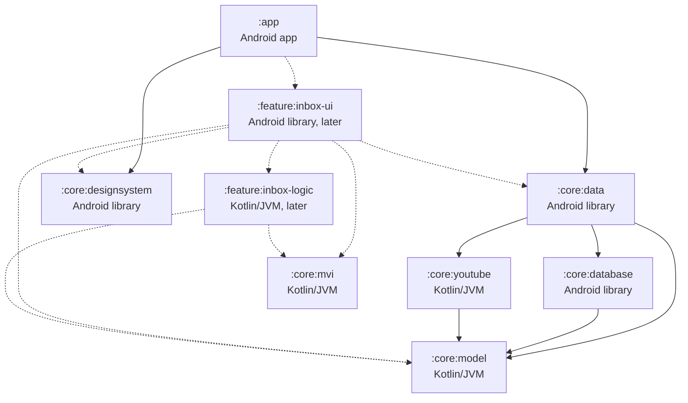

# Architecture

This is the design document for Dewfall. It explains how the app is built: its modules, how data moves through them, and how the main features work underneath. The reasons behind each decision are in the ADRs in [adr/](adr/). Update this file in the same pull request as any change to the structure of the app.

## Modules

Dewfall is one Gradle build with an app module, core modules, and feature modules as features arrive. Some modules are plain Kotlin/JVM and the rest are Android modules. [ADR 0006](adr/0006-platform-and-android-versions.md) explains why.

- A plain Kotlin/JVM module can't see Android classes, so the build itself keeps Android code out of it. Its tests run on the computer's JVM with nothing from Android to fake. It can't hold user-facing text, because string resources are part of Android, so it returns types that the screens turn into text.
- An Android module is the app or an Android library. It holds everything that needs Android, such as the database, screens, ViewModels, resources and background jobs.

### The module graph

Solid arrows are dependencies in the build today. Dashed arrows show where the inbox's two modules will go when Phase 5 adds them.

### Core modules

Android modules set a namespace. Plain Kotlin/JVM modules have no namespace, so for them the table gives the package their code uses.

| Module | Folder | Type | Namespace or package | What it holds | Depends on |
|---|---|---|---|---|---|
| `:app` | app/ | Android app | io.github.dewfallapp | The entry point, which ties the other modules together. Once features arrive, it also handles navigation between them. | `:core:data`, `:core:designsystem`, and each feature's `-ui` module |
| `:core:model` | core/model/ | Kotlin/JVM | io.github.dewfallapp.core.model | Domain models, such as videos, channels and subtitle lines | Nothing |
| `:core:mvi` | core/mvi/ | Kotlin/JVM | io.github.dewfallapp.core.mvi | The MVI base types: State, Intent, Effect and the reducer | Nothing |
| `:core:youtube` | core/youtube/ | Kotlin/JVM | io.github.dewfallapp.core.youtube | The YouTube layer: Dewfall's interfaces for search, video details, a channel's latest uploads, stream links and subtitles, and their NewPipeExtractor implementation. It is the only module that may use NewPipeExtractor. See [ADR 0001](adr/0001-newpipeextractor-behind-youtube-layer.md). | `:core:model` |
| `:core:database` | core/database/ | Android library | io.github.dewfallapp.core.database | The Room database: entities, DAOs, migrations and the exported schemas | `:core:model` |
| `:core:data` | core/data/ | Android library | io.github.dewfallapp.core.data | Repositories that combine the database and the YouTube layer | `:core:model`, `:core:database`, `:core:youtube` |
| `:core:designsystem` | core/designsystem/ | Android library | io.github.dewfallapp.core.designsystem | The Compose theme built from the design tokens, plus shared components and icons | Nothing |

The core modules are still empty. Later tasks fill them: Compose and Hilt in #23, Room in #24, the MVI base types in #25, the theme in #26, and the YouTube layer in Phase 3.

### Feature modules

Each feature has two modules, because its reducer has to be plain Kotlin/JVM and its screens need Android. For the inbox, they look like this.

| Module | Folder | Type | Namespace or package | What it holds | Depends on |
|---|---|---|---|---|---|
| `:feature:inbox-logic` | feature/inbox-logic/ | Kotlin/JVM | io.github.dewfallapp.feature.inbox.logic | InboxState, InboxIntent, InboxEffect, the reducer, and the reducer's tests | `:core:mvi`, `:core:model` |
| `:feature:inbox-ui` | feature/inbox-ui/ | Android library | io.github.dewfallapp.feature.inbox.ui | The Compose screens, InboxViewModel, string resources and screenshot tests | `:feature:inbox-logic`, `:core:data`, `:core:designsystem`, `:core:mvi`, `:core:model` |

- Feature modules depend on core modules, never on another feature's modules. A feature's `-ui` module also depends on its own `-logic` module.
- The ViewModel goes in the `-ui` module. It runs side effects through `:core:data` and uses Hilt, and both are Android. A plain Kotlin/JVM module can't depend on an Android module.
- `:app` depends on every feature's `-ui` module and handles navigation between features.

### Module names

Every module's last name segment must be unique in the build. Gradle can mix up two projects that have both the same group and the same name, such as `:inbox:logic` and `:search:logic` when both are in group dewfall ([gradle/gradle#847](https://github.com/gradle/gradle/issues/847)). By default, Gradle bases each project's group on its parent's path, so `:core:data` is in group dewfall.core and the clash can't happen yet. It happens as soon as a build setting gives every project the same group. Unique names prevent it, whatever the groups are. So feature modules are named `:feature:inbox-logic` and `:feature:inbox-ui`, not `:feature:inbox:logic` and `:feature:inbox:ui`.

### Build settings

Every module applies one of three convention plugins from build-logic/. They hold the settings that every module of that type shares.

| Plugin | For | What it sets |
|---|---|---|
| dewfall.android.application | `:app` | compileSdk 37, minSdk 29 and targetSdk 37, as ADR 0006 decides, and the JDK 17 toolchain |
| dewfall.android.library | Android libraries | compileSdk 37 and minSdk 29, targetSdk 37 for lint and tests, and the JDK 17 toolchain |
| dewfall.jvm.library | Plain Kotlin/JVM modules | The Kotlin JVM plugin and the JDK 17 toolchain |

Every module compiles with JDK 17, and the Java and Kotlin bytecode targets follow the toolchain. So every module produces Java 17 bytecode, and the version is written in one place. Android modules get Kotlin from AGP's built-in Kotlin support.

The versions of every plugin and library are in gradle/libs.versions.toml. To add a module, include it in settings.gradle.kts, apply one of the three plugins in its build.gradle.kts, and set a namespace if it is an Android module.

## Data flow

TODO

## The MVI contract

TODO

## The player

TODO

## Downloads and cleanup

TODO

## Subtitle search

TODO

## Database tables

TODO

## Error handling

TODO
