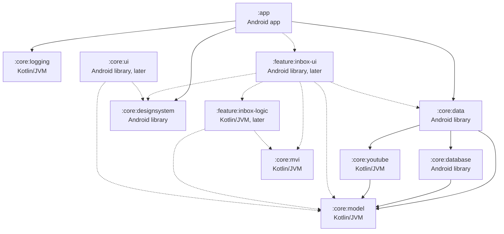
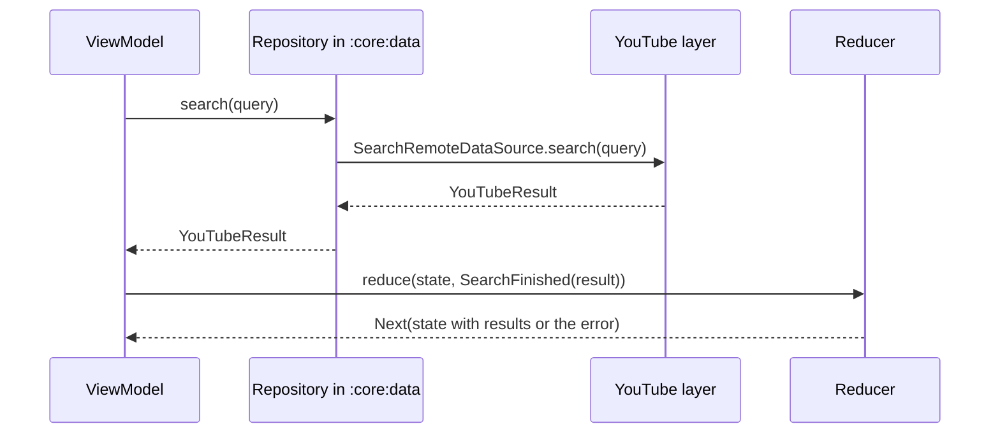
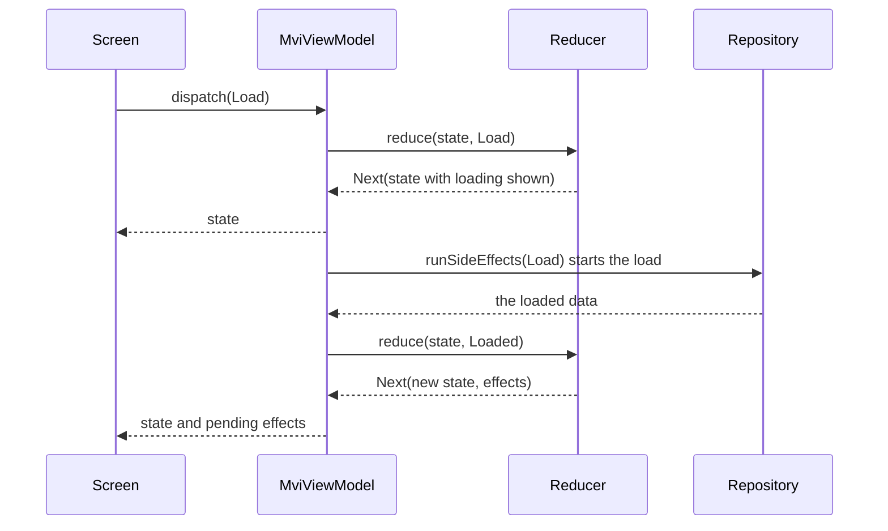

# Architecture

This is the design document for Dewfall. It explains how the app is built: its modules, how data moves through them, and how the main features work underneath. The reasons behind each decision are in the ADRs in [adr/](adr/). Update this file in the same pull request as any change to the structure of the app.

## Modules

Dewfall is one Gradle build with an app module, core modules, and feature modules as features arrive. Some modules are plain Kotlin/JVM and the rest are Android modules. [ADR 0006](adr/0006-platform-and-android-versions.md) explains why.

- A plain Kotlin/JVM module can't see Android classes, so the build itself keeps Android code out of it. Its tests run on the computer's JVM with nothing from Android to fake. It can't hold user-facing text, because string resources are part of Android, so it returns types that the screens turn into text.
- An Android module is the app or an Android library. It holds everything that needs Android, such as the database, screens, ViewModels, resources and background jobs.

### The module graph

Solid arrows are dependencies in the build today. Dashed arrows show modules that come later: the inbox's two modules, which Phase 5 adds, and `:core:ui`, which comes when a second feature needs shared UI.



### Core modules

Android modules set a namespace. Plain Kotlin/JVM modules have no namespace, so for them the table gives the package their code uses.

| Module | Folder | Type | Namespace or package | What it holds | Depends on |
|---|---|---|---|---|---|
| `:app` | app/ | Android app | io.github.dewfallapp | The entry point, which ties the other modules together. It holds the Hilt Application class and the app's only activity, which shows a placeholder screen until the first feature arrives. Once features arrive, it also handles navigation between them. It also holds the logcat writer and the Hilt module that provides the logger. See [Logging](#logging). | `:core:data`, `:core:designsystem`, `:core:logging`, and each feature's `-ui` module |
| `:core:model` | core/model/ | Kotlin/JVM | io.github.dewfallapp.core.model | Domain models, such as videos, channels and subtitle lines. Today it holds the YouTube layer's models, its IDs, YouTubeResult and YouTubeError. See [The YouTube layer](#the-youtube-layer). | Nothing |
| `:core:logging` | core/logging/ | Kotlin/JVM | io.github.dewfallapp.core.logging | The Logger that every module logs through, its levels and fields, and the error summary that leaves out messages. See [Logging](#logging). | Nothing |
| `:core:mvi` | core/mvi/ | Kotlin/JVM | io.github.dewfallapp.core.mvi | The MVI base: MviState, MviIntent, MviEffect, the Reducer, and MviViewModel, the base class of every screen's ViewModel. See [The MVI contract](#the-mvi-contract). | Nothing. It uses Lifecycle's ViewModel and kotlinx.coroutines. |
| `:core:youtube` | core/youtube/ | Kotlin/JVM | io.github.dewfallapp.core.youtube | The YouTube layer: Dewfall's interfaces for search, video details, a channel's latest uploads, stream links and subtitles, and their NewPipeExtractor implementation, which #35 and #148 add. It is the only module that may use NewPipeExtractor. See [ADR 0001](adr/0001-newpipeextractor-behind-youtube-layer.md) and [The YouTube layer](#the-youtube-layer). | `:core:model` |
| `:core:database` | core/database/ | Android library | io.github.dewfallapp.core.database | The Room database: entities, DAOs, migrations and the exported schemas | `:core:model` |
| `:core:data` | core/data/ | Android library | io.github.dewfallapp.core.data | Repositories that combine the database and the YouTube layer | `:core:model`, `:core:database`, `:core:youtube` |
| `:core:designsystem` | core/designsystem/ | Android library | io.github.dewfallapp.core.designsystem | The Compose theme built from the design tokens, with the Manrope font. See [The theme](#the-theme). Later, shared components and icons too. | Nothing. It exposes Material 3 as an api dependency. |

`:core:mvi` holds the MVI base, `:core:designsystem` holds the theme, and `:core:logging` holds the logger. `:core:youtube` holds the YouTube layer's interfaces, and `:core:model` the models they return. `:core:data` and `:core:database` hold no code yet. A module that logs depends on `:core:logging`. Today only `:app` does, and each other module adds the dependency when it first logs. `-logic` modules never do, because reducers don't log. `:core:database` has Room set up, but no database until Phase 5 adds the first tables (#48). #35 and #148 implement the YouTube layer's interfaces. Compose is set up in `:app` and `:core:designsystem`. Hilt is set up in `:app` only, until a core module needs it.

`:core:designsystem` holds the theme and the components that know nothing about Dewfall's data. Its components take plain values, such as text, images and click handlers. Shared UI that needs the domain models or string resources, such as a video row that several features use, or the code that formats a duration, goes in a `:core:ui` Android library instead. `:core:ui` gets created when a second feature needs such a piece. It may depend on `:core:designsystem` and `:core:model`, and feature `-ui` modules may depend on it.

### Feature modules

Each feature has two modules, because its reducer has to be plain Kotlin/JVM and its screens need Android. For the inbox, they look like this.

| Module | Folder | Type | Namespace or package | What it holds | Depends on |
|---|---|---|---|---|---|
| `:feature:inbox-logic` | feature/inbox-logic/ | Kotlin/JVM | io.github.dewfallapp.feature.inbox.logic | InboxState, InboxIntent, InboxEffect, the reducer, and the reducer's tests | `:core:mvi`, `:core:model` |
| `:feature:inbox-ui` | feature/inbox-ui/ | Android library | io.github.dewfallapp.feature.inbox.ui | The Compose screens, InboxViewModel, string resources and screenshot tests | `:feature:inbox-logic`, `:core:data`, `:core:designsystem`, `:core:mvi`, `:core:model` |

- Feature modules depend on core modules, never on another feature's modules. A feature's `-ui` module also depends on its own `-logic` module.
- The ViewModel goes in the `-ui` module and extends MviViewModel from `:core:mvi`. It runs side effects through `:core:data` and uses Hilt, and both are Android. A plain Kotlin/JVM module can't depend on an Android module.
- `:app` depends on every feature's `-ui` module and handles navigation between features.

### Module names

Every module's last name segment must be unique in the build. Gradle can mix up two projects that have both the same group and the same name, such as `:inbox:logic` and `:search:logic` when both are in group dewfall ([gradle/gradle#847](https://github.com/gradle/gradle/issues/847)). By default, Gradle bases each project's group on its parent's path, so `:core:data` is in group dewfall.core and the clash can't happen yet. It happens as soon as a build setting gives every project the same group. Unique names prevent it, whatever the groups are. So feature modules are named `:feature:inbox-logic` and `:feature:inbox-ui`, not `:feature:inbox:logic` and `:feature:inbox:ui`.

### Build settings

Every module applies one of three convention plugins from build-logic/. They hold the settings that every module of that type shares.

| Plugin | For | What it sets |
|---|---|---|
| dewfall.android.application | `:app` | compileSdk 37, minSdk 29 and targetSdk 37, as ADR 0006 decides, the JDK 17 toolchain, the shared Kotlin compiler, lint and detekt settings, and JUnit 4 unit tests |
| dewfall.android.library | Android libraries | compileSdk 37 and minSdk 29, targetSdk 37 for lint and tests, the JDK 17 toolchain, the shared Kotlin compiler, lint and detekt settings, and JUnit 4 unit tests |
| dewfall.jvm.library | Plain Kotlin/JVM modules | The Kotlin JVM plugin, the JDK 17 toolchain, the shared Kotlin compiler, lint and detekt settings, the Android API check, and JUnit 6 unit tests |

A fourth plugin, dewfall.detekt, holds the detekt settings and adds the compose-rules plugin to detekt. The three plugins above apply it, and so does the root project, to check the code in build-logic.

Android modules that use Compose, Hilt or Room also apply the matching plugins below, after dewfall.android.application or dewfall.android.library. Today `:app` and `:core:designsystem` apply dewfall.android.compose, only `:app` applies dewfall.android.hilt, and only `:core:database` applies dewfall.android.room. Each feature's `-ui` module will apply both dewfall.android.compose and dewfall.android.hilt.

`:app` also turns on BuildConfig, which AGP 8.0 and later generate only for modules that ask ([AGP 8.0.0](https://developer.android.com/build/releases/agp-8-0-0-release-notes)). The Hilt module that provides the logger reads BuildConfig.DEBUG to pick the lowest log level. See [Logging](#logging).

| Plugin | What it sets |
|---|---|
| dewfall.android.compose | The Compose compiler plugin, Compose turned on in the Android build, the Compose BOM, and the preview annotations, with the preview tooling in debug builds only. The module adds the Compose libraries it uses, such as Material 3. |
| dewfall.android.hilt | KSP, the Hilt Gradle plugin, Hilt and Hilt's compiler, with KSP warnings failing the build |
| dewfall.android.room | KSP, the Room Gradle plugin, Room and Room's compiler, with KSP warnings failing the build, and the module's schemas/ folder as the place where Room writes the database schemas |

The Compose compiler is part of Kotlin, so its plugin always has the Kotlin version, and it runs inside the Kotlin compiler that AGP's built-in Kotlin provides ([Compose compiler](https://developer.android.com/develop/ui/compose/compiler)). Compose 1.12 needs compileSdk 37 and AGP 9 ([compatibility](https://developer.android.com/develop/ui/compose/compiler#agp-compatibility)).

Hilt's compiler runs through KSP. The kotlin-kapt plugin doesn't work with built-in Kotlin. Google recommends KSP instead, and offers the com.android.legacy-kapt plugin only as a fallback for projects that can't move to KSP yet ([Migrate to built-in Kotlin](https://developer.android.com/build/migrate-to-built-in-kotlin#migration-steps-migrate-kotlin-kapt-plugin)). Hilt supports KSP, so the build uses neither. The Hilt Gradle plugin then builds the app's Hilt components in a javac task of its own, such as hiltJavaCompileDebug. In an Android module, the `ksp` configuration covers the main source set only. Tests that use Hilt add its compiler to `kspTest` or `kspAndroidTest` ([KSP configurations](https://github.com/google/ksp/blob/2.3.12/README.md#single-platform-jvm--android)). The Hilt Gradle plugin needs Hilt 2.59 or later on AGP 9 ([Dagger 2.59](https://github.com/google/dagger/releases/tag/dagger-2.59)), and Hilt reads the classes that Kotlin 2.4 compiles from 2.60 on ([google/dagger#5180](https://github.com/google/dagger/issues/5180)). So a new Kotlin minor version may need a Hilt update too.

Room's compiler runs through KSP too. The build uses Room 3, whose classes are in the androidx.room3 package. Google marks Room 2 as deprecated ([Room 2.x guide](https://developer.android.com/training/data-storage/room/v2)), and its Room guide uses Room 3 ([Room](https://developer.android.com/training/data-storage/room)). Room 3 generates only Kotlin, runs only through KSP, and is built around coroutines ([Room 3.0.0](https://developer.android.com/jetpack/androidx/releases/room3#3.0.0)). WorkManager 2.12.0 uses Room 2 for its own database, so the app will ship both once Phase 7 adds WorkManager. The two don't clash, because Room 3 has a package of its own for exactly this case ([Migrate from Room 2.x to Room 3.0](https://developer.android.com/training/data-storage/room/migration-2-to-3)).

The Room Gradle plugin tells Room's compiler where the schemas go. Room writes the schema of each database version to core/database/schemas/, as `<database class>/<version>.json`, and the files are committed. Debug and release builds share the folder, and the plugin checks that both write the same schema. The plugin also adds the folder to the androidTest assets, where migration tests read it ([Room Gradle plugin](https://developer.android.com/training/data-storage/room/migrating-db-versions#export-schemas)). Room writes a file only when the schema changed. If the schema changes but the version number stays the same, Room rewrites that version's file and the build still passes. The pull request workflow catches this, as [testing.md](testing.md#database-migration-tests) describes.

Room 3 adds a service, MultiInstanceInvalidationService, to the app's manifest. It isn't exported, and it runs only for a database built with enableMultiInstanceInvalidation(), which keeps database instances in several processes in sync. The app runs in a single process, so it doesn't need that.

Every module compiles with JDK 17, and the Java and Kotlin bytecode targets follow the toolchain. So every module produces Java 17 bytecode, and the version is written in one place. Android modules get Kotlin from AGP's built-in Kotlin support.

Kotlin compiler warnings fail the build in every module, so a call to a deprecated API stops the build. KotlinCompiler.kt in build-logic turns on the compiler's [allWarningsAsErrors](https://kotlinlang.org/docs/gradle-compiler-options.html#attributes-common-to-jvm-and-javascript) option in the module's `kotlin.compilerOptions` block, which reaches every Kotlin compilation in the module, tests included ([Target the JVM](https://kotlinlang.org/docs/gradle-compiler-options.html#target-the-jvm)). In Android modules, AGP's built-in Kotlin provides that block ([Migrate to built-in Kotlin](https://developer.android.com/build/migrate-to-built-in-kotlin#migration-steps-migrate-kotlin-options)). In plain Kotlin/JVM modules, the Kotlin JVM plugin does. The code in build-logic is a separate build, so the setting doesn't cover it. KSP has a setting of its own, which dewfall.android.hilt and dewfall.android.room turn on through KotlinSymbolProcessing.kt, so warnings that Hilt or Room report while KSP runs fail the build too. javac compiles the Java code that Hilt generates, and builds the Hilt components in the Hilt Gradle plugin's own task. Its warnings, such as Dagger's warnings about the dependency graph, don't fail the build. If a warning can't be fixed, suppress it with @Suppress on the single statement or declaration, never a whole file, with a comment that says why and names the issue that will remove it, if there is one.

**Unit tests.** Testing.kt in build-logic sets up every module's unit tests, so a new module gets them by applying its plugin. Tests use [kotlin.test](https://kotlinlang.org/api/core/kotlin-test/)'s annotations and assertions everywhere, so they read the same in every module. Underneath, two versions of JUnit run them:

- Plain Kotlin/JVM modules run JUnit 6 through the JUnit Platform. Kotlin's docs use JUnit 6 with kotlin.test ([Test code using JUnit](https://kotlinlang.org/docs/jvm-test-using-junit.html)). Gradle 9 no longer puts the JUnit Platform launcher on the test classpath by itself, so Testing.kt adds it ([Gradle upgrade guide](https://docs.gradle.org/9.8.1/userguide/upgrading_version_8.html)).
- Android modules run JUnit 4, AGP's default and the framework in Android's [local test guide](https://developer.android.com/training/testing/local-tests). Robolectric supports only JUnit 4 ([robolectric#3477](https://github.com/robolectric/robolectric/issues/3477)), Compose's test rules are JUnit 4 rules, and JUnit 6 deprecates the engine that would run JUnit 4 tests on it ([JUnit 6.0.0](https://docs.junit.org/6.0.0/release-notes/)).

Both get kotlinx-coroutines-test. [testing.md](testing.md#running-tests-locally) explains how to write and run the tests.

The versions of every plugin and library are in gradle/libs.versions.toml. To add a module, include it in settings.gradle.kts, apply one of the three plugins in its build.gradle.kts, add dewfall.android.compose, dewfall.android.hilt or dewfall.android.room if it uses them, and set a namespace if it is an Android module.

### Formatting and lint

Four tools check the code. AGENTS.md lists the commands that run them.

**Formatting.** Spotless runs ktfmt in kotlinlang style, with 4-space indents and lines of up to 100 characters. It covers every Kotlin file and Kotlin build script in the repository. Its settings are in the root build.gradle.kts, because build-logic and the root build scripts belong to no module. Kotlin files use LF line endings, set in .gitattributes and in the Spotless settings. ktfmt doesn't read .editorconfig. The Kotlin section there comes from ktfmt and helps the IDE's own formatter come close to it. The roadmap first named ktlint. Its last stable release, 1.8.0 from November 2025, parses Kotlin 2.2. The ktlint organization took the project over from Pinterest and supports newer Kotlin only in 2.0 alphas, which moved to new Maven coordinates ([ktlint changelog](https://github.com/ktlint/ktlint/blob/master/CHANGELOG.md)). Spotless can't load them yet, because it only knows the old coordinates ([KtLintStep.java](https://github.com/diffplug/spotless/blob/gradle/8.10.3/lib/src/main/java/com/diffplug/spotless/kotlin/KtLintStep.java)).

**detekt.** detekt runs its default rules, with the changes in config/detekt/detekt.yml, on every module and on build-logic. Any finding fails the build. Each module runs the plain `detekt` task, which doesn't need compiled code. So the rules that need type resolution don't run, such as InjectDispatcher, which would back the "inject dispatchers" rule in AGENTS.md. ForbiddenImport runs without it, and rejects imports of GlobalScope, android.util.Log, and NewPipeExtractor's ExtractorLogger and Logger, as [ADR 0007](adr/0007-how-the-app-logs.md) decides. It sees only imports, so a call that names a class in full passes. Suppressing a detekt finding follows the rule for compiler warnings in [Build settings](#build-settings). The one exception is an import finding, which can only be suppressed for a whole file, because an import can't carry an annotation. LogcatWriter.kt and its test are the only files that do this, because LogcatWriter is the one class allowed to call android.util.Log. A whole-file suppression also lifts the rule's other entries, such as GlobalScope, in those two files. PrintStackTrace, on by default, catches only `printStackTrace()` on a catch block's own exception. ForbiddenMethodCall, which could reject println, needs type resolution. So println, System.out, System.err and other printStackTrace calls stay unchecked until the lint check in #144. The task reads only src/main and src/test, so Android test and variant folders aren't checked. Composable functions are named in PascalCase, as the Compose API guidelines say, so FunctionNaming ignores functions annotated with @Composable ([detekt and Compose](https://github.com/detekt/detekt/blob/v2.0.0-alpha.6/website/docs/introduction/compose.mdx)). UnusedPrivateFunction and LongParameterList need type resolution, so they don't run yet. When type resolution is turned on, they need the same page's settings for private previews and for composables with many parameters. The build uses detekt 2.0.0-alpha.6, which is an alpha. The newest stable release, 1.23.8 from February 2025, was built for Kotlin 2.0.21, Gradle 8.12.1 and AGP 8.8.1 ([compatibility table](https://detekt.dev/docs/introduction/compatibility/)). It uses a Gradle method that Gradle 10 removes, and its maintainers plan no more 1.23 releases ([detekt#8452](https://github.com/detekt/detekt/issues/8452)). Support for AGP 9's built-in Kotlin came only in the 2.0 alphas ([detekt#8320](https://github.com/detekt/detekt/issues/8320)). 2.0.0-alpha.6 is built against Kotlin 2.4.10, Gradle 9.6.1 and AGP 9.3.1, close to this build's versions ([release notes](https://github.com/detekt/detekt/releases/tag/v2.0.0-alpha.6)). Rule names and settings may still change before 2.0.0, so read the release notes before each detekt update.

**detekt's Compose rules.** detekt also runs [compose-rules](https://github.com/mrmans0n/compose-rules) 0.6.7, a detekt plugin with rules for Compose code, such as "a public composable that emits UI takes a modifier parameter". dewfall.detekt adds it, so it checks every module and build-logic. The Compose section of config/detekt/detekt.yml lists every rule, as compose-rules' docs recommend ([detekt setup](https://github.com/mrmans0n/compose-rules/blob/v0.6.7/docs/detekt.md#enabling-rules)). The docs leave the four opt-in rules off. Three of them stay off: ComposableNestingDepth, PreviewNaming and UnstableCollections. Material2 is on, because it enforces the Material 3 rule in AGENTS.md. It flags any use of Material 2, the androidx.compose.material package, but not the icons in androidx.compose.material.icons, which the rule always allows. Every other rule is on. [rules.md](https://github.com/mrmans0n/compose-rules/blob/v0.6.7/docs/rules.md) explains each rule. Eight rules need type resolution, so they don't run yet: ConditionHoist, InvalidReadOnlyComposable, MissingNonRestartableComposable, MissingReadOnlyComposable, StaleRememberUpdatedStateInRemember, UnnecessaryComposable, UnnecessaryLaunchedEffect and VarsWithoutStateBacking. compose-rules' ComposableNaming checks the names of composable functions, which detekt's FunctionNaming skips. Each compose-rules release is built for one detekt version, and 0.6.7 is built for detekt 2.0.0-alpha.6 ([supported versions](https://github.com/mrmans0n/compose-rules/blob/v0.6.7/docs/detekt.md#supported-versions-matrix)). So each detekt update has to wait for a compose-rules release built for the new detekt version, and both versions change in the same pull request. Renovate puts both in one pull request, which waits for the maintainer's approval ([testing.md](testing.md#dependency-updates)).

**Android Lint.** Lint checks every module, the plain Kotlin/JVM ones through the com.android.lint plugin. Any warning fails the build. Each module checks only its own code. The checks that look up versions or library data on the network are off, so lint gives the same result on every run. AndroidLint.kt in build-logic lists them. Renovate's pull requests bring new versions instead ([testing.md](testing.md#dependency-updates)). The app's manifest suppresses two checks until the tasks that fix them are done: DataExtractionRules (#68) and MissingApplicationIcon (#120).

**The Android API check.** The plain Kotlin/JVM modules compile and run their tests against the full JDK, so a call to a Java API that Android 10 lacks passes there and fails on a phone ([ADR 0006](adr/0006-platform-and-android-versions.md)). Lint can't catch this in these modules. AGP runs lint one module at a time, and lint's API check skips any module that isn't Android ([ApiDetector](https://android.googlesource.com/platform/tools/base/+/refs/heads/mirror-goog-studio-main/lint/libs/lint-checks/src/main/java/com/android/tools/lint/checks/ApiDetector.kt)). So [Animal Sniffer](https://github.com/xvik/gradle-animalsniffer-plugin) checks each of these modules' compiled classes against a [Gummy Bears](https://github.com/open-toast/gummy-bears) signature of the Android API. The signature's API level comes from the minSdk in build-logic, so the check follows it. `./gradlew lint` runs it too.

The signature includes the methods that D8 backports, but not the APIs that core library desugaring adds, because Gummy Bears publishes no such signature for API 29. So the check also flags an API that only desugaring provides. If code needs such an API, check that Android's [desugaring table](https://developer.android.com/studio/write/java11-nio-support-table) lists it, then allow it in configureAndroidApiCheck with Animal Sniffer's ignore or annotation setting, and say why in a comment.

What it checks:

- The module's own classes in src/main. Test code never ships, so it isn't checked, and a module with no classes has nothing to check.
- Calls to the JDK. It doesn't check the module's dependencies, such as NewPipeExtractor, or calls into them, because Animal Sniffer allows every package it finds on the compile classpath, such as kotlinx.coroutines or androidx.lifecycle.
- For an invokedynamic call, only a lambda's target method and interface ([SignatureChecker, Animal Sniffer 1.24](https://github.com/mojohaus/animal-sniffer/blob/animal-sniffer-1.24/animal-sniffer/src/main/java/org/codehaus/mojo/animal_sniffer/SignatureChecker.java#L358-L371)). It never checks the JDK class that sets the call up.

That last point matters for Kotlin's string templates, such as the toString of a data class. Kotlin compiles them to invokedynamic calls through StringConcatFactory, which Android 10 lacks, and Animal Sniffer passes them. That is right, because D8 rewrites these calls into StringBuilder calls ([StringConcatInstructionDesugaring](https://r8.googlesource.com/r8/+/refs/heads/main/src/main/java/com/android/tools/r8/ir/desugar/stringconcat/StringConcatInstructionDesugaring.java)). Lambdas work on any API level too ([Java 8+ language features](https://developer.android.com/studio/write/java8-support)).

## Network access

AGENTS.md says the app's network calls go only to YouTube, through the YouTube layer, and to services the user turns on. PRIVACY.md tells users that the app connects to YouTube. Some libraries make requests of their own, so the app turns those off.

**Emoji fonts.** Compose brings in androidx.emoji2. Its EmojiCompatInitializer runs at startup and asks the system's downloadable font provider for a newer emoji font. On most phones that provider is Google Play services, which may download the font from Google. `:app`'s manifest removes the initializer with `tools:node="remove"`, as the [emoji2](https://developer.android.com/develop/ui/views/text-and-emoji/emoji2#use-different-font-provider) and [App Startup](https://developer.android.com/topic/libraries/app-startup#disable-individual) docs describe. The cost is on older phones. Android 11 and lower can't update their emoji font ([Display emoji](https://developer.android.com/develop/ui/compose/text/emoji)), so very new emoji, such as those in video titles, may show as empty boxes on Android 10 and 11.

**Fonts.** The theme bundles its font, Manrope, in the APK. Compose's downloadable fonts, from androidx.compose.ui:ui-text-google-fonts, would ask Google Play services' font provider for it instead, and that provider may download the font from Google. So the app doesn't use downloadable fonts. See [The theme](#the-theme).

## Logging

Every module logs through the Logger in `:core:logging`. [ADR 0007](adr/0007-how-the-app-logs.md) explains why the app has its own logger, and defines the user data that no log line may contain. The logger makes no network calls and has no startup initializer. Its lines go to logcat on the phone and nowhere else.

### The parts

| Type | Module | What it does |
|---|---|---|
| Logger | `:core:logging` | The class that code calls: `debug`, `info`, `warn` and `error`. It drops lines below its minimum level before it builds any text, and writes an error as its summary. It is final, so every line goes through the same formatting. |
| LogLevel | `:core:logging` | DEBUG, INFO, WARN and ERROR. |
| LogField | `:core:logging` | A value logged after the message as `name=value`: a count, a flag, a duration or an enum's name. It has no version that takes a String. |
| LogWriter | `:core:logging` | Where finished lines go. It has one function, so a test can pass a lambda. |
| LogcatWriter | `:app` | The LogWriter that writes to logcat. It is the only code that calls android.util.Log. |
| LoggingModule | `:app` | The Hilt module that provides one Logger for the whole app, with LogcatWriter and the build's lowest level. |

### Using the logger

A class receives a Logger in its constructor and keeps it with an area tag. Messages, areas and field names are constant text. Values go in fields, and an error goes in the `error` parameter. For example:

```kotlin
class UploadsRefresher(logger: Logger) {
    private val log = logger.withTag("YouTube")

    fun onRefreshed(videoCount: Int) {
        log.info("Refreshed uploads", LogField.count("videos", videoCount))
    }

    fun onRefreshFailed(attempt: Int, error: Exception) {
        log.warn("Refresh failed", LogField.count("attempt", attempt), error = error)
    }
}
```

The warning above is written with the tag Dewfall.YouTube, as text like this:

```
Refresh failed attempt=2
java.io.IOException
  at io.github.dewfallapp.core.youtube.UploadsRefresher.refresh(UploadsRefresher.kt:41)
Caused by: java.net.SocketTimeoutException
  at ...
```

- Every tag is Dewfall, or Dewfall followed by a dot and an area, such as Dewfall.YouTube, so one prefix finds every line the app writes. Android limits tag length only up to Android 7 ([isLoggable](https://developer.android.com/reference/android/util/Log#isLoggable(java.lang.String,%20int))), but tags stay short anyway, because LogcatWriter leaves only 68 bytes of each entry for everything except the text. See [Long text](#long-text).
- The error summary writes the class name of the error and of each cause, each with up to 30 stack frames, and at most 10 causes. It never writes a message or toString(). It stops at a cause it already wrote, so a chain that loops ends.
- There is no global logger. Hilt provides the Logger, and code that Hilt doesn't build gets it from whoever builds that code.
- Reducers never log, because logging is a side effect. ViewModels may.
- Tests pass `Logger.Silent`, or a Logger with a writer that records lines. [testing.md](testing.md#logging) shows how.

### Levels in each build

Debug builds keep every level. Release builds keep WARN and ERROR. LoggingModule picks the level from BuildConfig.DEBUG, which `:app` turns on, as [Build settings](#build-settings) describes.

Google's [Log Info Disclosure](https://developer.android.com/privacy-and-security/risks/log-info-disclosure) page recommends a logcat backend in developer builds only. For apps that can't avoid logs in production, it falls back to keeping only warnings and errors, with R8 removing the other levels, with no values that aren't constant in the log statements, and with flags that can shut logging down during an incident. Dewfall keeps one part of the fallback, warnings and errors in release builds, because it has no crash reporting: the WARN and ERROR lines in logcat are what a user can read with adb and share when reporting a problem. It departs from the fallback in three ways, as [ADR 0007](adr/0007-how-the-app-logs.md#why-release-builds-keep-warnings-and-errors) explains. Its lines keep LogField values and error class names and frames, which aren't constant, but whose types keep user data out. Until Phase 9 turns on R8, a level check drops the other levels, not R8. And it has no flag to shut logging down, because it has no server or remote settings, so only a new release can change logging.

Nothing shrinks the code yet, so release builds still contain the debug and info calls and their constant text. Those calls return after one level check, before building any text. When Phase 9 turns on R8 (#146):

- A `-assumenosideeffects` rule on Logger.debug and Logger.info removes those calls ([rule types](https://developer.android.com/topic/performance/app-optimization/additional-rule-types)). Phase 9 checks R8's output for what stays, such as the code that builds the LogField arguments.
- The same page describes `-maximumremovedandroidloglevel` as removing Android logging calls, such as Log.w and Log.isLoggable, at or below a level. LogcatWriter passes the priority as a variable, so that rule can't remove its calls by level. The `-assumenosideeffects` rule above does that job instead.

### Long text

liblog cuts any log entry whose payload, the priority, the tag and the text, is over LOGGER_ENTRY_MAX_PAYLOAD, 4068 bytes ([log.h](https://android.googlesource.com/platform/system/logging/+/bcac7c30d88a3773a7c0bc9f5617a23a886331fd/liblog/include/log/log.h#71)). An error summary at its limits goes far past that. So LogcatWriter splits text longer than 4000 bytes into several entries, with the same priority and tag:

- It splits at line breaks, so each entry holds whole lines where it can.
- It splits a single line longer than 4000 bytes between characters, never inside one.
- It counts a character outside the Basic Multilingual Plane, such as most emoji, as 6 bytes. Log.println hands the text to liblog through JNI's GetStringUTFChars ([android_util_Log.cpp](https://android.googlesource.com/platform/frameworks/base/+/1cdfff555f4a21f71ccc978290e2e212e2f8b168/core/jni/android_util_Log.cpp#92)). The [JNI spec](https://docs.oracle.com/en/java/javase/17/docs/specs/jni/functions.html#getstringutfchars) says that returns modified UTF-8, which writes such a character as 6 bytes. ART writes it as UTF-8's 4 bytes instead, against the spec ([jni_internal.cc](https://android.googlesource.com/platform/art/+/6484611fd45e69db9f33f98bfd6864014b030ecf/runtime/jni/jni_internal.cc#222)). Counting 6 keeps each entry within 4000 bytes either way.

The splitting is a function that unit tests call directly, because android.util.Log has no working code in local unit tests.

### What the logger can't cover

- **NewPipeExtractor's logger.** NewPipeExtractor has its own hook, ExtractorLogger, which stays silent until an app sets a logger. Dewfall never sets it, because half of its calls log user data, such as URLs and titles. detekt rejects imports of it.
- **Uncaught exceptions.** Android's RuntimeInit installs a pre-handler in every app process that writes an uncaught exception's full stack trace, messages included, to logcat's crash buffer. Apps can replace the default handler, but not the pre-handler ([RuntimeInit.java](https://android.googlesource.com/platform/frameworks/base/+/1cdfff555f4a21f71ccc978290e2e212e2f8b168/core/java/com/android/internal/os/RuntimeInit.java#240)). This gap is permanent. Catching exceptions at module edges narrows it. See [Error handling](#error-handling).
- **Other libraries' own logs.** Media3 logs errors by default ([Debug logging](https://developer.android.com/media/media3/exoplayer/debug-logging)), and WorkManager has its own minimum logging level ([custom configuration](https://developer.android.com/develop/background-work/background-tasks/persistent/configuration/custom-configuration)). The tasks that add them check them against ADR 0007.
- **Calls that skip the logger.** detekt checks only imports, so println, System.out, System.err and most printStackTrace calls stay unchecked until the lint check in #144. See [Formatting and lint](#formatting-and-lint).

## The YouTube layer

`:core:youtube` is the only module that reaches YouTube, and the only one that may use NewPipeExtractor ([ADR 0001](adr/0001-newpipeextractor-behind-youtube-layer.md)). It returns Dewfall's own models from `:core:model`, so nothing outside it knows which library sits underneath. [ADR 0008](adr/0008-youtube-layer-contract.md) explains its results, errors, IDs and time types.

### The interfaces

There is one interface for each thing the app needs from YouTube, so each caller depends only on what it uses. Their names follow Google's convention for data sources, the type of data followed by RemoteDataSource ([data layer](https://developer.android.com/topic/architecture/data-layer)).

| Interface | Function | Returns | Implemented in |
|---|---|---|---|
| SearchRemoteDataSource | `search(query)` | The first page of channels and videos | #35 |
| VideoDetailsRemoteDataSource | `videoDetails(videoId)` | What the video screen shows | #35 |
| ChannelUploadsRemoteDataSource | `latestUploads(channelId)` | The channel, with its latest long-form videos and live streams | #35 |
| StreamLinksRemoteDataSource | `streamLinks(videoId)` | The links that play or download the video | #35 |
| SubtitlesRemoteDataSource | `subtitleTracks(videoId)`, then `subtitleLines(track)` | The video's subtitle tracks, then one track's lines | #148 |

The first four are `fun interface`s, so a test can pass a lambda instead of writing a fake. One class can implement several of them. #35 decides how Hilt provides them.

Every function keeps these rules. Each interface's KDoc repeats the first two.

- It is a suspend function, and main-safe: it can be called from any thread, including the main thread, and the implementation moves blocking work to a dispatcher it receives, so tests can replace it, as the [data layer guide](https://developer.android.com/topic/architecture/data-layer) asks.
- It returns `YouTubeResult`: `Success` with the value, or `Failure` with a `YouTubeError`. It reports every problem with YouTube or the network as a Failure. The only exception it throws is CancellationException, when the calling coroutine is cancelled.
- It catches every NewPipeExtractor exception at the module's edge, logs it with the Logger, and returns its category. No NewPipeExtractor exception leaves the module. See [Mapping NewPipeExtractor's exceptions](#mapping-newpipeextractors-exceptions).
- It never logs the search text, IDs, URLs or anything else that ADR 0007 calls user data.

### The models

| Model | What it holds |
|---|---|
| VideoId, ChannelId | A video's or a channel's ID. The constructor checks the format and throws IllegalArgumentException with a fixed message. `parseOrNull` returns null instead, for text from outside the app, such as the Takeout import. toString leaves out the ID. |
| VideoSummary | A video in a list: ID, title, channel ID and name, length, publish time, thumbnails and VideoKind |
| VideoKind | VIDEO, SHORT, LIVE or UPCOMING. VIDEO includes finished premieres and recordings of live streams. LIVE includes a premiere that is playing now. |
| Channel | ID, name, avatars and description |
| SearchResults | The first page of a search: channels and videos, in YouTube's order |
| ChannelUploads | A channel, and its latest long-form videos and live streams, never Shorts, in the order that [A channel's latest uploads](#a-channels-latest-uploads) describes. A premiere or live stream that hasn't started is UPCOMING. |
| VideoDetails | ID, title, channel ID, name and avatars, description as plain text, length, publish time, thumbnails, and whether it is live |
| StreamLinks | Audio formats, video formats, an HLS manifest, and when the links stop working |
| SubtitleTrack, SubtitleLine | A track's language, whether YouTube generated it, and its link. A line's start, end and text. |
| Thumbnail | One size of an image, with its width and height when YouTube gives them |
| PublishedTime | When a video was published or is scheduled to start, and whether that time is only an estimate |
| YouTubeResult, YouTubeError | What a function returns, and why it failed. See [Error handling](#error-handling). |

The ID, title, channel ID and channel name of a video are required. When #35 can't read one of them, it leaves the item out of a list, or fails a call about one video with BROKEN. The other fields are optional: #35 fills them with null or an empty list or text, and logs a warning.

Times are kotlin.time's Instant, and lengths are its Duration. YouTube often gives only a date with no time, or a relative time in days or longer, such as "3 weeks ago". Then PublishedTime's `isApproximate` is true, and its Instant is an estimate: the time of day means nothing, and the date can be as far off as the unit YouTube gave. A relative time in hours, such as "7 hours ago", isn't marked approximate, but is only as exact as the hour.

A model's thumbnails hold every size YouTube offers. The screen picks the smallest one that is at least as wide as the space it fills in pixels, or the largest one if none is that wide. That helper comes with the first screen that shows a thumbnail, in Phase 4.

### A channel's latest uploads

ChannelUploads holds a channel's long-form videos and live streams, and never its Shorts. Whether the inbox shows videos that haven't started is a Phase 5 decision.

On a channel's page, YouTube shows regular videos and premieres in the Videos tab, live streams in the Live tab, whether they are on air, upcoming or recorded, and Shorts in the Shorts tab. So #35 reads two tabs, two requests for each channel, and merges them:

- The Videos tab. NewPipeExtractor's channel request already holds it, with the channel's name, avatar and description.
- The Live tab.

Both tabs give the length of each video that can be watched from start to end. NewPipeExtractor's item code marks a stream that is on air by its badge, and a premiere or stream that hasn't started by its scheduled start. The other publish times are relative, such as "Streamed 2 years ago", so most of them are approximate.

The merged list follows this order, which the KDoc of ChannelUploads and ChannelUploadsRemoteDataSource states too:

- The videos are sorted by their publish time, newest first. Exact and approximate times are compared as they are.
- An upcoming video's time is its scheduled start, which is in the future, so upcoming videos with a scheduled start come first.
- Videos with no publish time come last.
- Videos with the same time, and videos with no time, keep the order YouTube gave, with the Videos tab's videos before the Live tab's.

#35 implements this order and tests it. If the inbox wants a different order later, Phase 5 sorts its own rows.

The channel's RSS feed was rejected. It lists Shorts without marking them, so leaving them out would depend on an undocumented link pattern, and it gives no lengths.

### Stream links

YouTube serves most of a video's sound and picture as separate formats. Each format in StreamLinks is a single file that HTTP GET requests with byte ranges can read. #35 leaves out the formats that need a manifest to play. So a player usually plays one audio format and one video format together, such as with Media3's MergingMediaSource ([media sources](https://developer.android.com/media/media3/exoplayer/media-sources)). A video format whose `includesAudio` is true has the sound too, so it plays on its own. A player can also play the HLS manifest. A live stream has only the HLS manifest.

The links stop working after some time. NewPipeExtractor doesn't say when, so #35 reads the `expire` parameter from the links and leaves `expiresAt` null when there is none. Callers fetch new links just before playing or downloading, and again when a link stops working. StreamLinks has no DASH manifest, because NewPipeExtractor's dev branch no longer gives one.

### Subtitles

SubtitlesRemoteDataSource lists a video's tracks first, then reads the lines of the track the caller picks. A track carries its link, so reading its lines is one request. #148 picks the subtitle format that YouTube sends, downloads the track through the layer's own HTTP code, and parses it into lines with their start and end times.

### Mapping NewPipeExtractor's exceptions

#35 and #148 turn every exception into one of the categories in [Error handling](#error-handling). They check a subclass before its parent. The table names the exceptions of NewPipeExtractor v0.26.5.

| Thrown | Category |
|---|---|
| CancellationException | Thrown again, never mapped |
| IOException and its subclasses, from the layer's own HTTP code | NETWORK |
| ReCaptchaException, which the layer's HTTP code throws for HTTP 429 or a captcha page, and SignInConfirmNotBotException | BLOCKED |
| PrivateContentException | PRIVATE |
| AgeRestrictedContentException | AGE_RESTRICTED |
| GeographicRestrictionException, UnsupportedContentInCountryException | COUNTRY_BLOCKED |
| PaidContentException, YoutubeMusicPremiumContentException | MEMBERS_OR_PAID |
| AccountTerminatedException | CHANNEL_CLOSED |
| Any other ContentNotAvailableException, and ContentNotSupportedException | UNAVAILABLE |
| SearchExtractor.NothingFoundException | Not an error: a Success with empty lists |
| ParsingException, ExtractionException and their other subclasses, and any other RuntimeException | BROKEN, unless an IOException is among its causes, which is NETWORK |

Errors, such as OutOfMemoryError, aren't caught.

### NewPipeExtractor's dev branch

On October 21, 2026, NewPipeExtractor's dev branch was 60 commits past v0.26.5, at commit 405f549. These changes touch what #35 and #148 read, so the contract avoids depending on them:

- Formats, the HLS manifest, subtitle tracks and the live flag come only from the visionOS client. The Android and iOS clients are gone, so which formats YouTube sends may change.
- The DASH manifest is gone, and setPoTokenProvider does nothing until NewPipeExtractor supports SABR, YouTube's newer way of streaming. SABR could replace single-file format links, which would change StreamLinks.
- Description is now a record with a Type enum, which changes #35's code but not the models. Subtitle tracks gain a name, and audio formats can be marked as dubbed automatically. Neither of those is in the models yet.

## Data flow

### Reading from YouTube

This is how a screen reads from YouTube, once Phase 4 adds the first repository in `:core:data`. Feature modules can't see `:core:youtube`, because `:core:data` depends on it as an implementation dependency. They see the models, `YouTubeResult` and `YouTubeError`, because those live in `:core:model`.



1. The ViewModel's runSideEffects calls the repository from viewModelScope. The call is main-safe, so the ViewModel doesn't switch threads.
2. The repository calls the YouTube layer, and returns its result, or a result of its own built from it.
3. The ViewModel dispatches the result as an intent, such as SearchFinished. The reducer turns a Success into content and a Failure into an error state.

The rest of this section, such as how data moves through the database and background jobs, comes with Phase 5.

## The MVI contract

Every screen uses MVI, as [ADR 0002](adr/0002-mvi-with-playback-state-outside.md) decides. `:core:mvi` holds the base types that every screen builds on. A small example screen, a counter, lives in core/mvi/src/test/ and shows the whole pattern with its tests.

### The types

| Type | What it is |
|---|---|
| MviState | A screen's state. One immutable class per screen, usually a data class with val properties and read-only collections. After the initial state, only the screen's reducer makes new ones. |
| MviIntent | Something that happens to the screen: what the user does, or the result of work the ViewModel ran. A screen's intents form a sealed interface. Results are named in the past tense, such as Loaded. |
| MviEffect | A one-time instruction to the UI, such as showing a message or opening another screen. A screen's effects form a sealed interface. |
| Reducer | A pure function from the old state and an intent to a Next: the new state and any effects, in order. It runs no coroutines, I/O, clock, randomness or shared mutable state. |
| PendingEffect | An effect that the UI hasn't handled yet, with an id that is unique within its ViewModel. |
| MviViewModel | The base class of every screen's ViewModel. It holds the state and the pending effects, and runs every intent through the reducer. |

A feature's State, Intent, Effect and reducer go in its `-logic` module. Its ViewModel extends MviViewModel and goes in its `-ui` module. The base type names start with Mvi, so they don't clash with Compose's State or Android's Intent.

### How an intent flows



1. The screen calls dispatch with an intent, such as Load.
2. dispatch runs the reducer. The new state replaces the old one in `state`, and the reducer's effects join the end of `pendingEffects`.
3. dispatch then calls the ViewModel's runSideEffects. It starts the work that the intent needs in viewModelScope, such as a load through `:core:data`. Intents that need no work do nothing there.
4. When the work finishes, the ViewModel calls dispatch again with the result, such as Loaded. The result goes through the reducer like any other intent.

So every change to the state comes from the reducer, and the reducer's unit tests cover most of the screen's logic. The ViewModel's tests cover which work starts for which intent. dispatch runs on the main thread: the UI calls it there, and viewModelScope runs on Dispatchers.Main.immediate.

### Effects

Android's [UI events guidance](https://developer.android.com/topic/architecture/ui-layer/events) says that events from a ViewModel should become UI state, because a channel or stream doesn't guarantee that the UI receives and handles each event when the ViewModel outlives the UI. So MviViewModel holds effects as state. Each effect waits in `pendingEffects`, a StateFlow next to `state`, until the UI says it handled it.

- The UI handles the first pending effect, then calls effectHandled with its id. That removes only that effect, and the next one becomes first, so effects are handled in order.
- An effect stays pending until then. If the UI stops before it handles the effect, or its handler is cancelled halfway, such as a message that was showing during a rotation, the UI gets the effect again.
- Pending effects survive configuration changes and the UI stopping, because they live in the ViewModel. They don't survive process death. Anything that must survive process death belongs in the screen's state, saved with [SavedStateHandle](https://developer.android.com/topic/libraries/architecture/viewmodel/viewmodel-savedstate).

The UI side comes with the first screen in Phase 4. It will look like this sketch. It waits until the screen is started, handles the effect, then reports it. It is keyed by the effect's id, so a recomposition doesn't handle the same effect twice.

```kotlin
import androidx.compose.runtime.Composable
import androidx.compose.runtime.LaunchedEffect
import androidx.compose.runtime.getValue
import androidx.compose.runtime.rememberUpdatedState
import androidx.lifecycle.Lifecycle
// Not androidx.compose.ui.platform.LocalLifecycleOwner, which is deprecated.
import androidx.lifecycle.compose.LocalLifecycleOwner
import io.github.dewfallapp.core.mvi.MviEffect
import io.github.dewfallapp.core.mvi.PendingEffect
import kotlinx.coroutines.flow.first

@Composable
fun <E : MviEffect> HandleEffects(
    pendingEffects: List<PendingEffect<E>>,
    onEffectHandled: (id: Long) -> Unit,
    handle: suspend (E) -> Unit,
) {
    val first = pendingEffects.firstOrNull()
    val lifecycle = LocalLifecycleOwner.current.lifecycle
    val currentHandle by rememberUpdatedState(handle)
    val currentOnEffectHandled by rememberUpdatedState(onEffectHandled)
    if (first != null) {
        LaunchedEffect(first.id, lifecycle) {
            lifecycle.currentStateFlow.first { it.isAtLeast(Lifecycle.State.STARTED) }
            currentHandle(first.effect)
            currentOnEffectHandled(first.id)
        }
    }
}
```

A screen calls it with `viewModel.pendingEffects.collectAsStateWithLifecycle().value` and `viewModel::effectHandled`.

### Side effects and dispatchers

- MviViewModel takes no dispatcher. viewModelScope runs on Dispatchers.Main.immediate, and tests replace Main with Dispatchers.setMain, as Google's [coroutine testing guide](https://developer.android.com/kotlin/coroutines/test#setting-main-dispatcher) does.
- Code that moves work to another thread, such as a repository, receives a CoroutineDispatcher in its constructor, so a test can pass a TestDispatcher. Its suspend functions are safe to call from the main thread, so the ViewModel calls them from viewModelScope without switching threads ([coroutines best practices](https://developer.android.com/kotlin/coroutines/coroutines-best-practices)).
- The reducer never runs side effects. Only runSideEffects starts work.
- Playback state never goes into screen state. A screen that shows playback reads two sources: its own state, and the player's playback stream. See [ADR 0002](adr/0002-mvi-with-playback-state-outside.md).

### Why the ViewModel base is in a plain Kotlin/JVM module

[ADR 0006](adr/0006-platform-and-android-versions.md) puts the MVI base types in a plain Kotlin/JVM module, and MviViewModel can live there too. Lifecycle publishes a JVM build of lifecycle-viewmodel, lifecycle-viewmodel-desktop, and `:core:mvi` compiles against it. Android modules get the Android build, lifecycle-viewmodel-android, instead. Both builds come from the same source files, and their ViewModel and viewModelScope APIs are the same, so classes compiled against one run with the other. The Android build only adds AndroidViewModel and helpers for Android's View tree, which `:core:mvi` doesn't use.

`:core:mvi` exposes Lifecycle and kotlinx.coroutines as api dependencies, because MviViewModel extends ViewModel and exposes StateFlows. So `-logic` modules can see ViewModel too. They don't use it, because ViewModels go in `-ui` modules.

On the computer's JVM there's no Main dispatcher, and viewModelScope then quietly falls back to EmptyCoroutineContext, so its coroutines run on Dispatchers.Default's threads ([Lifecycle 2.8.0](https://developer.android.com/jetpack/androidx/releases/lifecycle#2.8.0)). That's why every ViewModel test sets Main first, as [testing.md](testing.md#running-tests-locally) shows.

## The theme

`:core:designsystem` holds Dewfall's Material 3 theme. It comes from the Dewfall design system in [design/claude-design/design-system/](design/claude-design/design-system/README.md): the colors, type scale, shapes and spacing in its tokens.json, with the code adapted from its compose-theme.md. That export stays an unchanged copy of the design system, so the theme's code copies the values instead of reading them.

- `DewfallTheme` is the entry point. `:app` draws the whole UI inside it. Screens read colors, text styles and shapes from `MaterialTheme`, never fixed values, and take spacing from `DewfallSpacing`.
- On Android 12 and later, the theme takes its colors from the wallpaper, because the [design brief](design/brief.md) turns dynamic color on by default. Older phones get Dewfall's own light and dark palettes. The brief has no setting to turn dynamic color off, so the app has none. The `dynamicColor` parameter is there for previews.
- The `darkTheme` parameter follows the system's dark theme. The fullscreen player will pass true, because it uses the dark scheme in light mode too.
- The palettes, the type scale and the shapes are internal to the module, so screens reach them only through `MaterialTheme`. The palettes include the fixed roles, which Material 3's scheme builders accept.
- Material 3 is an api dependency of the module, because screens use its components and `MaterialTheme`.
- The design system's opacity tokens aren't in the code. Material 3's components already use the same state layer and disabled opacities, and its modal bottom sheet puts `scrim` behind itself at 32%, as scrim-modal asks. Compose dialogs are different: they dim the screen through Android's dialog window, by an amount that comes from the window theme, not from `scrim`. The first dialog needs a check against the design system's 32%. duration-scrim comes with the first component that uses it.

**Manrope.** All text is set in Manrope, the design system's typeface. The module's res/font/manrope.ttf is the variable font Manrope[wght].ttf, version 4.505, from [googlefonts/manrope](https://github.com/googlefonts/manrope) at commit 468c0db. The copy in Google Fonts' own repository, ofl/manrope/ in [google/fonts](https://github.com/google/fonts), is the same file, with the same Git blob hash. One file holds every weight from 200 to 800, at 164,700 bytes. The static files for the three weights the type scale uses, manrope-regular.ttf, manrope-medium.ttf and manrope-semibold.ttf in fonts/ttf/ at the same commit, take 432,912 bytes together. Variable fonts need Android 8.0, below the app's minimum ([ADR 0006](adr/0006-platform-and-android-versions.md)).

- The type scale uses weights 400, 500 and 600. The font family also has 700 and 800, from the same file, for Android's Bold text setting on Android 12 and later. With the setting on, Compose adds the setting's adjustment, 300 on the Android 16 emulator, to each style's weight. Body text then draws at 700, and headlines and titles at 800, the heaviest weight in the family. So all text gets bolder, and body text stays lighter than titles. Without 700 and 800, every style would draw at 600. The family has a Font for each of these weights, so text never gets a synthetic bold.
- The file's own default weight is 200. Compose's `Font(resId, weight)` sets the weight axis of a res/font font only after the font loads, and on the Android 10 and Android 16 emulators that had no effect: every weight drew ExtraLight. So each weight has a font XML in res/font, such as manrope_regular.xml, whose `android:fontVariationSettings` sets the axis as the font loads. The font family points at those files. compose-theme.md's Type.kt passes the weight to `Font(R.font.manrope, weight, variationSettings)`, which goes through the same step after loading, so the theme replaces it with the font XMLs.
- Manrope covers Latin, Cyrillic, Greek and Vietnamese. Video titles, channel names, descriptions and subtitles can be in any language. Characters Manrope lacks, such as Japanese, Arabic, Hindi or Thai, fall back one by one to the phone's own fonts, so a mixed line uses two typefaces.

**The font's license.** Manrope is under the SIL Open Font License 1.1, with no Reserved Font Name. Every copy of the font must ship with its copyright notice and the license. The module's assets/licenses/Manrope-OFL.txt is the license file from the font's repository, and it starts with the copyright notice. It sits in assets/ because res/font/ accepts only font files, and because resource shrinking never removes assets, so every APK contains it. The app has no screen that shows it yet. An open-source licenses section in Settings will (#139).

**Checking the theme against the tokens.** DesignTokensTest, in the module's unit tests, reads tokens.json and compares every color, text style, shape and spacing value with the theme. It also fails when a token group gains or loses a token. Copy a token edit into the theme by hand, and the test passes once both agree. The module's build declares tokens.json as an input of its test tasks, so Gradle runs the tests again when the tokens change, instead of reusing a cached result. kotlinx-serialization-json parses the file in the tests only, and doesn't ship. ManropeTest checks that each of Manrope's fonts loads one of the font XMLs, and that each XML sets the weight it declares. The font folder is a test input too.

**Previews.** ThemePreviews.kt shows every color role except scrim and surfaceTint, which carry no text, with the roles drawn on it, the type scale with a line in several scripts, and the shapes. The color previews come in Dewfall's palette, in light and dark, and in dynamic color. Android Studio shows them. To see one on a phone or an emulator, install the debug build and open the preview through Compose's PreviewActivity, which the preview tooling adds to debug builds only:

```bash
adb shell am start -n io.github.dewfallapp/androidx.compose.ui.tooling.PreviewActivity --es composable io.github.dewfallapp.core.designsystem.theme.ThemePreviewsKt.AccentColorsPreview
```

The other previews are SurfaceColorsPreview, AccentColorsDynamicPreview, SurfaceColorsDynamicPreview, TypeScalePreview and ShapeScalePreview. On a phone, the phone's own dark theme and wallpaper decide what they show. The previews without Dynamic in their name keep Dewfall's palette on Android 12 and later too.

## The player

TODO

## Downloads and cleanup

TODO

## Subtitle search

TODO

## Database tables

There are no tables yet. Phase 5 adds the first ones (#48), and Phase 8 adds the full-text index for subtitle search (#71). The database lives in `:core:database`, and Room writes its schemas to core/database/schemas/, as [Build settings](#build-settings) describes.

**The SQLite driver.** Room 3 reaches SQLite through a driver. Dewfall uses AndroidSQLiteDriver, which uses the SQLite that comes with the phone's Android version. Its library is already one of Room's dependencies, so it adds nothing to the APK. The database builder sets it with setDriver, as Google's [Room guide](https://developer.android.com/training/data-storage/room) does. The other driver, BundledSQLiteDriver, ships its own SQLite 3.50.1, with FTS5, compiled into a native library for each processor type (ABI). In androidx.sqlite:sqlite-bundled-android 2.7.1, each library is 1.1 to 1.3 MB, and the four ABIs add 4.9 MB in all. SQLite is public domain, which isn't on the license list in AGENTS.md, so that driver needs the maintainer's approval. Phase 8 looks at the choice again, once the full-text index's needs are known.

**Schema changes.** The first public release is the first GitHub release, including a pre-release, published from a version tag. A tag made only to test the release workflow, with no published release, doesn't count, and nightly APKs don't count. Until then, the database stays at version 1, and a schema change needs no migration. Room rewrites the version 1 schema file, and the pull request commits it. A phone that ran an older build can't open the database after that, because Room finds a different schema under the same version number and throws an exception. Clear the app's data after installing the new build. Destructive migrations stay banned. From the first public release on, every schema change raises the version and comes with a migration and a migration test.

## Error handling

When code logs an error, the logger writes only the class names and stack frames of the error and its causes, never their messages, because libraries put URLs and IDs in them. Code that catches a library's exceptions at its module's edge, such as the YouTube layer turning NewPipeExtractor's exceptions into Dewfall's own errors, also keeps them away from Android's crash handler, which logs every message. See [Logging](#logging).

### Errors from YouTube

The YouTube layer reports every problem as a `YouTubeResult.Failure` that holds a `YouTubeError`, and never throws one. [ADR 0008](adr/0008-youtube-layer-contract.md) explains why. The categories are the ones a screen or a background job can act on. The last column is a plan. The OpenSpec changes for the screens in Phases 4 and 5 and the background jobs in Phase 7 decide what the app does.

| Category | What it means | What the app plans to do |
|---|---|---|
| NETWORK | YouTube couldn't be reached | A screen shows "offline" when the phone has no connection, and "YouTube not loading" otherwise. A job tries again later. |
| BLOCKED | YouTube refused to answer, such as with a captcha | "YouTube not loading". A job waits longer before it tries again. |
| BROKEN | The layer couldn't read YouTube's answer | "YouTube not loading". An update fixes it, as [breakage.md](breakage.md) describes. |
| PRIVATE, AGE_RESTRICTED, COUNTRY_BLOCKED, MEMBERS_OR_PAID, CHANNEL_CLOSED, UNAVAILABLE | One video or channel can't be shown | A message on that video or channel. The rest of the screen works. |

The design's two error states for the inbox are "Inbox, offline" and "Inbox, YouTube not loading" ([screens.md](design/screens.md#empty-error-and-offline-states)). Only Android code can tell whether the phone has a connection, so the code that shows an error checks the connection when it gets NETWORK. A later phase decides where that check lives.

An error reaches a screen this way, as [Reading from YouTube](#reading-from-youtube) shows:

1. The YouTube layer catches the library's exception at its edge, logs it with the Logger, and returns a Failure with the category.
2. The repository in `:core:data` passes the result on. `YouTubeResult` and `YouTubeError` live in `:core:model`, which `:core:data` exposes, so feature modules can see them without seeing `:core:youtube`.
3. The ViewModel dispatches the result as an intent, and the reducer turns the category into state.
4. The screen picks the text for the category from string resources, because plain Kotlin/JVM modules can't hold text.

`YouTubeError` is an enum, and Failure holds nothing but the enum, so neither one's toString contains user data. Neither is a Throwable, so neither can reach Android's crash handler. VideoId's and ChannelId's toString and error messages leave out the ID.

TODO: errors from the database, downloads and background jobs, which come with the phases that add them.
