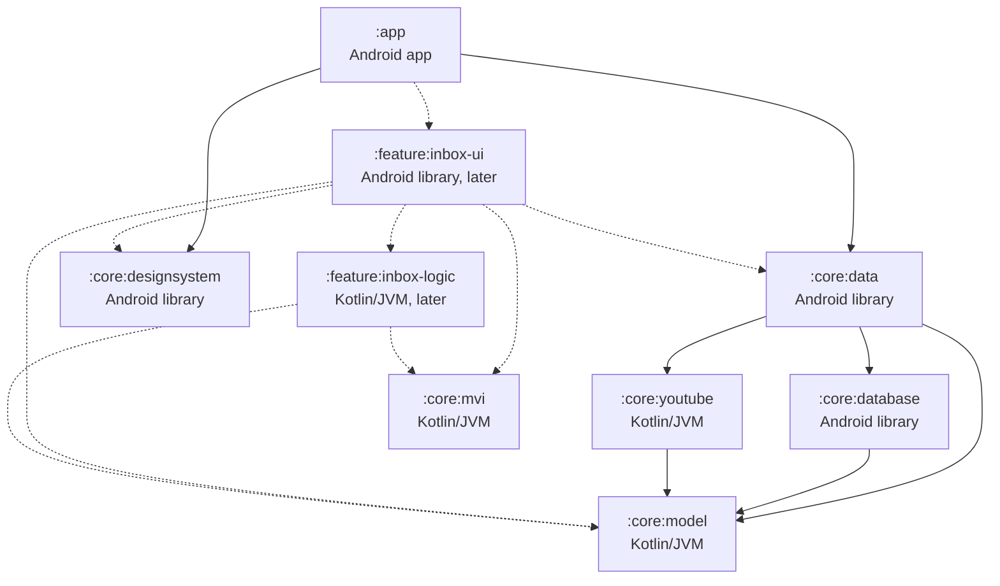

# Architecture

This is the design document for Dewfall. It explains how the app is built: its modules, how data moves through them, and how the main features work underneath. The reasons behind each decision are in the ADRs in [adr/](adr/). Update this file in the same pull request as any change to the structure of the app.

## Modules

Dewfall is one Gradle build with an app module, core modules, and feature modules as features arrive. Some modules are plain Kotlin/JVM and the rest are Android modules. [ADR 0006](adr/0006-platform-and-android-versions.md) explains why.

- A plain Kotlin/JVM module can't see Android classes, so the build itself keeps Android code out of it. Its tests run on the computer's JVM with nothing from Android to fake. It can't hold user-facing text, because string resources are part of Android, so it returns types that the screens turn into text.
- An Android module is the app or an Android library. It holds everything that needs Android, such as the database, screens, ViewModels, resources and background jobs.

### The module graph

Solid arrows are dependencies in the build today. Dashed arrows show where the inbox's two modules will go when Phase 5 adds them.

### Core modules

Android modules set a namespace. Plain Kotlin/JVM modules have no namespace, so for them the table gives the package their code uses.

| Module | Folder | Type | Namespace or package | What it holds | Depends on |
|---|---|---|---|---|---|
| `:app` | app/ | Android app | io.github.dewfallapp | The entry point, which ties the other modules together. It holds the Hilt Application class and the app's only activity, which shows a placeholder screen until the first feature arrives. Once features arrive, it also handles navigation between them. | `:core:data`, `:core:designsystem`, and each feature's `-ui` module |
| `:core:model` | core/model/ | Kotlin/JVM | io.github.dewfallapp.core.model | Domain models, such as videos, channels and subtitle lines | Nothing |
| `:core:mvi` | core/mvi/ | Kotlin/JVM | io.github.dewfallapp.core.mvi | The MVI base types: State, Intent, Effect and the reducer | Nothing |
| `:core:youtube` | core/youtube/ | Kotlin/JVM | io.github.dewfallapp.core.youtube | The YouTube layer: Dewfall's interfaces for search, video details, a channel's latest uploads, stream links and subtitles, and their NewPipeExtractor implementation. It is the only module that may use NewPipeExtractor. See [ADR 0001](adr/0001-newpipeextractor-behind-youtube-layer.md). | `:core:model` |
| `:core:database` | core/database/ | Android library | io.github.dewfallapp.core.database | The Room database: entities, DAOs, migrations and the exported schemas | `:core:model` |
| `:core:data` | core/data/ | Android library | io.github.dewfallapp.core.data | Repositories that combine the database and the YouTube layer | `:core:model`, `:core:database`, `:core:youtube` |
| `:core:designsystem` | core/designsystem/ | Android library | io.github.dewfallapp.core.designsystem | The Compose theme built from the design tokens, plus shared components and icons | Nothing |

The core modules are still empty. Later tasks fill them: Room in #24, the MVI base types in #25, the theme in #26, and the YouTube layer in Phase 3. Compose and Hilt are set up in `:app` only, until a core module needs them.

### Feature modules

Each feature has two modules, because its reducer has to be plain Kotlin/JVM and its screens need Android. For the inbox, they look like this.

| Module | Folder | Type | Namespace or package | What it holds | Depends on |
|---|---|---|---|---|---|
| `:feature:inbox-logic` | feature/inbox-logic/ | Kotlin/JVM | io.github.dewfallapp.feature.inbox.logic | InboxState, InboxIntent, InboxEffect, the reducer, and the reducer's tests | `:core:mvi`, `:core:model` |
| `:feature:inbox-ui` | feature/inbox-ui/ | Android library | io.github.dewfallapp.feature.inbox.ui | The Compose screens, InboxViewModel, string resources and screenshot tests | `:feature:inbox-logic`, `:core:data`, `:core:designsystem`, `:core:mvi`, `:core:model` |

- Feature modules depend on core modules, never on another feature's modules. A feature's `-ui` module also depends on its own `-logic` module.
- The ViewModel goes in the `-ui` module. It runs side effects through `:core:data` and uses Hilt, and both are Android. A plain Kotlin/JVM module can't depend on an Android module.
- `:app` depends on every feature's `-ui` module and handles navigation between features.

### Module names

Every module's last name segment must be unique in the build. Gradle can mix up two projects that have both the same group and the same name, such as `:inbox:logic` and `:search:logic` when both are in group dewfall ([gradle/gradle#847](https://github.com/gradle/gradle/issues/847)). By default, Gradle bases each project's group on its parent's path, so `:core:data` is in group dewfall.core and the clash can't happen yet. It happens as soon as a build setting gives every project the same group. Unique names prevent it, whatever the groups are. So feature modules are named `:feature:inbox-logic` and `:feature:inbox-ui`, not `:feature:inbox:logic` and `:feature:inbox:ui`.

### Build settings

Every module applies one of three convention plugins from build-logic/. They hold the settings that every module of that type shares.

| Plugin | For | What it sets |
|---|---|---|
| dewfall.android.application | `:app` | compileSdk 37, minSdk 29 and targetSdk 37, as ADR 0006 decides, the JDK 17 toolchain, and the shared Kotlin compiler, lint and detekt settings |
| dewfall.android.library | Android libraries | compileSdk 37 and minSdk 29, targetSdk 37 for lint and tests, the JDK 17 toolchain, and the shared Kotlin compiler, lint and detekt settings |
| dewfall.jvm.library | Plain Kotlin/JVM modules | The Kotlin JVM plugin, the JDK 17 toolchain, the shared Kotlin compiler, lint and detekt settings, and the Android API check |

A fourth plugin, dewfall.detekt, holds the detekt settings and adds the compose-rules plugin to detekt. The three plugins above apply it, and so does the root project, to check the code in build-logic.

Android modules that use Compose or Hilt also apply one or both of these plugins, after dewfall.android.application or dewfall.android.library. Today only `:app` applies them. `:core:designsystem` applies dewfall.android.compose when #26 adds the theme, and each feature's `-ui` module applies both.

| Plugin | What it sets |
|---|---|
| dewfall.android.compose | The Compose compiler plugin, Compose turned on in the Android build, the Compose BOM, and the preview annotations, with the preview tooling in debug builds only. The module adds the Compose libraries it uses, such as Material 3. |
| dewfall.android.hilt | KSP, the Hilt Gradle plugin, Hilt and Hilt's compiler, with KSP warnings failing the build |

The Compose compiler is part of Kotlin, so its plugin always has the Kotlin version, and it runs inside the Kotlin compiler that AGP's built-in Kotlin provides ([Compose compiler](https://developer.android.com/develop/ui/compose/compiler)). Compose 1.12 needs compileSdk 37 and AGP 9 ([compatibility](https://developer.android.com/develop/ui/compose/compiler#agp-compatibility)).

Hilt's compiler runs through KSP. The kotlin-kapt plugin doesn't work with built-in Kotlin. Google recommends KSP instead, and offers the com.android.legacy-kapt plugin only as a fallback for projects that can't move to KSP yet ([Migrate to built-in Kotlin](https://developer.android.com/build/migrate-to-built-in-kotlin#migration-steps-migrate-kotlin-kapt-plugin)). Hilt supports KSP, so the build uses neither. The Hilt Gradle plugin then builds the app's Hilt components in a javac task of its own, such as hiltJavaCompileDebug. In an Android module, the `ksp` configuration covers the main source set only. Tests that use Hilt add its compiler to `kspTest` or `kspAndroidTest` ([KSP configurations](https://github.com/google/ksp/blob/2.3.12/README.md#single-platform-jvm--android)). The Hilt Gradle plugin needs Hilt 2.59 or later on AGP 9 ([Dagger 2.59](https://github.com/google/dagger/releases/tag/dagger-2.59)), and Hilt reads the classes that Kotlin 2.4 compiles from 2.60 on ([google/dagger#5180](https://github.com/google/dagger/issues/5180)). So a new Kotlin minor version may need a Hilt update too.

Every module compiles with JDK 17, and the Java and Kotlin bytecode targets follow the toolchain. So every module produces Java 17 bytecode, and the version is written in one place. Android modules get Kotlin from AGP's built-in Kotlin support.

Kotlin compiler warnings fail the build in every module, so a call to a deprecated API stops the build. KotlinCompiler.kt in build-logic turns on the compiler's [allWarningsAsErrors](https://kotlinlang.org/docs/gradle-compiler-options.html#attributes-common-to-jvm-and-javascript) option in the module's `kotlin.compilerOptions` block, which reaches every Kotlin compilation in the module, tests included ([Target the JVM](https://kotlinlang.org/docs/gradle-compiler-options.html#target-the-jvm)). In Android modules, AGP's built-in Kotlin provides that block ([Migrate to built-in Kotlin](https://developer.android.com/build/migrate-to-built-in-kotlin#migration-steps-migrate-kotlin-options)). In plain Kotlin/JVM modules, the Kotlin JVM plugin does. The code in build-logic is a separate build, so the setting doesn't cover it. KSP has a setting of its own, which dewfall.android.hilt turns on, so warnings that Hilt reports while KSP runs fail the build too. javac compiles the Java code that Hilt generates, and builds the Hilt components in the Hilt Gradle plugin's own task. Its warnings, such as Dagger's warnings about the dependency graph, don't fail the build. If a warning can't be fixed, suppress it with @Suppress on the single statement or declaration, never a whole file, with a comment that says why and names the issue that will remove it, if there is one.

The versions of every plugin and library are in gradle/libs.versions.toml. To add a module, include it in settings.gradle.kts, apply one of the three plugins in its build.gradle.kts, add dewfall.android.compose or dewfall.android.hilt if it uses them, and set a namespace if it is an Android module.

### Formatting and lint

Four tools check the code. AGENTS.md lists the commands that run them.

**Formatting.** Spotless runs ktfmt in kotlinlang style, with 4-space indents and lines of up to 100 characters. It covers every Kotlin file and Kotlin build script in the repository. Its settings are in the root build.gradle.kts, because build-logic and the root build scripts belong to no module. Kotlin files use LF line endings, set in .gitattributes and in the Spotless settings. ktfmt doesn't read .editorconfig. The Kotlin section there comes from ktfmt and helps the IDE's own formatter come close to it. The roadmap first named ktlint. Its last stable release, 1.8.0 from November 2025, parses Kotlin 2.2. The ktlint organization took the project over from Pinterest and supports newer Kotlin only in 2.0 alphas, which moved to new Maven coordinates ([ktlint changelog](https://github.com/ktlint/ktlint/blob/master/CHANGELOG.md)). Spotless can't load them yet, because it only knows the old coordinates ([KtLintStep.java](https://github.com/diffplug/spotless/blob/gradle/8.10.3/lib/src/main/java/com/diffplug/spotless/kotlin/KtLintStep.java)).

**detekt.** detekt runs its default rules, with the changes in config/detekt/detekt.yml, on every module and on build-logic. Any finding fails the build. Each module runs the plain `detekt` task, which doesn't need compiled code. So the rules that need type resolution don't run, such as InjectDispatcher, which would back the "inject dispatchers" rule in AGENTS.md. The task reads only src/main and src/test, so Android test and variant folders aren't checked. Composable functions are named in PascalCase, as the Compose API guidelines say, so FunctionNaming ignores functions annotated with @Composable ([detekt and Compose](https://github.com/detekt/detekt/blob/v2.0.0-alpha.6/website/docs/introduction/compose.mdx)). UnusedPrivateFunction and LongParameterList need type resolution, so they don't run yet. When type resolution is turned on, they need the same page's settings for private previews and for composables with many parameters. The build uses detekt 2.0.0-alpha.6, which is an alpha. The newest stable release, 1.23.8 from February 2025, was built for Kotlin 2.0.21, Gradle 8.12.1 and AGP 8.8.1 ([compatibility table](https://detekt.dev/docs/introduction/compatibility/)). It uses a Gradle method that Gradle 10 removes, and its maintainers plan no more 1.23 releases ([detekt#8452](https://github.com/detekt/detekt/issues/8452)). Support for AGP 9's built-in Kotlin came only in the 2.0 alphas ([detekt#8320](https://github.com/detekt/detekt/issues/8320)). 2.0.0-alpha.6 is built against Kotlin 2.4.10, Gradle 9.6.1 and AGP 9.3.1, close to this build's versions ([release notes](https://github.com/detekt/detekt/releases/tag/v2.0.0-alpha.6)). Rule names and settings may still change before 2.0.0, so read the release notes before each detekt update.

**detekt's Compose rules.** detekt also runs [compose-rules](https://github.com/mrmans0n/compose-rules) 0.6.7, a detekt plugin with rules for Compose code, such as "a public composable that emits UI takes a modifier parameter". dewfall.detekt adds it, so it checks every module and build-logic. The Compose section of config/detekt/detekt.yml lists every rule, as compose-rules' docs recommend ([detekt setup](https://github.com/mrmans0n/compose-rules/blob/v0.6.7/docs/detekt.md#enabling-rules)). All of them are on except the four opt-in rules, which the docs leave off: ComposableNestingDepth, Material2, PreviewNaming and UnstableCollections. [rules.md](https://github.com/mrmans0n/compose-rules/blob/v0.6.7/docs/rules.md) explains each rule. Eight rules need type resolution, so they don't run yet: ConditionHoist, InvalidReadOnlyComposable, MissingNonRestartableComposable, MissingReadOnlyComposable, StaleRememberUpdatedStateInRemember, UnnecessaryComposable, UnnecessaryLaunchedEffect and VarsWithoutStateBacking. compose-rules' ComposableNaming checks the names of composable functions, which detekt's FunctionNaming skips. Each compose-rules release is built for one detekt version, and 0.6.7 is built for detekt 2.0.0-alpha.6 ([supported versions](https://github.com/mrmans0n/compose-rules/blob/v0.6.7/docs/detekt.md#supported-versions-matrix)). So each detekt update has to wait for a compose-rules release built for the new detekt version, and both versions change in the same pull request.

**Android Lint.** Lint checks every module, the plain Kotlin/JVM ones through the com.android.lint plugin. Any warning fails the build. Each module checks only its own code. The checks that look up versions or library data on the network are off, so lint gives the same result on every run. AndroidLint.kt in build-logic lists them. The app's manifest suppresses two checks until the tasks that fix them are done: DataExtractionRules (#68) and MissingApplicationIcon (#120).

**The Android API check.** The plain Kotlin/JVM modules compile and run their tests against the full JDK, so a call to a Java API that Android 10 lacks passes there and fails on a phone ([ADR 0006](adr/0006-platform-and-android-versions.md)). Lint can't catch this in these modules. AGP runs lint one module at a time, and lint's API check skips any module that isn't Android ([ApiDetector](https://android.googlesource.com/platform/tools/base/+/refs/heads/mirror-goog-studio-main/lint/libs/lint-checks/src/main/java/com/android/tools/lint/checks/ApiDetector.kt)). So [Animal Sniffer](https://github.com/xvik/gradle-animalsniffer-plugin) checks each of these modules' compiled classes against a [Gummy Bears](https://github.com/open-toast/gummy-bears) signature of the Android API. The signature's API level comes from the minSdk in build-logic, so the check follows it. The signature includes the methods that D8 backports, but not the APIs that core library desugaring adds, because Gummy Bears publishes no such signature for API 29. So the check also flags an API that only desugaring provides. If code needs such an API, check that Android's [desugaring table](https://developer.android.com/studio/write/java11-nio-support-table) lists it, then allow it in configureAndroidApiCheck with Animal Sniffer's ignore or annotation setting, and say why in a comment. It checks the module's own classes, not its dependencies such as NewPipeExtractor. `./gradlew lint` runs it too.

## Network access

AGENTS.md says the app's network calls go only to YouTube, through the YouTube layer, and to services the user turns on. PRIVACY.md tells users that the app connects to YouTube. Some libraries make requests of their own, so the app turns those off.

**Emoji fonts.** Compose brings in androidx.emoji2. Its EmojiCompatInitializer runs at startup and asks the system's downloadable font provider for a newer emoji font. On most phones that provider is Google Play services, which may download the font from Google. `:app`'s manifest removes the initializer with `tools:node="remove"`, as the [emoji2](https://developer.android.com/develop/ui/views/text-and-emoji/emoji2#use-different-font-provider) and [App Startup](https://developer.android.com/topic/libraries/app-startup#disable-individual) docs describe. The cost is on older phones. Android 11 and lower can't update their emoji font ([Display emoji](https://developer.android.com/develop/ui/compose/text/emoji)), so very new emoji, such as those in video titles, may show as empty boxes on Android 10 and 11.

## Data flow

TODO

## The MVI contract

TODO

## The player

TODO

## Downloads and cleanup

TODO

## Subtitle search

TODO

## Database tables

TODO

## Error handling

TODO
