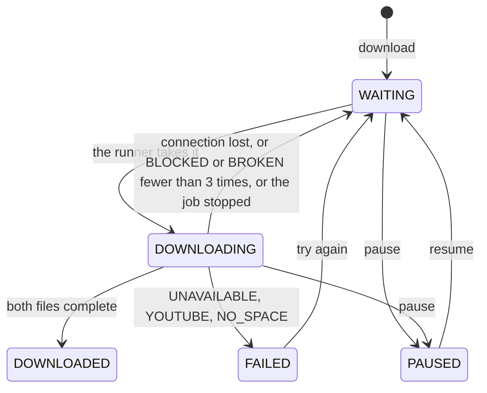

# Design

## Context

Phase 6 adds manual downloads, and Phase 7 reuses the same code from an overnight job that runs only on Wi-Fi while charging ([roadmap](../../../docs/roadmap.md#phase-7-overnight-downloads-and-cleanup)). AGENTS.md says download logic must not depend on any screen being open. This change is #54, the first Phase 6 task, so it decides the engine that #55 to #58 and Phase 7 build on, and ADR 0010 records it.

What exists today:

- The YouTube layer's `streamLinks(videoId)` gives the video's progressive formats, each a single file that HTTP range requests read, plus an HLS manifest for live streams ([architecture: Stream links](../../../docs/architecture.md#stream-links)). With NewPipeExtractor v0.27.1, a video's sound and picture are separate files, and the links expire after some hours.
- MediaRequests, the layer's client for googlevideo.com, which `:core:data` hands out as `@ProgressiveMediaCalls`. Each request is a POST with `x\0`, numbered with `rn`, with the visionOS client's User-Agent, only over HTTPS to googlevideo.com, with every redirect's host checked ([architecture: Network access](../../../docs/architecture.md#network-access)). Downloads use the same client, so they keep the same rules.
- FormatChoice in `:core:model` picks the formats to play, and Decoders in `:core:playback` says what the phone decodes.
- The database has no downloads table, and the app has no WorkManager.

The facts below were checked on November 26, 2026, against the pages and sources linked.

## Goals / Non-Goals

**Goals**

- A download that the user starts runs to the end without any screen, survives the process ending, a reboot and a lost connection, and goes on from the bytes it has.
- A clear API that #55 (list, pause, cancel, remove), #56 (play the files), #57 (storage used) and Phase 7 (overnight job, retries, storage limit) extend without changing the engine.
- The buttons on the video screen and in the inbox, as the design shows them.

**Non-Goals**

- Playing the downloaded files (#56). Until then a downloaded video still streams.
- Pausing a waiting download: like the design system's Queued state, a waiting video has no control on either screen until #55's Downloads screen adds pause and cancel for every row.
- Removing a download, the Downloads screen and cancel (#55), the storage indicator (#57), the offline emulator test (#58).
- The storage limit, cleanup, retries overnight, and asking for the notification permission (Phase 7 and its onboarding).
- Thumbnails of downloaded videos as images (#176 decides how images load). The downloads table keeps the thumbnail list, as `videos` does.

## Decisions

### 1. The engine: Dewfall's own range-request writer, run by a user-initiated data transfer job on Android 14 and later, and by a WorkManager worker below

Three ways were compared.

**Media3's DownloadManager and DownloadService** ([Downloading media](https://developer.android.com/media/media3/exoplayer/downloading-media)). Rejected:

- In Media3 1.11.1, DownloadService never uses its Scheduler on API 31 and above: `canStartForegroundServiceFromBackground` is `SDK_INT < 31`, and the Javadoc of `getScheduler` says that on API 31 and above "this method will not be called". Instead the service "will remain in the foreground until the downloads are able to continue" ([DownloadService.java at 1.11.1](https://github.com/androidx/media/blob/1.11.1/libraries/exoplayer/src/main/java/androidx/media3/exoplayer/offline/DownloadService.java)). Phase 7's job waits for charging and Wi-Fi, so it would hold a foreground service, which on Android 15 and later counts against dataSync's "total of 6 hours in a 24-hour period" ([Foreground service timeouts](https://developer.android.com/develop/background-work/services/fgs/timeout)).
- A DownloadRequest holds one URI, so each video would be two downloads that the app pairs itself.
- It stores bytes as SimpleCache spans with its own SQLite index, and the guide says not to read the download folder directly. #57's storage count and #56's playback would both have to go through Media3's cache, and Phase 7's cleanup would delete through it.

**WorkManager only.** WorkManager's page on long-running workers says: "If you need to download data in response to a user action, consider using a user-initiated data transfer job." ([Support for long-running workers](https://developer.android.com/develop/background-work/background-tasks/persistent/how-to/long-running)). Android 16 makes jobs started while the app is visible, and jobs running beside a foreground service, "adhere to the job runtime quota", which "impacts tasks scheduled using WorkManager, JobScheduler, and DownloadManager" ([Android 16 behavior changes](https://developer.android.com/about/versions/16/behavior-changes-all)). A long download could stop half way on a quota and wait.

**Chosen: our own writer, run by the scheduler Google recommends for each case.**

- Google's [data transfer options](https://developer.android.com/develop/background-work/background-tasks/data-transfer-options) page recommends user-initiated data transfer (UIDT) jobs for transfers "triggered by the user and you need to keep the user informed", and WorkManager for those started in the background. UIDT jobs exist from Android 14 (API 34), need the RUN_USER_INITIATED_JOBS permission, must be scheduled "while the application is visible to the user", and are "unaffected by App Standby Buckets quotas" ([User-initiated data transfer](https://developer.android.com/develop/background-work/background-tasks/uidt)). "There is currently no Jetpack library that supports UIDT jobs", and the same page names "WorkManager's foreground service implementation as a fallback" for older versions.
- So a tap schedules DownloadJobService, a JobService with `setUserInitiated(true)`, on API 34 and later, and DownloadWorker, a WorkManager CoroutineWorker that calls `setForeground` with the dataSync type, on API 29 to 33. Both run the same DownloadRunner, which is plain coroutine code with no Android scheduler in it.
- Phase 7's overnight job is a WorkManager worker with charging and unmetered constraints, which is what the data transfer page recommends for app-initiated work. It runs the same DownloadRunner. Because each format is written in ranges and goes on from the bytes on disk, a run that Android stops after its time is up loses at most one range.
- The writer is ours: about the size of MediaInterceptor, it asks for byte ranges through MediaRequests, appends them to a file, and goes on from the file's length. Its files are plain files, so #56 plays them with Media3's FileDataSource, and #57 adds up their sizes.

### 2. The writer: 10 MiB ranges through MediaRequests

FormatWriter downloads one format to `<name>.part`:

- It starts at the file's current length and asks for `bytes=<start>-<end>` in ranges of 10 MiB, the size yt-dlp uses for YouTube's HTTPS formats (`CHUNK_SIZE = 10 << 20` in [yt_dlp/extractor/youtube/_video.py at 2026.11.23](https://github.com/yt-dlp/yt-dlp/blob/2026.11.23/yt_dlp/extractor/youtube/_video.py)), and appends each answer's body. Each format gets a new `@ProgressiveMediaCalls` factory, so its requests number from 0, as each media source's do in the player.
- It expects 206 with a Content-Range that starts where it asked. A 200 for a range that starts at 0 is accepted when it is the whole file. Anything else that isn't 403 or 410 is an IOException. 403 and 410 are LinkRefused, which the runner answers with new links, as the player does ([architecture: Errors](../../../docs/architecture.md#errors)).
- It stops at the format's length from StreamLinks, or, when YouTube gave none, at the total in the first Content-Range.
- It reads the body in 64 KiB buffers, never a whole range into memory, because Android 17 ends apps that use too much memory ([Android 17 behavior changes](https://developer.android.com/about/versions/17/behavior-changes-all)).
- It checks for cancellation between buffers, so a pause or a stop ends it within one buffer, and the bytes already written stay.
- When both formats are complete, the runner renames the parts to `video.<ext>` and `audio.<ext>`, or `media.<ext>` for a format with both, from the MIME type (mp4, webm, m4a).

### 3. The queue and its states

The `downloads` table in `:core:database` is the queue and the record. One row per video:

| Column | What it holds |
|---|---|
| `video_id` | Primary key |
| `folder` | A random UUID, the name of the download's folder, so no path holds a video ID |
| `title`, `channel_id`, `channel_name`, `duration_ms`, `published_at`, `published_approximate`, `kind`, `thumbnails` | The whole VideoSummary that `download` receives, so #55's list, and any later screen, can show the video without asking YouTube, even when it came from search and isn't in `videos` |
| `state` | WAITING, DOWNLOADING, PAUSED, FAILED or DOWNLOADED |
| `failure` | UNAVAILABLE, YOUTUBE or NO_SPACE while FAILED, else NULL |
| `requested_at` | The queue's order |
| `video_itag`, `video_mime`, `video_bytes`, `audio_itag`, `audio_mime`, `audio_bytes` | The chosen formats, kept so new links after an expiry continue the same files. NULL until chosen. |
| `downloaded_bytes` | Bytes on disk, for progress |
| `youtube_tries` | Tries that failed with BLOCKED or BROKEN in a row |
| `updated_at` | Time of the last change |

The database stays at version 1, as AGENTS.md allows before the first public release, so this needs no migration.

Downloads never write the `videos` table. docs/architecture.md's Database tables section left "whether a time from a video's details should win over a refresh" to "Phase 6's manual downloads", as the first task that might save a played video's details. Keeping the download's own copy means no time from a video's details ever meets a refresh's in `videos`, so the question doesn't arise here, and the `videos` merge rule stays as it is. That line in architecture.md moves on to the first task that writes a video's details into `videos`, if one ever does.

DownloadRunner, a singleton in `:core:download`:

- At the start of each run it turns any DOWNLOADING row back to WAITING, because a process that ended left it there.
- It takes the WAITING row with the lowest `requested_at`, marks it DOWNLOADING, and downloads it. It goes on until no row waits, then the job ends.
- It runs one video at a time. The YouTube layer runs one NewPipeExtractor call at a time anyway, and one download at a time finishes the first video soonest.
- A Mutex-guarded flag says whether a run is active in the process. DownloadsRepository's `download` and `resume` write the row first, then call `DownloadScheduler.start()`, which schedules a job only when no run is active. A run checks for a waiting row under the same lock before it ends, so a row added in that moment is never left behind, and a running job is never scheduled again: "If a job with the given ID is currently running, it will be stopped" ([JobScheduler.schedule](https://developer.android.com/reference/android/app/job/JobScheduler#schedule(android.app.job.JobInfo))).
- While it downloads a row, it follows that row's state. When the user pauses it, the row turns PAUSED, and the runner cancels that video's download within one buffer, keeps the parts, and goes on with the next row. Progress writes say `WHERE state = 'DOWNLOADING'`, so a late write never turns a paused row back.
- **Restarting the queue.** A run is started in three ways: a tap, through `DownloadScheduler.start()`; the system, which runs a scheduled job again after a stop it was told to reschedule, after a reboot for the persisted UIDT job, and after WorkManager's own reschedule; and the app coming to the front. A UIDT `schedule` made while the app isn't visible fails with RESULT_FAILURE, such as a tap's write that finished after the user left. So MainActivity's `onStart` calls `DownloadScheduler.start()` too: in the app scope, when no run is active in the process and a row is WAITING or DOWNLOADING, it turns DOWNLOADING rows back to WAITING and schedules a run. With no run active in the process, a DOWNLOADING row can only be left over. Scheduling a job that is pending but not running only replaces it. A RESULT_FAILURE is logged as one constant-text line and leaves the rows WAITING for the next `onStart`.
- **A stop by the user counts as a pause**, as the maintainer chose. Android won't run a job again after the user stops it from the Task Manager ("Prevents user-visible jobs from being rescheduled", [UIDT](https://developer.android.com/develop/background-work/background-tasks/uidt)), and the user meant it. In DewfallApplication's `onCreate`, before anything else in the process can start a run, DownloadsAfterStop reads the latest of the app's own exit records with `ActivityManager.getHistoricalProcessExitReasons(packageName, 0, 1)`, which Android's [handle user stopping](https://developer.android.com/develop/background-work/services/fgs/handle-user-stopping) page points to. REASON_USER_REQUESTED alone isn't enough: [ApplicationExitInfo](https://developer.android.com/reference/android/app/ApplicationExitInfo#REASON_USER_REQUESTED) gives it also when the user removed the app "away from Recents", and before Android 14 when the app was updated. So it pauses only when all three hold: (a) the latest exit's reason is REASON_USER_REQUESTED; (b) a DOWNLOADING row is left over, which with no run in the new process means a run was downloading when the process ended. The Task Manager lists only apps that run a foreground service or a user-initiated job, so its Stop always ends a process with a run, while a swipe from Recents of an app that only waits, for a connection or its backoff, ends one with only WAITING rows, which then go on; and (c) the app wasn't updated at or after the exit's time, read from PackageInfo's `lastUpdateTime`, which leaves out Android 11 to 13's updates. Then it turns every WAITING and DOWNLOADING row to PAUSED, in the app scope, before `start()` can schedule anything. On stock Android, removing a task from Recents doesn't end a process that runs a foreground service or a user-initiated job, so swiping Dewfall away while it downloads leaves the download running; the hand checks confirm that on Android 13, 14 and 17. On a phone whose maker ends such a process anyway, the download shows as paused, as after a Stop, which is what the user then sees happen. It checks once per process, so the record of one stop pauses once. The exit records came with Android 11, so on Android 10 a force stop can't be told apart, and the queue goes on the next time the app shows. The hand checks confirm the reason that the Task Manager's Stop leaves on Android 14 and 17. On Android 14 and later the stopped job is a UIDT job, which Android won't run again. On Android 13 the Task Manager exists but the download runs through WorkManager, and "Scheduled jobs execute at their scheduled time" ([handle user stopping](https://developer.android.com/develop/background-work/services/fgs/handle-user-stopping)), so WorkManager may run its worker again in the new process. The pause still wins, because of its order: DownloadsAfterStop holds a CompletableDeferred that it completes once its decision is written, or at once when there is nothing to decide, and DownloadRunner awaits it before it takes its first row, as `start()` does before it reads the rows. So a run in the new process sees the rows already PAUSED, finds nothing waiting, and ends. A failure of the decision's write is logged and completes it too, so a database that throws never holds the queue forever.
- It writes `downloaded_bytes` at most once a second, and at the end of each range, so Room's Flow doesn't wake the screens for every buffer.

States and what moves them:



### 4. Failures

| What happened | State | Files |
|---|---|---|
| NETWORK from the links call, or an IOException from the writer | WAITING, and the job asks to be rescheduled with its backoff. JobScheduler and WorkManager run it again once the network constraint holds. | Kept |
| BLOCKED or BROKEN | `youtube_tries` + 1. Below 3, WAITING with a reschedule. At 3, FAILED YOUTUBE, which the screens show as "Download failed". | Kept, because the block may pass, and "try again" goes on from them. Phase 7's cleanup can delete what a failed download left. |
| PRIVATE, AGE_RESTRICTED, COUNTRY_BLOCKED, MEMBERS_OR_PAID, CHANNEL_CLOSED, UNAVAILABLE, a live stream, or NotDecodable | FAILED UNAVAILABLE, "Download failed" | Deleted |
| 403 or 410 on a range | New links, once in a row: the same itags continue the parts. A second refusal without new bytes counts as BROKEN. If the new links no longer have the chosen itags, the parts are deleted and the formats chosen again. | Kept, or restarted |
| Not enough space | FAILED NO_SPACE, "Not enough space on this phone". Before each format, the runner asks StorageManager's `getAllocatableBytes` for the folder's storage, which counts the cache Android can clear ([Query free space](https://developer.android.com/training/data-storage/app-specific#query-free-space)), and compares it with the bytes still to come. An IOException while space is below what's left counts the same. | Kept, so "try again" goes on |
| The user stops Dewfall from the Task Manager or forces it to stop | Every WAITING and DOWNLOADING row turns PAUSED when the process next starts, from Android 11 on, as "A stop by the user counts as a pause" says | Kept |
| A UIDT `schedule` returns RESULT_FAILURE | Rows stay WAITING until MainActivity's next `onStart`, which schedules a run, as "Restarting the queue" says | Kept |
| Any other exception, such as a database that throws | The runner's CoroutineExceptionHandler logs it, the row goes back to WAITING, and the job asks to be rescheduled | Kept |

The Downloads screen (#55) can say more about each reason, so the row keeps it.

### 5. The schedulers and the notification

- **DownloadScheduler**, an interface in `:core:data`, with one function, `start()`. `:core:download` binds it, by API level, to the UIDT scheduler or the WorkManager one.
- **UIDT (API 34+).** One job ID for the queue. `JobInfo.Builder(...).setUserInitiated(true).setRequiredNetworkType(NETWORK_TYPE_ANY)` and the estimated bytes when known, persisted so it survives a reboot, which needs RECEIVE_BOOT_COMPLETED ([JobInfo.Builder.setPersisted](https://developer.android.com/reference/android/app/job/JobInfo.Builder#setPersisted(boolean))). `onStartJob` must call `setNotification` within 10 seconds, or the system raises an ANR and stops the job ([JobService](https://developer.android.com/reference/android/app/job/JobService)). `onStartJob` calls `setNotification` with JOB_END_NOTIFICATION_POLICY_REMOVE, so the notification goes when the job ends, since DETACH would leave it "shown even after JobScheduler stops the job" ([JobService](https://developer.android.com/reference/android/app/job/JobService)), and runs the runner in the service's scope. `onStopJob` cancels it and returns true, so the system runs it again. The manifest declares RUN_USER_INITIATED_JOBS, and the service with `android.permission.BIND_JOB_SERVICE`, not exported.
- **WorkManager (API 29 to 33).** One unique work name for the queue, `ExistingWorkPolicy.REPLACE`, not KEEP: KEEP does nothing while work of the same name is uncompleted, and running work counts ([ExistingWorkPolicy](https://developer.android.com/reference/androidx/work/ExistingWorkPolicy)), so a tap that comes between the runner's last empty check and the worker's return would be dropped. REPLACE is safe because `start()` enqueues only when no run is active in the process, so it never cancels a run that is still downloading; it replaces a run that has finished its work and is returning, or one that waits for its constraints. a CONNECTED network constraint, `setExpedited(RUN_AS_NON_EXPEDITED_WORK_REQUEST)`, and `setForeground` with `FOREGROUND_SERVICE_TYPE_DATA_SYNC`. DownloadWorker also implements `getForegroundInfo()`, which an expedited CoroutineWorker must, because before Android 12 WorkManager runs expedited work as a foreground service and leaving it out "can lead to runtime crashes" ([Define work requests](https://developer.android.com/develop/background-work/background-tasks/persistent/getting-started/define-work)). The manifest merges `foregroundServiceType="dataSync"` onto WorkManager's SystemForegroundService and declares FOREGROUND_SERVICE_DATA_SYNC, as the long-running workers page asks. On Android 12 and 13, a run that WorkManager starts while the app is in the background, such as after a reboot, may not start a foreground service ([background start restrictions](https://developer.android.com/develop/background-work/services/fgs/restrictions-bg-start)). The worker catches ForegroundServiceStartNotAllowedException and goes on as a plain job, which Android stops after about 10 minutes and runs again, losing at most one range.
- **Job IDs.** WorkManager 2.12 schedules its own jobs in a JobScheduler namespace of its own on Android 14 and later, `androidx.work.systemjobscheduler` (`JobSchedulerExt.kt` in [work-runtime 2.12.0's sources](https://dl.google.com/android/maven2/androidx/work/work-runtime/2.12.0/work-runtime-2.12.0-sources.jar), which uses `forNamespace` from API 34), so the UIDT job's fixed ID in the default namespace can't clash with WorkManager's IDs there, and only Android 14 and later schedule the UIDT job.
- **WorkManager's setup.** DewfallApplication implements `Configuration.Provider` with DownloadWorkerFactory from `:core:download`, a hand-written WorkerFactory that Hilt injects with what DownloadWorker needs, so androidx.hilt's hilt-work isn't needed. WorkManager starts on demand, and the manifest removes WorkManagerInitializer from App Startup, as WorkManager's [custom configuration](https://developer.android.com/develop/background-work/background-tasks/persistent/configuration/custom-configuration) page says. WorkManager writes its own log lines, with work IDs and worker class names, and the app can't turn them off: in WorkManager 2.12.0, `Logger.get()` makes a DEBUG LogcatLogger when none is set (Logger.java), `setLogger` keeps the first one, and `createSchedulers` logs through it before WorkManagerImpl's constructor applies `setMinimumLoggingLevel` ([work-runtime 2.12.0 sources](https://dl.google.com/android/maven2/androidx/work/work-runtime/2.12.0/work-runtime-2.12.0-sources.jar)). So the work carries nothing about a video: a constant unique name, no tags and no input data. The app still sets `setMinimumLoggingLevel(Int.MAX_VALUE)`, a level above every one WorkManager logs at, ASSERT included, so every line after the setup is dropped, and the app's code never names android.util.Log, which Dewfall's lint checks keep to LogcatWriter, and the hand checks read logcat for WorkManager's lines. ADR 0010 records this next to ADR 0007's rules, as Media3's logging is recorded in the player's.
- **The notification.** A channel "Downloads", low importance, so it makes no sound. "Downloading a video", the percentage, and a progress bar, with no title, channel name or ID, so the lock screen and apps that read notifications learn only that a download runs. Phase 7's overnight notification decides whether to show titles, as the "Download notification" frames do. Its ID is fixed and isn't 1001, the media notification's. Tapping it opens the app through the same SessionActivity PendingIntent that the media notification uses. The app doesn't ask for POST_NOTIFICATIONS: without it, Android 13 and later still run the job and show it in the Task Manager, not in the shade ([Notification runtime permission](https://developer.android.com/develop/ui/views/notifications/notification-permission)). For foreground services the page says so, but no page says it for UIDT jobs, so the build's first step checks on an Android 14 or later emulator, with the permission denied, that a UIDT download runs; if it doesn't, this design comes back to the maintainer before anything else is built. Phase 7's onboarding decides whether to ask.

- **Nothing escapes the job.** DownloadWorker's `doWork` and DownloadJobService's coroutine catch every Throwable but CancellationException, log it through the Logger as class names and frames, and end the run with a reschedule. WorkManager would otherwise log a `doWork` exception with its message at error level, which `setMinimumLoggingLevel` lets through, and an exception in the service's scope would crash the app with its message in the crash log, which ADR 0007 rules out.
- **Retries stay minimal.** The only retries here are the scheduler's own backoff after a lost connection or a stop, and the 3 tries for BLOCKED and BROKEN. Phase 7's "Automatic retries with a growing wait between attempts" decides the overnight job's backoff and limits, and docs/architecture.md says so.

- **Dispatchers.** DownloadRunner and FormatWriter take the dispatcher for their file and network work in their constructors, injected as `@DownloadDispatcher`, which Hilt provides as Dispatchers.IO, so tests replace it, as AGENTS.md asks.

### 6. Choosing the formats

`chooseDownloadFormats(links, videoDecoding, audioDecodes)` in `:core:model` reuses FormatChoice's rules with the download limit in place of the network's: the largest decodable video format whose shorter side is within `DOWNLOAD_LIMIT`, 720 pixels, as the maintainer chose, hardware decoders first, then the lowest bitrate, and the original audio track's highest bitrate. A video with no formats, only an HLS manifest, or nothing decodable gives NotDecodable. Decoders in `:core:playback` becomes public, so the download uses the player's own check, and what it keeps will play in #56.

### 7. Where the files live

`DownloadFiles` in `:core:data` owns `noBackupFilesDir/downloads/<folder>/`. `noBackupFilesDir` is app-specific internal storage, which other apps can't read, and which Auto Backup never copies ([Context.getNoBackupFilesDir](https://developer.android.com/reference/android/content/Context#getNoBackupFilesDir())). The backup rules already exclude every domain. External app-specific storage was rejected: on some phones it is a removable card that other devices can read. The folder name is a random UUID, so a crash's message that quotes a path holds no video ID.

### 8. The API for features and later tasks

`:core:data`:

```kotlin
interface DownloadsRepository {
    /** Every video's download status, for the inbox. Videos with no row are NotDownloaded. */
    fun statuses(): Flow<Map<VideoId, DownloadStatus>>
    /** One video's status, for the video screen. */
    fun status(videoId: VideoId): Flow<DownloadStatus>
    /** Queues [video], or goes on with a paused or failed download of it. */
    suspend fun download(video: VideoSummary)
    /** Pauses a waiting or running download, keeping its bytes. */
    suspend fun pause(videoId: VideoId)
}
```

DownloadStatus in `:core:model`: `NotDownloaded`, `Waiting(progress)`, `Downloading(progress)`, `Paused(progress)`, `Failed(reason)`, `Downloaded(bytes)`, where `progress` holds the bytes on disk and the total, if known, and gives the percentage.

DownloadQueue, also in `:core:data`, is the engine's view of the table: the next waiting row, setting formats, progress and states. Only `:core:download` uses it. Later tasks add to these interfaces: #55 `downloads()` and `remove(videoId)`, #56 the files of a downloaded video, #57 the bytes in use. docs/architecture.md lists them.

Writes run in the `@ApplicationScope` scope, as every repository write does, so a tap's write finishes when the screen closes.

### 9. The buttons

- **Video screen.** PlayerState gets `download: DownloadChip?`: null while unknown or unreadable, else the status. PlayerViewModel follows `status(videoId)` for as long as it exists, as it follows the watch state. The waiting chip isn't clickable, so a screen reader announces no action, like the inbox's waiting row, which has no control after the design system's Queued state. The intents `Download` and `PauseDownload` change no state: the ViewModel calls the repository, and the answer comes back through the Flow. The download needs the video's summary, which PlayerViewModel builds from the details it shows, so the chip shows only once the details have loaded. A live or upcoming video has no chip.
- **Inbox.** InboxViewModel combines `statuses()` with its reads, and InboxState gives each video row its status. `Download(video)` and `PauseDownload(videoId)` intents call the repository. A read of the statuses that throws leaves the rows without a control, and the inbox stays as it is.
- **The row.** VideoRowItem gets an optional `status` slot at the end of its meta line, as the design system's VideoRow says. The inbox fills it with DownloadStatusControl from `:core:ui`, since #55's list will use it too. The row's text stays one merged node, and the control is its own focus target with its own content description. #176's session also changes VideoRowItem, for thumbnails, and whichever lands second rebases.
- **Glyphs.** `download`, `schedule` and `pause` from Material Symbols Rounded, Apache 2.0, in `:core:designsystem`, beside the others. `error` and `check` are there.

### 10. Logging

The runner logs, through the Logger, one line when a run starts and one when it ends, with counts, and one line per failure with its reason's name. It never logs an ID, title, link, file name or folder. Exceptions are logged as class names and frames, as ADR 0007 says.

### 11. Dependencies

The worker factory is hand-written, so androidx.hilt's hilt-work and its compiler aren't added.


androidx.work:work-runtime 2.12.0, released September 23, 2026, 64 days before November 26, 2026 ([release notes](https://developer.android.com/jetpack/androidx/releases/work)). Apache 2.0. It ships, and sends data nowhere. Its POM brings androidx.room:room-runtime 2.7.0 for WorkManager's own database, so Room 2 ships inside WorkManager, apart from Dewfall's database, which stays on Room 3; the two use different packages. AGENTS.md's Room 3 rule gets a pointer to ADR 0010 for it. Gradle resolves androidx.sqlite to the higher version that Room 3 needs, which the emulator tests check. The pull request lists every new transitive artifact with its license and age.

## Risks / Trade-offs

- **WorkManager's log lines** can't be turned off. The work holds no user data, and the hand checks read them.
- **Long runs on Android 10 to 13** run as expedited work with a foreground service while the app was visible when they started, but Google's guide says expedited work "best fits short tasks", and a run that couldn't start its foreground service, or that Android stops, goes on in the next run, so a long download there may stop every 10 minutes or so and go on. ADR 0010 says so.
- **A queue that only the app's return restarts.** After a Task Manager stop or a refused schedule, a download waits until the user opens the app again. Both cases begin with the user leaving or stopping the app, and the video says "Waiting to download" meanwhile.
- **Two schedulers** for one tap, by API level. Both are thin, and the runner and writer, which hold the logic, are shared and tested on the JVM. The emulator tests run on Android 10 and 17 in CI, so both paths run there.
- **Android 16's job quota** still applies to WorkManager runs on Android 16 and later, but those phones use UIDT for taps. Phase 7's overnight runs may stop on a quota, and go on from the bytes on disk in the next run.
- **Room 2 in the APK** through WorkManager. It adds size, and AGENTS.md's Room 3 rule is about Dewfall's database. ADR 0010 says so.
- **The notification shows no title**, unlike the overnight design. It keeps the media session exception the only one, and Phase 7 can add titles with the maintainer's approval.
- **YouTube may throttle** single requests. 10 MiB ranges are what yt-dlp uses, and a hand check measures a real download's speed.

## Migration Plan

None: no data exists to migrate, and the database stays at version 1.

## Open Questions

Settled by the maintainer's answers in proposal.md.
